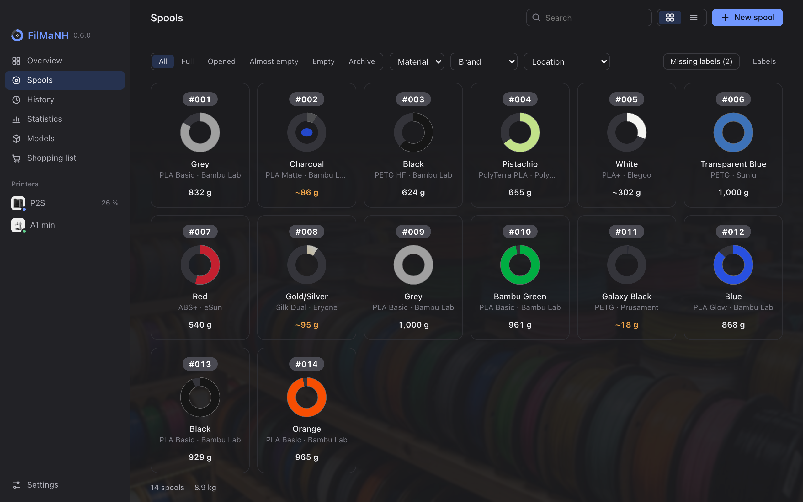
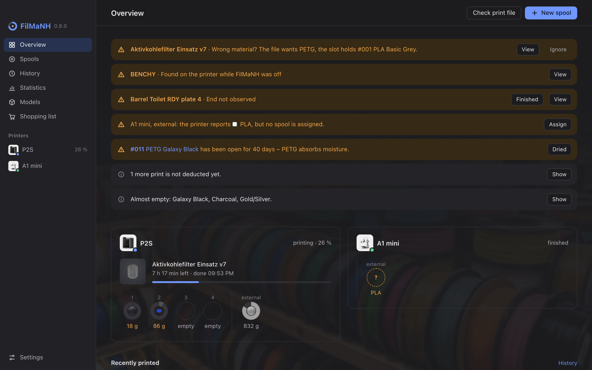
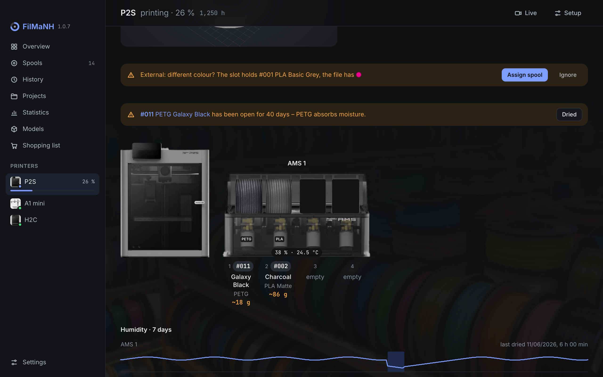
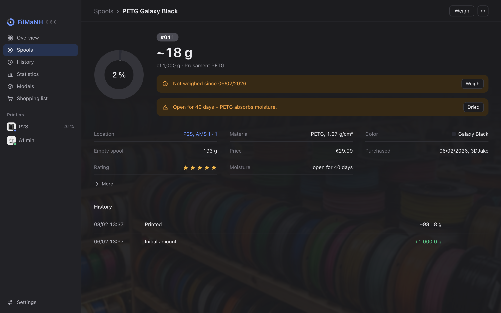
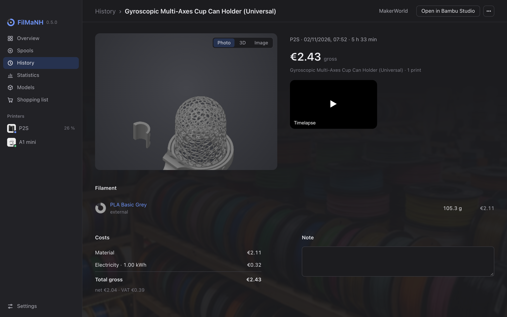
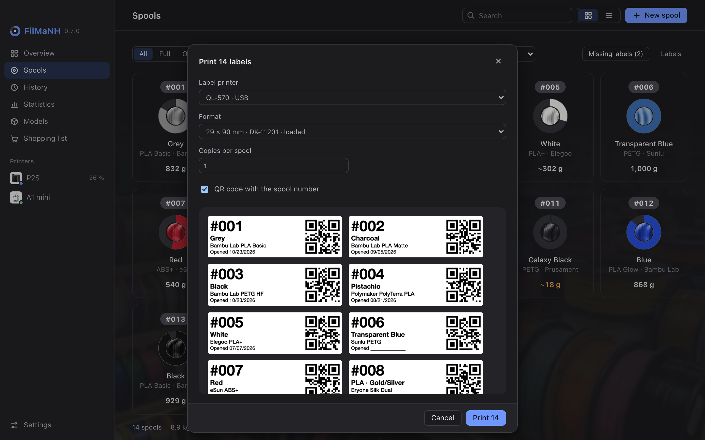
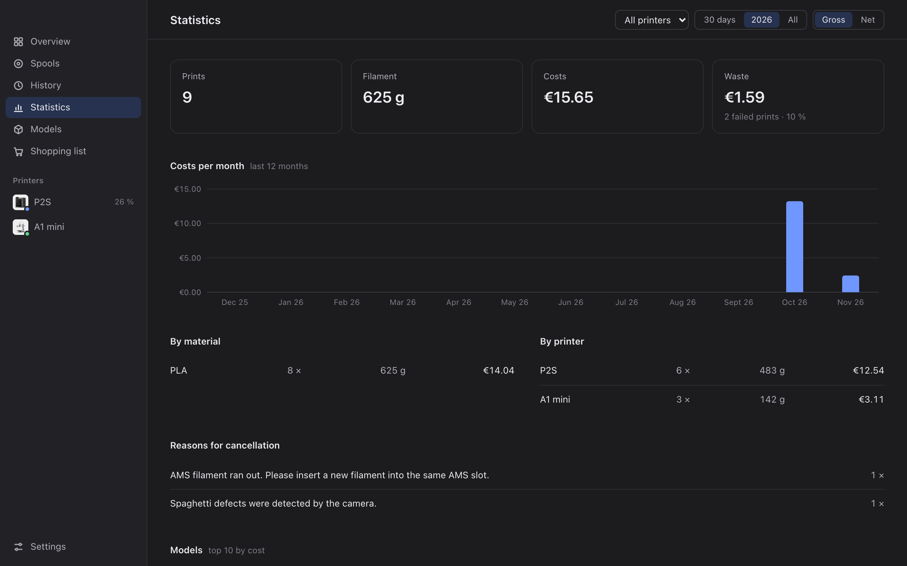
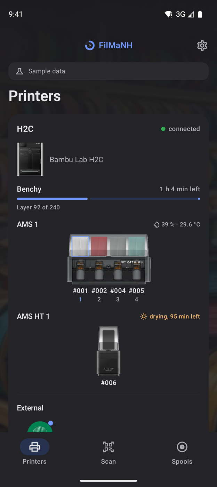
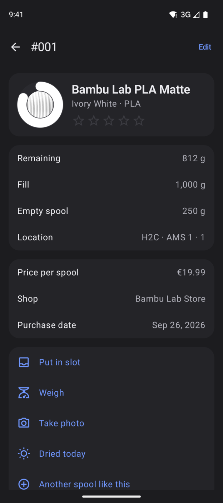
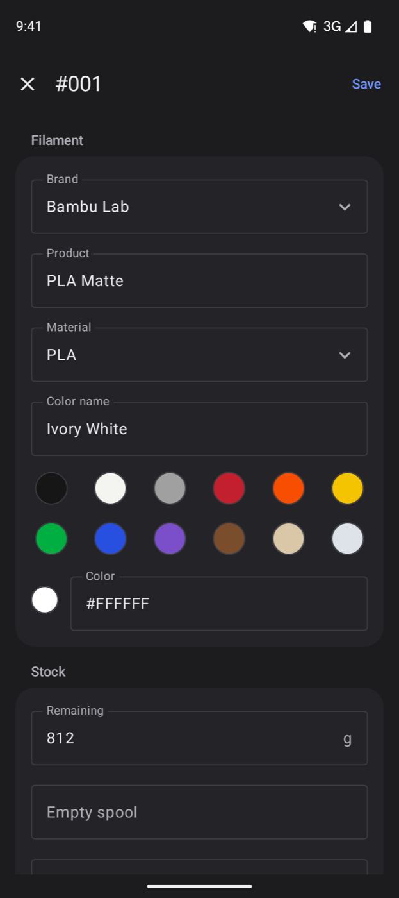

  

<h1 align="center">FilMaNH</h1>

  <b>Filament and spool manager for Bambu Lab printers</b> 
  What's in the AMS, how much is left on the spool, what did the print cost? 
  Runs locally on your computer, no cloud, no printer settings to change.

  

<a href="README.md">Deutsch</a> · <b>English</b>

  

  
  
  
  

## What it's for

With several spools and an AMS it's easy to lose track: What's loaded where? How much is left? Is it enough for the
next print? FilMaNH follows your printers on your home network and, after every print, books the usage off the right
spool – from the print file, including the purge when changing colours. Your stock stays right without entering
anything after each print.

## How it works

1. **Add spools** – from the catalog with more than 7,000 filaments, by EAN scan or with the link to the product page.
   FilMaNH recognises Bambu spools with RFID by itself when you load them.
2. **Print a label and load the spool** – every spool gets a number and a label with a QR code. When it's in the AMS,
   FilMaNH asks once which spool it is.
3. **Print** – at the end of every print, FilMaNH books the usage per spool. If the computer was off, it catches up on
   the next start.
4. **Keep track** – remaining amounts, cost per print, notices for the wrong material or filament left open too long,
   and a shopping list.

> [!NOTE]
> FilMaNH only reads from the printers. It never sends them commands and needs neither LAN-only mode nor developer mode.

## Features

<table>
<tr>
<td width="50%" valign="top">

### Overview and notices

- All printers with the current print, time left and slots with remaining amount
- Notices with the matching action: wrong material in a slot, unassigned spool, filament open too long, spools almost
  empty
- Recent prints, with cost

</td>
<td width="50%" valign="top">

### Printers and AMS

- Find printers on the network, take the access code from Bambu Studio
- Live AMS with humidity, temperature and the humidity history of the last 7 days
- H2C and H2D with two nozzles: AMS and external spools per nozzle
- At print start: wrong material, different colour, spool won't last

</td>
</tr>
<tr>
<td width="50%" valign="top">

### Spools

- Remaining amount, price, shop, location, rating and history for every spool
- Weighing makes the stock exact – FilMaNH learns the deviation per filament from it
- Notice when filament has been open too long (PETG after 30 days, TPU after 14, PA and PC after 7)
- Filter by state, material, brand and location

</td>
<td width="50%" valign="top">

### Prints and cost

- Usage per slot from the print file; for a cancelled print only up to the layer reached
- Cost per print, net and gross: material, electricity and machine time
- History with image, 3D view and timelapse
- Models: all prints of a model with cost and success rate

</td>
</tr>
<tr>
<td width="50%" valign="top">

### Labels

- Number, colour, brand, date opened and QR code
- Brother QL via USB directly, no driver needed (Mac); other label printers and A4 sheets via the print dialog
- **Missing labels** prints exactly the new spools

</td>
<td width="50%" valign="top">

### Statistics and shopping

- Cost per month, material and printer, waste and cancellation reasons
- **Check print file:** Is there enough filament, what will the print cost?
- Minimum stock per filament: shopping list with shop and last price

</td>
</tr>
</table>

## On your phone

  
  
  

Scan spools, put them in slots, weigh, photograph and edit them – together with FilMaNH on your computer, on your home
network and encrypted. The **Android** app is available for download below; the **iPhone** app is coming soon to the
App Store. Guides: [Android](handbook/android.md) · [iPhone](handbook/iphone.md)

## Download

| System | Download |
|---|---|
| **macOS** · Apple Silicon and Intel, notarized by Apple | [Releases](https://github.com/NikolausH76/FilMaNH/releases/latest) → `FilMaNH_…_universal.dmg` |
| **Windows** · 10 and 11, 64-bit | [Releases](https://github.com/NikolausH76/FilMaNH/releases/latest) → `FilMaNH_…_x64-setup.exe` |
| **Android** · Android 9 or later | **[FilMaNH-Android.apk](https://github.com/NikolausH76/FilMaNH/releases/latest/download/FilMaNH-Android.apk)** · [How to install](handbook/android.md#1-installing) |
| **iPhone** | coming soon to the App Store |

 
Android app: scan with your phone

The program on your computer announces new versions itself and installs them with one click.

**Requirements:** Bambu Lab printers on the same network as the computer (tested with A1 mini, P2S and H2C). FilMaNH
takes the access code from Bambu Studio; otherwise you find it on the printer under **Settings › WLAN**.

## User guide

**[User guide with screenshots](handbook/README.md)** – installation, setup and all features.
For the phones: [Android](handbook/android.md) · [iPhone](handbook/iphone.md)

## Privacy

All data stays on your computer – no account, no ads, no analytics. FilMaNH only goes online for updates and the
filament catalog (both on GitHub), for a shop link you paste and for importing from Spoolman. More:
[privacy statement](DATENSCHUTZ.md)

## Coming soon

In progress – already in the app, but not yet tested on real printers

- **AMS HT** as a unit of its own
- **Spool ran out:** if a spool runs out during a print, one click sets its remaining amount to 0
- **Drying in the AMS 2 Pro and AMS HT:** the loaded spools count as dried afterwards – not if drying was stopped
  before half the time
- **Spool change during a print:** AMS backup spool or swapped by hand – usage is split between both spools at that
  layer
- **Print without a print file** (e.g. H2 without a USB drive): enter the usage per spool, with a suggestion from the
  RFID reading

## Questions and bugs

Please open an [issue](https://github.com/NikolausH76/FilMaNH/issues).

---

© 2026 N. Hass. Kostenlos nutzbar, alle Rechte vorbehalten; der Quellcode ist nicht öffentlich.
*Free to use, all rights reserved; the source code is not public.* ([Lizenz / License](LICENSE.txt))

FilMaNH ist ein unabhängiges Projekt und nicht mit Bambu Lab verbunden. Es nutzt das inoffizielle lokale Protokoll
der Drucker und greift nur lesend zu. *FilMaNH is an independent project and not affiliated with Bambu Lab. It uses
the printers’ unofficial local protocol and only reads from them.*
