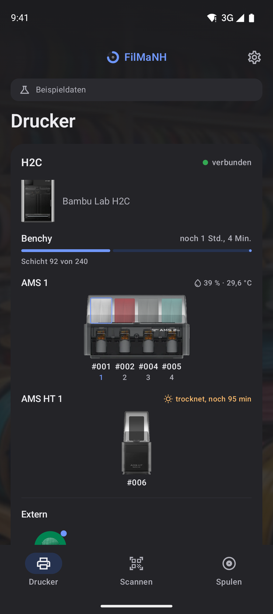
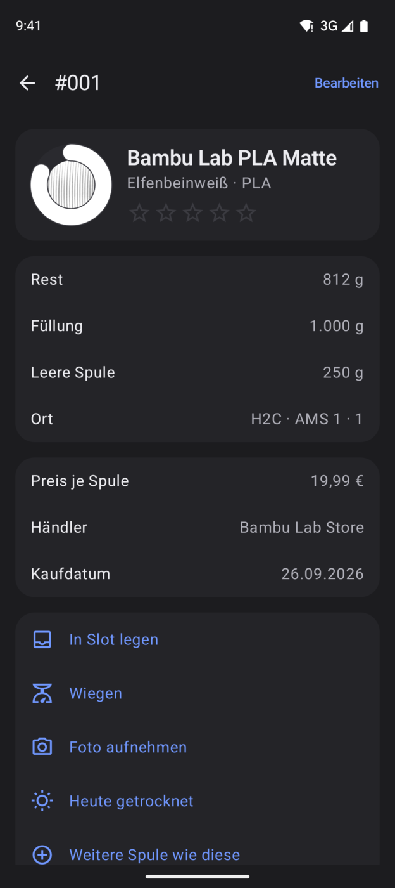
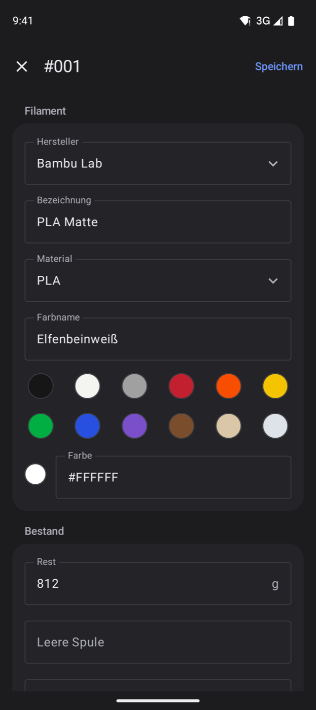

  

<h1 align="center">FilMaNH</h1>

  <b>Filament- und Spulenverwaltung für Bambu-Lab-Drucker</b> 
  Was steckt im AMS, wie viel ist noch auf der Spule, was hat der Druck gekostet? 
  Lokal auf deinem Rechner, ohne Cloud und ohne Einstellungen am Drucker.

  

<b>Deutsch</b> · <a href="README.en.md">English</a>

  

  
  
  
  

## Worum es geht

Mit mehreren Spulen und einem AMS verliert man schnell den Überblick: Was steckt wo? Wie viel ist noch drauf? Reicht
das für den nächsten Druck? FilMaNH liest deine Drucker im Heimnetz mit und bucht nach jedem Druck den Verbrauch von
der richtigen Spule ab – aus der Druckdatei, mit dem Spülen beim Farbwechsel. So stimmt der Bestand, ohne dass du nach
jedem Druck etwas eintragen musst.

## So funktioniert's

1. **Spulen anlegen** – aus dem Katalog mit über 7.000 Filamenten, per EAN-Scan oder mit dem Link zur Produktseite.
   Bambu-Spulen mit RFID erkennt FilMaNH beim Einlegen von selbst.
2. **Etikett drucken und einlegen** – jede Spule bekommt eine Nummer und ein Etikett mit QR-Code. Steckt sie im AMS,
   fragt FilMaNH einmal, welche Spule das ist.
3. **Drucken** – am Ende jedes Drucks bucht FilMaNH den Verbrauch je Spule ab. War der Rechner aus, holt es das beim
   nächsten Start nach.
4. **Überblick behalten** – Restmengen, Kosten je Druck, Hinweise bei falschem Material oder zu lange offenem
   Filament, und eine Einkaufsliste.

> [!NOTE]
> FilMaNH liest die Drucker nur aus. Es schickt ihnen keine Befehle und braucht weder LAN-Modus noch Entwicklermodus.

## Funktionen

<table>
<tr>
<td width="50%" valign="top">

### Übersicht und Hinweise

- Alle Drucker mit laufendem Druck, Restzeit und Slots samt Restmenge
- Hinweise mit passender Aktion: falsches Material im Slot, Spule ohne Zuordnung, Filament zu lange offen, fast leere
  Spulen, fällige Wartung
- Zuletzt gedruckt, mit Kosten

</td>
<td width="50%" valign="top">

### Drucker und AMS

- Drucker im Netz finden, Zugangscode aus Bambu Studio übernehmen
- AMS live mit Feuchte, Temperatur und Feuchteverlauf der letzten 7 Tage
- H2C und H2D mit zwei Düsen: AMS und externe Spulen je Düse
- Beim Druckstart: falsches Material, andere Farbe, Spule reicht nicht, abrasives Filament auf weicher Düse
- Wartungsplan je Drucker nach Druckstunden oder Zeit

</td>
</tr>
<tr>
<td width="50%" valign="top">

### Spulen

- Rest, Preis, Händler, Lagerort, Bewertung und Verlauf je Spule
- Wiegen macht den Bestand genau – FilMaNH lernt daraus die Abweichung je Filament
- Hinweis, wenn Filament zu lange offen liegt (PETG nach 30 Tagen, TPU nach 14, PA und PC nach 7)
- Filter nach Zustand, Material, Hersteller und Lagerort
- Über 80 Filamentfarben zur Wahl, auch mehrfarbig und mit Verlauf

</td>
<td width="50%" valign="top">

### Drucke und Kosten

- Verbrauch je Slot aus der Druckdatei, bei einem Abbruch nur bis zur erreichten Schicht
- Kosten je Druck, netto und brutto: Material, Strom und Maschinenzeit (aus Kaufpreis und Nutzungsdauer)
- Projekte: Drucke je Auftrag bündeln, mit Verkaufspreis aus Kosten, Arbeitszeit und Aufschlag
- Verlauf mit Bild, 3D-Ansicht und Zeitraffer
- Modelle: alle Drucke eines Modells mit Kosten und Erfolgsquote

</td>
</tr>
<tr>
<td width="50%" valign="top">

### Etiketten

- Nummer, Farbe, Hersteller, Öffnungsdatum und QR-Code; auf Wunsch Drucktemperatur, Lagerort, Kaufdatum, Preis
- Brother QL per USB direkt, ohne Treiber (Mac); jeder Drucker des Systems für Rollen und A4-/Letter-Bögen
- **Fehlende Etiketten** druckt genau die neuen Spulen

</td>
<td width="50%" valign="top">

### Auswertung und Einkauf

- Kosten je Monat, Material und Drucker, Ausschuss und Abbruchgründe
- **Druckdatei prüfen:** Reicht das Filament, was kostet der Druck?
- Mindestbestand je Filament: Einkaufsliste mit Händler und letztem Preis
- Reichweite nach dem Verbrauch: was in den nächsten Wochen leer wird

</td>
</tr>
</table>

## Am Handy

  
  
  

Spulen scannen, in Slots legen, wiegen, fotografieren und bearbeiten – zusammen mit FilMaNH auf deinem Rechner, im
Heimnetz und verschlüsselt, dazu ein Widget mit den laufenden Drucken. Die App für **Android** gibt es unten zum Download, die für das **iPhone** erscheint
demnächst im App Store. Anleitungen: [Android](handbuch/android.md) · [iPhone](handbuch/iphone.md)

## Download

| System | Download |
|---|---|
| **macOS** · Apple Silicon und Intel, von Apple geprüft | [Releases](https://github.com/NikolausH76/FilMaNH/releases/latest) → `FilMaNH_…_universal.dmg` |
| **Windows** · 10 und 11, 64 Bit | [Releases](https://github.com/NikolausH76/FilMaNH/releases/latest) → `FilMaNH_…_x64-setup.exe` |
| **Android** · ab Android 9 | **[FilMaNH-Android.apk](https://github.com/NikolausH76/FilMaNH/releases/latest/download/FilMaNH-Android.apk)** · [Installieren](handbuch/android.md#1-installieren) |
| **iPhone** | demnächst im App Store |

 
Android-App: mit dem Handy scannen

Neue Versionen meldet das Programm auf dem Rechner selbst und installiert sie auf Klick.

**Sprachen:** Deutsch, English, Español, Français, Italiano, Nederlands, Polski – am Rechner und am Handy.

**Voraussetzungen:** Bambu-Lab-Drucker im selben Netzwerk wie der Rechner (geprüft mit A1 mini, P2S und H2C). Den
Zugangscode übernimmt FilMaNH aus Bambu Studio, sonst steht er am Drucker unter **Einstellungen › WLAN**.

## Handbuch

**[Benutzerhandbuch mit Screenshots](handbuch/README.md)** – Installation, Einrichtung und alle Funktionen.
Für die Handys: [Android](handbuch/android.md) · [iPhone](handbuch/iphone.md)

## Datenschutz

Alle Daten bleiben auf deinem Rechner – kein Konto, keine Werbung, keine Analyse. Ins Internet geht FilMaNH nur für
Updates und den Filament-Katalog (beides auf GitHub), für einen eingefügten Shop-Link und für die Übernahme aus
Spoolman. Mehr dazu: [Datenschutzerklärung](DATENSCHUTZ.md)

## Eingebaut, aber noch nicht getestet

Diese Funktionen sind schon im Programm, konnten aber noch nicht auf echter Hardware ausprobiert werden – es fehlt
das passende Gerät oder die Situation kam noch nicht vor. Wer sie nutzt: Eine kurze
[Rückmeldung](https://github.com/NikolausH76/FilMaNH/issues) hilft.

- **AMS HT** als eigene Einheit
- **Etiketten unter Windows** direkt auf einen Drucker des Systems
- **Widget der Android-App** auf einem echten Handy (im Emulator geprüft)
- **Spule leer gelaufen:** Läuft eine Spule im Druck leer, setzt ein Klick ihren Rest auf 0
- **Trocknen im AMS 2 Pro und AMS HT:** Die eingelegten Spulen gelten danach als getrocknet – nicht, wenn die
  Trocknung vor der Hälfte der Zeit abgebrochen wurde
- **Spulenwechsel im Druck:** Ersatzspule im AMS oder von Hand getauscht – der Verbrauch wird an dieser Schicht auf
  beide Spulen aufgeteilt
- **Druck ohne Druckdatei** (z.B. H2 ohne USB-Stick): Verbrauch je Spule eintragen, mit Vorschlag aus der RFID-Anzeige

## Fragen und Fehler

Bitte als [Issue](https://github.com/NikolausH76/FilMaNH/issues) melden.

---

© 2026 N. Hass. Kostenlos nutzbar, alle Rechte vorbehalten; der Quellcode ist nicht öffentlich.
*Free to use, all rights reserved; the source code is not public.* ([Lizenz / License](LICENSE.txt))

FilMaNH ist ein unabhängiges Projekt und nicht mit Bambu Lab verbunden. Es nutzt das inoffizielle lokale Protokoll
der Drucker und greift nur lesend zu. *FilMaNH is an independent project and not affiliated with Bambu Lab. It uses
the printers’ unofficial local protocol and only reads from them.*
