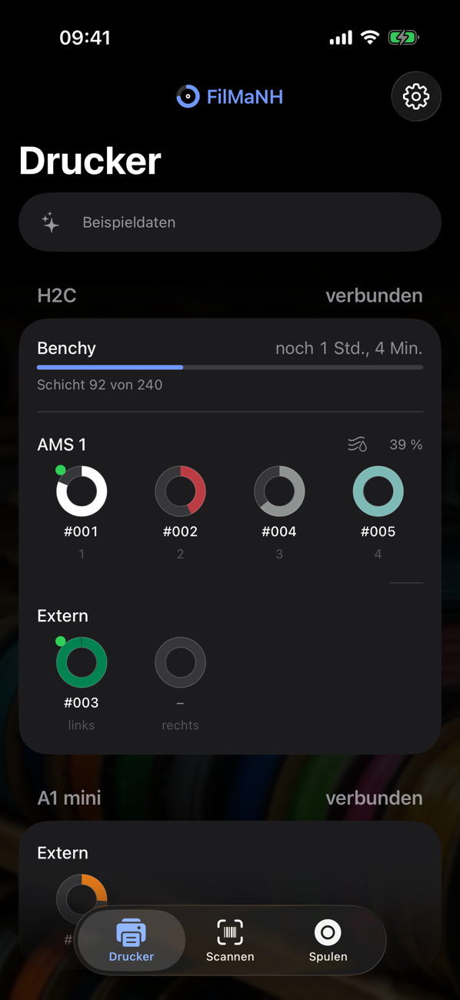
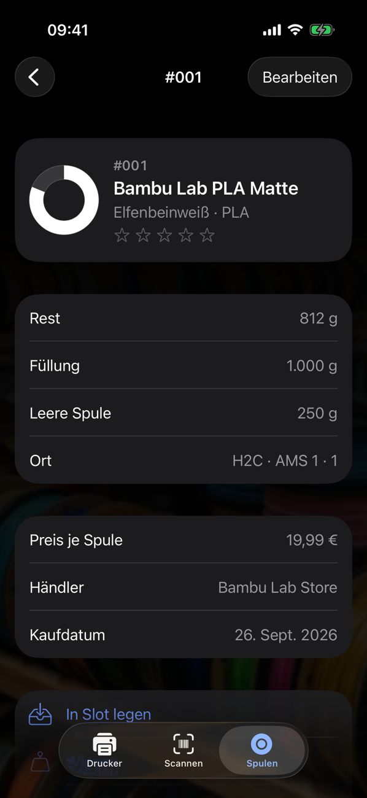
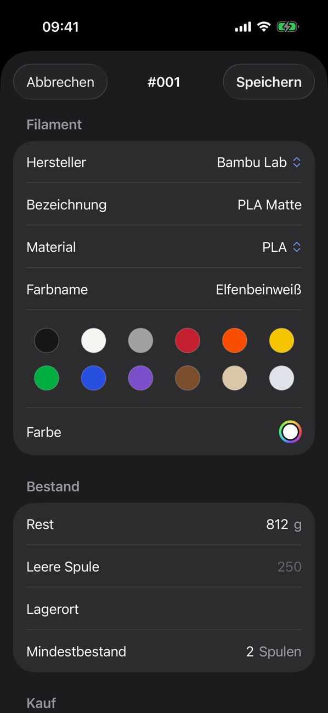
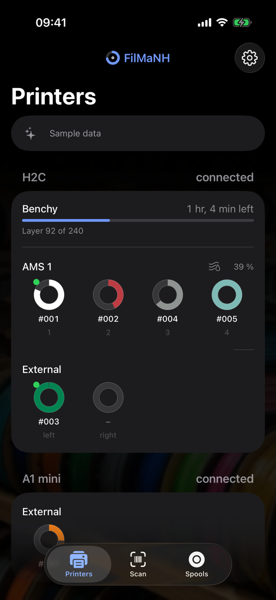
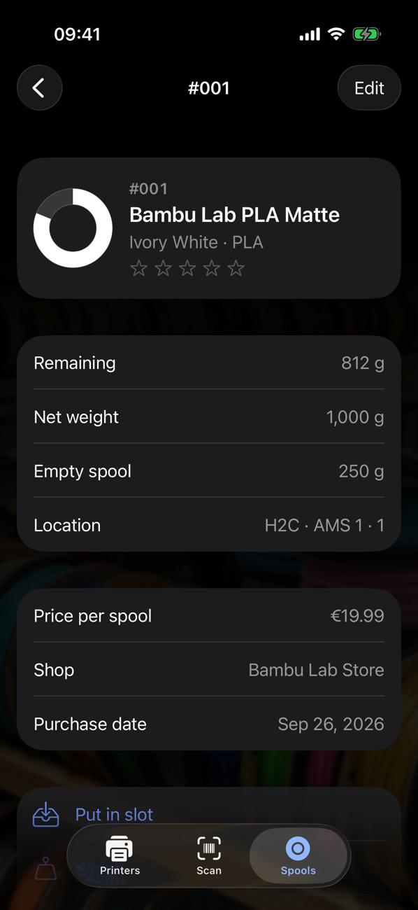
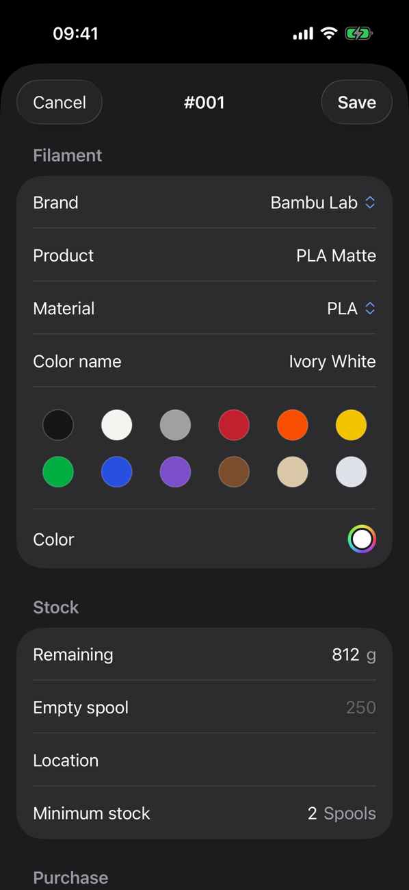

# FilMaNH

**Deutsch** · [English](#english)

Filament- und Spulenverwaltung für Bambu-Lab-Drucker. Läuft lokal auf deinem Rechner (macOS und Windows),
ohne Cloud und ohne Einstellungen am Drucker zu ändern. Die App spricht Deutsch und Englisch.

## Download

Installer für macOS (Apple Silicon und Intel, von Apple geprüft) und Windows (64 Bit) unter
**[Releases](https://github.com/NikolausH76/FilMaNH/releases/latest)**. Neue Versionen meldet die App danach selbst
und installiert sie auf Klick.

## Handbuch

**[Benutzerhandbuch mit Screenshots](handbuch/README.md)** – Installation, Einrichtung und alle Funktionen.

## Was FilMaNH kann

- Spulen anlegen mit Katalog (über 7.000 Filamente), per EAN-Scan oder Shop-Link; wiegen, bewerten, Etiketten drucken
- Drucker im Netz finden, AMS live, Bambu-Spulen mit RFID automatisch erkennen – mit Farbnamen aus Bambu Studio
- H2C und H2D mit zwei Düsen: AMS und externe Spulen je Düse (links, rechts)
- Verbrauch jedes Drucks automatisch abbuchen – auch wenn der Rechner während des Drucks aus war
- Kosten je Druck, netto und brutto, mit Strom und Maschinenzeit
- Druckverlauf mit Bild und 3D-Ansicht, „Reicht die Spule?“, Feuchte, Einkaufsliste, Auswertung

## Für iPhone und Android

Die App für das iPhone erscheint demnächst im App Store: Spulen scannen, in Slots legen, wiegen, fotografieren und
bearbeiten – zusammen mit FilMaNH auf deinem Rechner, im Heimnetz und ohne Cloud. Eine App für Android ist in Planung.

  
  
  

## Demnächst

In Arbeit – schon in der App angelegt, aber noch nicht an echten Druckern geprüft:

- **AMS HT** als eigene Einheit
- **Spule leer gelaufen:** Läuft eine Spule im Druck leer, setzt ein Klick ihren Rest auf 0
- **Trocknen im AMS 2 Pro und AMS HT:** Die eingelegten Spulen gelten danach als getrocknet – nicht, wenn die
  Trocknung vor der Hälfte der Zeit abgebrochen wurde
- **Spulenwechsel im Druck:** Ersatzspule im AMS oder von Hand getauscht – der Verbrauch wird an dieser Schicht auf
  beide Spulen aufgeteilt
- **Druck ohne Druckdatei** (z.B. H2 ohne USB-Stick): Verbrauch je Spule eintragen, mit Vorschlag aus der RFID-Anzeige

## Fragen und Fehler

Bitte als [Issue](https://github.com/NikolausH76/FilMaNH/issues) melden.

---

## English

Filament and spool manager for Bambu Lab printers. Runs locally on your computer (macOS and Windows), no cloud,
no printer settings to change. The app speaks English and German.

### Download

Installers for macOS (Apple Silicon and Intel, notarized by Apple) and Windows (64-bit) under
**[Releases](https://github.com/NikolausH76/FilMaNH/releases/latest)**. After that the app announces new versions
itself and installs them with one click.

### User guide

**[User guide with screenshots](handbook/README.md)** – installation, setup and every feature.

### Features

- Add spools from a catalog (more than 7,000 filaments), by EAN scan or shop link; weigh, rate, print labels
- Find printers on the network, live AMS view, Bambu spools with RFID recognised automatically – with colour names
  from Bambu Studio
- H2C and H2D with two nozzles: AMS units and external spools per nozzle (left, right)
- Deducts what every print uses, automatically – even if the computer was off during the print
- Cost per print, net and gross, including electricity and machine time
- Print history with image and 3D view, “Will the spool last?”, moisture, shopping list, statistics

### iPhone and Android

The iPhone app is coming soon to the App Store: scan spools, put them in slots, weigh, photograph and edit them –
together with FilMaNH on your computer, on your home network and without a cloud. An Android app is planned.

  
  
  

### Coming soon

In progress – already in the app, but not yet tested on real printers:

- **AMS HT** as a unit of its own
- **Spool ran out:** if a spool runs out during a print, one click sets its remaining amount to 0
- **Drying in the AMS 2 Pro and AMS HT:** the loaded spools count as dried afterwards – not if drying was stopped
  before half the time
- **Spool change during a print:** AMS backup spool or swapped by hand – usage is split between both spools at that
  layer
- **Print without a print file** (e.g. H2 without a USB drive): enter the usage per spool, with a suggestion from the
  RFID reading

### Questions and bugs

Please open an [issue](https://github.com/NikolausH76/FilMaNH/issues).

---

© 2026 N. Hass. Kostenlos nutzbar, alle Rechte vorbehalten; der Quellcode ist nicht öffentlich.
*Free to use, all rights reserved; the source code is not public.* ([Lizenz / License](LICENSE.txt))

FilMaNH ist ein unabhängiges Projekt und nicht mit Bambu Lab verbunden. Es nutzt das inoffizielle lokale Protokoll
der Drucker und greift nur lesend zu. *FilMaNH is an independent project and not affiliated with Bambu Lab. It uses
the printers’ unofficial local protocol and only reads from them.*
