# FilMaNH – User guide

*[Deutsch](../handbuch/README.md) · English · [iPhone app](iphone.md) · [Android app](android.md)*

FilMaNH keeps track of your filament spools and deducts what every print uses, automatically. It runs locally on
your computer and reads from the Bambu Lab printers on your network; on a printer it only deletes files you
confirm.

1. [Installation](#1-installation)
2. [First setup](#2-first-setup)
3. [How FilMaNH works](#3-how-filmanh-works)
4. [Overview](#4-overview)
5. [Spools](#5-spools)
6. [Printers](#6-printers)
7. [Check print file](#7-check-print-file)
8. [History](#8-history)
9. [Projects](#9-projects)
10. [Models](#10-models)
11. [Statistics](#11-statistics)
12. [Shopping list](#12-shopping-list)
13. [Settings](#13-settings)
14. [Running in the background](#14-running-in-the-background)
15. [Keyboard and scanner](#15-keyboard-and-scanner)
16. [Data and privacy](#16-data-and-privacy)
17. [FAQ](#17-faq)

---

## 1. Installation

Download from [Releases](https://github.com/NikolausH76/FilMaNH/releases/latest).

**macOS** (Apple Silicon and Intel): open `FilMaNH_…_universal.dmg` and drag FilMaNH into “Applications”. The app
is notarized by Apple; on first launch just confirm that you want to open an app downloaded from the internet. Don’t
run it directly from the DMG – updates can’t be installed there. If FilMaNH does run from the DMG, the overview offers
**Move to Applications**.

**Windows 10/11** (64-bit): run `FilMaNH_…_x64-setup.exe`. If you see “Windows protected your PC”:
**More info › Run anyway**. No administrator rights needed.

Your computer and printers need to be on the same network. Nothing has to be changed on the printer. FilMaNH
connects to the printer's ports 8883 (status) and 990 (print files), and for the camera image to 322 (video) or 6000
(still images) – if there is a firewall in between, they must be open.

## 2. First setup

On first launch FilMaNH searches your network for printers and asks for each one whether to add it.

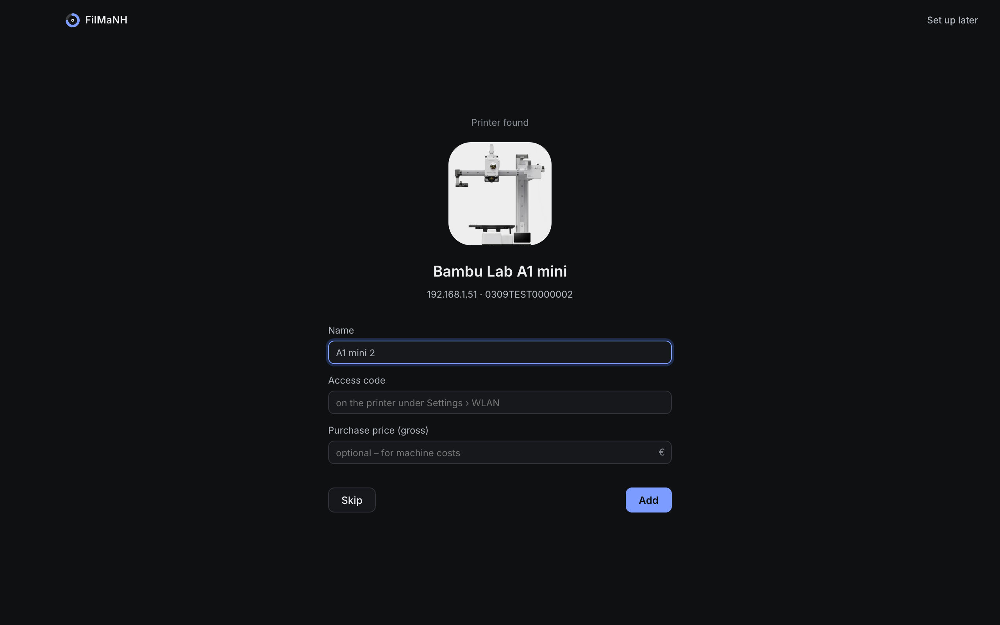

- **Access code:** If Bambu Studio is set up on the computer, FilMaNH takes the code from there. Otherwise you find
  it on the printer under **Settings › WLAN**.
- **Purchase price** (optional): for the machine costs, see [Settings](#13-settings).
- **No printer found:** If the printer is on a different subnet (e.g. a separate network for smart-home devices),
  enter that subnet like `192.168.2` or the printer’s IP address.

Next, FilMaNH asks what to do with prints that are already on the SD card:

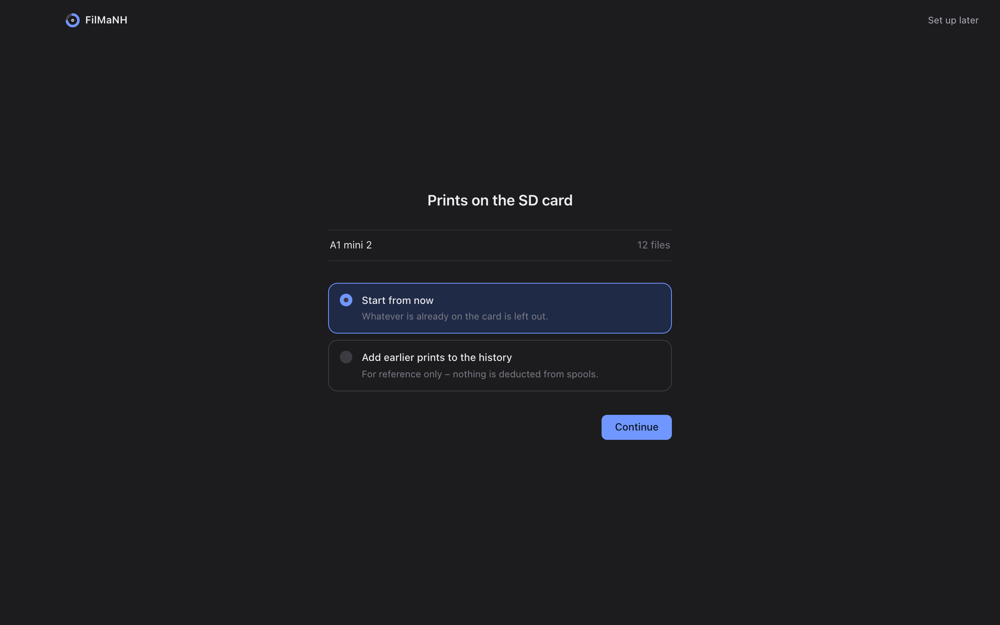

- **Start from now:** older prints are left out.
- **Add earlier prints to the history:** they show up in History and Models, but nothing is deducted from spools,
  and they don’t count in Statistics.

Finally, FilMaNH asks for the **electricity price** per kWh (for the electricity cost of prints) and whether to
**launch at login** – recommended, so FilMaNH follows every print.

**Set up later** skips the setup; you can add printers any time under Settings › Printers.

## 3. How FilMaNH works

- Every spool has a number (#001, #002 …) and a remaining amount.
- A spool in the AMS or on the external holder is assigned to that slot. **Bambu spools with RFID** are created
  automatically when loaded. For any other spool FilMaNH asks once which spool it is.
- **When a print ends**, FilMaNH reads from the print file how much filament each slot used and deducts it from
  the spool, including the flushing for colour changes. If a print is cancelled, only the layers actually printed
  are deducted.
- **If your computer was off or asleep**, FilMaNH catches up when it wakes up or starts next with whatever the printer
  did in the meantime. If the printer cannot be reached then, FilMaNH decides from the start and the planned duration:
  once the expected end is well past, it deducts; if the printer later reports otherwise, it corrects that.
  Anything it cannot settle for sure appears as a notice that you confirm with one click.
- **Not deducted?** If a print is over but not deducted (e.g. because no spool was assigned), a red **Not deducted**
  banner appears at the top of every page until it is settled, and you get a notification.
- **Weighing** makes the stock exact. From your weighings FilMaNH learns how far the real consumption of each
  filament differs from the calculation and takes that into account from the second weighing on (can be switched
  off under Settings › Tracking).
- **“~”** in front of a weight means estimated, may be slightly off. Weighing makes it exact again.

## 4. Overview

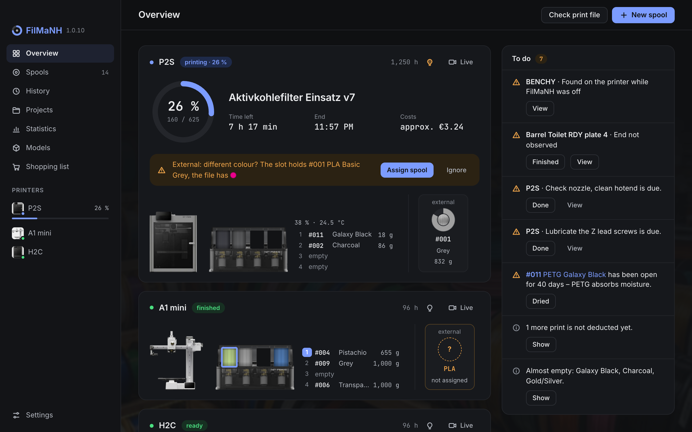

- **Printers** on the left, printing ones first: for the current print the progress with layer, time left, end and
  estimated cost; notices about this print (wrong material, different colour, abrasive filament, spool won’t last)
  right below. Then the printer and each AMS as a picture: every spool in its colour, the loaded slot marked, a slot
  with filament but no assigned spool dashed; beside it number, colour and remaining amount per slot, plus the AMS
  humidity and temperature and a running drying cycle. The external spool set apart. Click a printer to open it.
  Top right of the card: total print hours and **Live** (see [Printers](#6-printers)).
- **Recently printed** with amount and cost.
- **To do** on the right, each with the matching action:
  - A print whose end is unknown ([End unknown](#end-unknown)): **Finished** deducts it with one click if all spools
    of the print are known, otherwise **View**.
  - Prints not deducted, including those whose print file could not be obtained.
  - Slots that don’t match what the printer reports ([Matching with the printer](#matching-with-the-printer)).
  - [Maintenance](#maintenance) that is due, with **Done**.
  - Spools in a printer that have been open too long ([Moisture](#moisture)), with **Dried**.
  - Spools in a printer without a price, with **Enter price** – only once any spool has a price.
  - Bambu spools whose remaining amount according to RFID differs from the calculated one by 15 percentage points or
    more: **Weigh** or **Ignore**. Spools weighed in the last 7 days are left out.
  - Almost empty spools; **Show** opens them in the spool list.

## 5. Spools

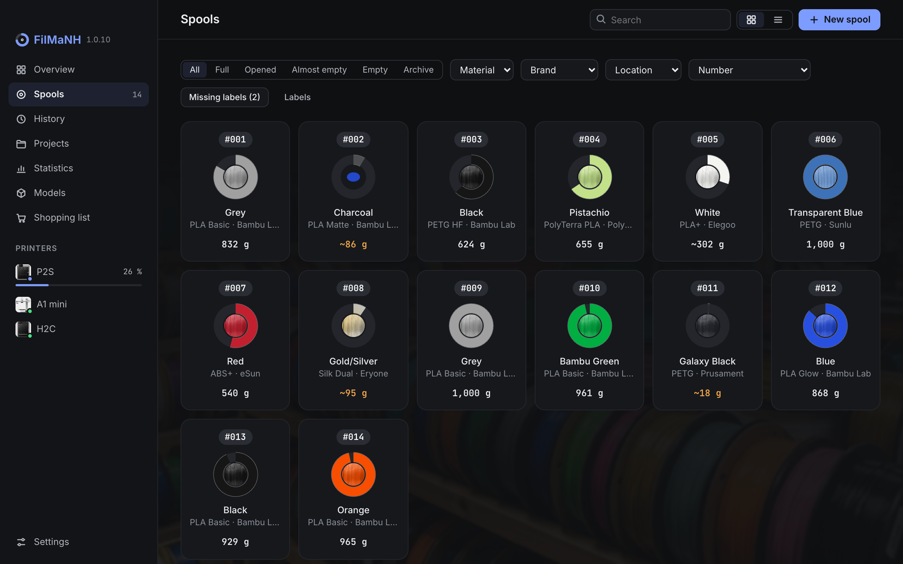

Filter by state (Full, Opened, Almost empty, Empty, Archive), material, brand and location; search; view as
**Grid** or **List**. **Labels** prints labels for all spools shown. **Missing labels** appears as soon as new spools
have no label yet (including spools created on a phone) and prints exactly those.

The **sort order** (number, fill level in either direction, name, brand, material, last used, newest first) is
remembered. Filters and search stay when you come back from a spool.

### New spool

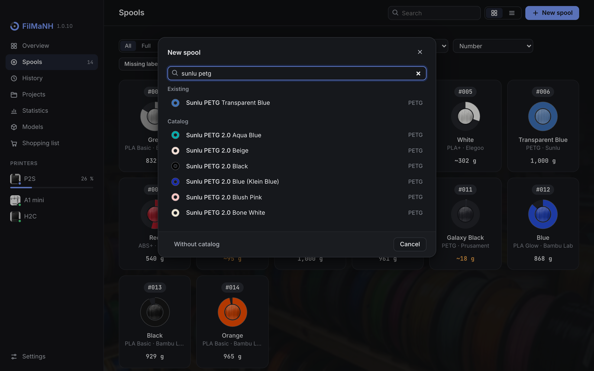

Type brand, material or colour into the search field, e.g. “sunlu petg white”. Filaments you already have are listed
first under **Existing**, below them the **Catalog** with more than 7,000 filaments; picking one fills in colour, net
weight and empty spool weight. Optionally add the price (gross or net), location and **Quantity**: 3 creates three
spools, each with its own number. If a filament is not in the catalog: **Without catalog** and enter it yourself.
Your own filament presets from Bambu Studio are in the catalog too.

Under **More details**: net weight, **Remaining now** (for a spool that is already in use; empty means full), empty
spool, VAT, purchase date, shop, batch and EAN.

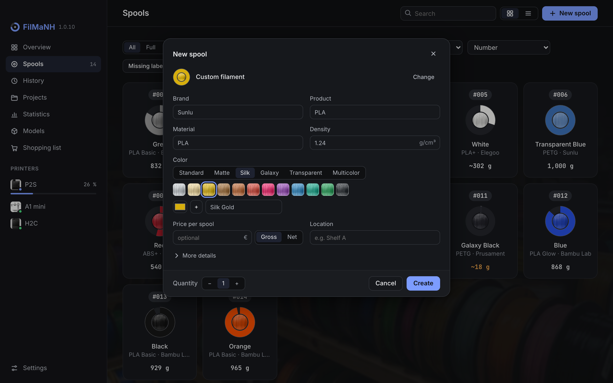

The **Color** then comes from more than 80 filament colours, sorted by **Standard**, **Matte**, **Silk**, **Galaxy**,
**Transparent** and **Multicolor** – or you set it yourself. **+** adds more colours (up to eight) for gradient and
multicolour filament.

The search field also takes an **EAN** (barcode on the spool or box) and a **shop link**:

- **EAN:** scan or type it and press Enter. The first time, pick the filament and FilMaNH remembers the EAN. Next
  time the filament is already selected, with price and shop of the last spool.
- **Shop link:** paste the link to the product page. FilMaNH reads name, price and shop from the page and suggests
  matching filaments from the catalog; price (in your currency) and shop are filled in. This doesn’t work with every
  shop – some don’t provide this data.

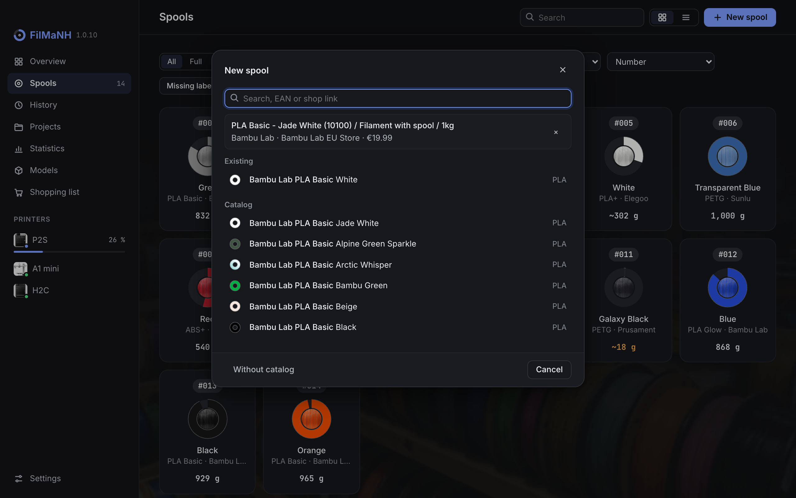

After creating, FilMaNH offers to print the label right away. Bambu spools with RFID don’t need to be created – just
load them.

### Spool details

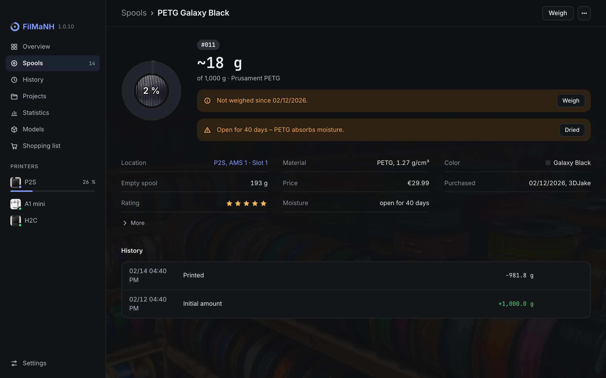

Remaining amount, location (slot or shelf; click to change it), material, price, moisture, **Rating** and every
deduction in the history. If the remaining amount is only estimated, **Not weighed since …** appears with **Weigh**.
**More** shows the remaining value and price per kg, accuracy, batch, when the spool was added, opened and dried,
Bambu ID, EAN, the learned **Correction** (applies from the second weighing), minimum stock and note.

Click an entry in the history to see its source and accuracy. Weighings and corrections can be reverted there with
**Undo**, prints in the print with **Undo deduction**.

If the spool is almost empty or below 30 %, **Use up the rest** lists single-colour models in the same material that
you have printed before and that the remaining filament is still enough for.

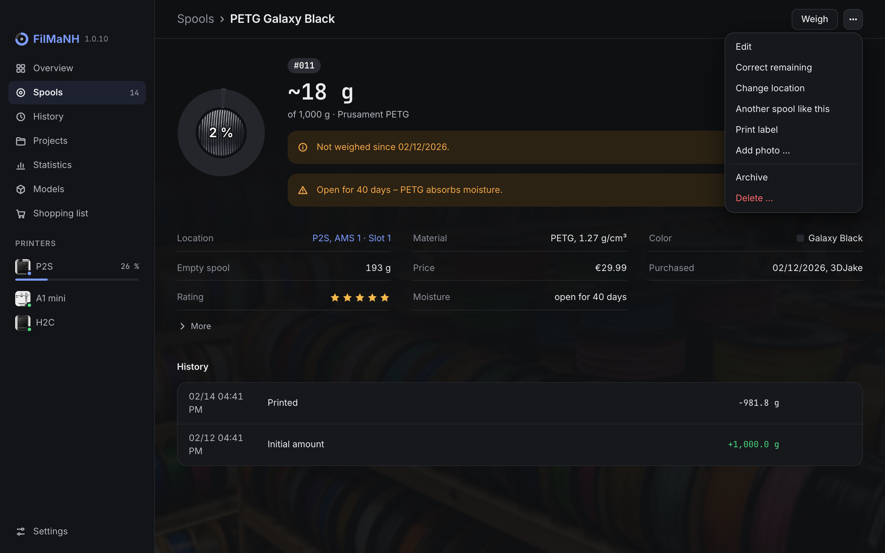

**Weigh** is at the top. In the **…** menu: Edit, Correct remaining, Change location, Another spool like this, Print
label, Add photo (or change and remove it), Archive (or **Unarchive**) and Delete. A **photo** applies to all spools of
this filament and shows the real colour in the centre of the ring; without a photo, the centre shows the filament’s
texture in its colour – glossy for silk, sparkling for galaxy.

**Delete** removes a spool for good, e.g. one created by mistake. This only works as long as no print has been
deducted from it; otherwise **Archive** – that keeps history and costs.

The **Rating** (1–5 stars) applies to the filament, i.e. to all spools of that kind; clicking the same star again
clears it. Under **Edit** you can enter EANs by hand, several separated by commas (e.g. with spool and refill). You
can also change the **Brand**, **Product**, **Material** and **Color** there (with the same colour choice as when
creating); this applies to all spools of this filament.

If a spool only gets a **price** later, FilMaNH recalculates the costs of the prints already deducted from it.
If an existing price changes, past costs stay as they were – unless you tick **Recalculate costs of past prints
with the new price**.

### Weigh

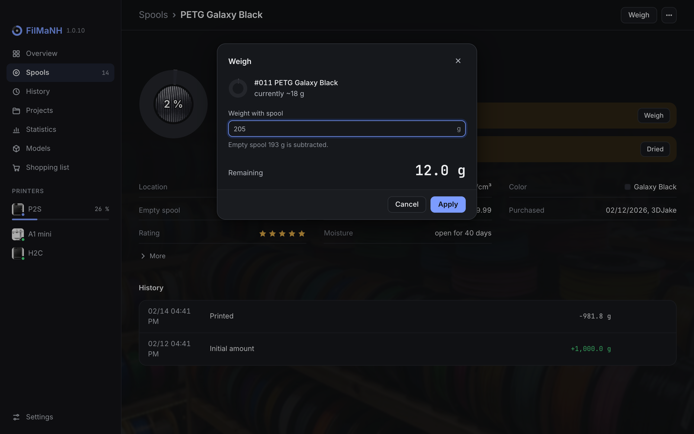

Weigh the spool including the reel and enter the weight. FilMaNH subtracts the empty spool weight and takes over
the rest. This needs the empty spool weight – if it is missing, enter it under **Edit** at **Empty spool**. If the
result differs clearly from the calculated amount, FilMaNH tells you (is a print missing? is the empty spool weight
right?).

**Correct remaining** sets the remaining amount directly, optionally with a reason.

### Labels

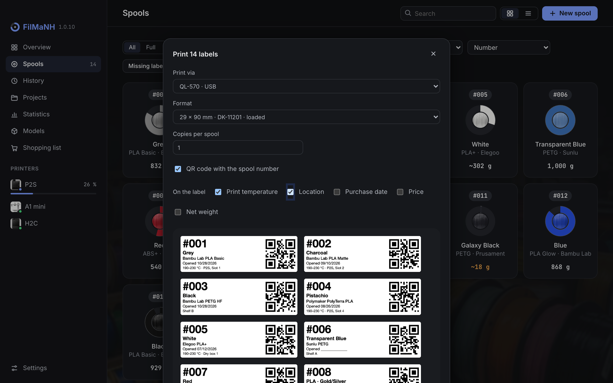

On the label: number, colour (with the material in front unless the product name already contains it), brand and
product, when the spool was opened, and a QR code with the number (can be switched off: **QR code with the spool
number**). Unopened spools get “Opened” with a line to fill in by hand. Under **On the label** you can add **Print
temperature** (from the filament catalog, where known), **Location**, **Purchase date**, **Price** and **Net weight** in
an extra line; the label then gets slightly smaller, and a line that is too long is shortened. FilMaNH remembers your
choice.

Under **Print via:**

- **Brother QL via USB** (Mac, e.g. QL-570): FilMaNH prints directly, no driver needed. **Format** lists every roll
  the printer supports; the loaded one is marked. If the chosen format does not match the loaded roll, FilMaNH says
  so and does not print; after changing the roll, **Check again**. The label adapts to the format, and the preview
  shows exactly what is printed.
- **System printers:** every installed printer with its name and model; the default printer is marked. FilMaNH
  prints directly to it, without another dialog – label printers (Brother, Dymo, Niimbot, Phomemo, Zebra, Rollo) as
  well as an office printer for label sheets.
- **System print dialog …** opens the usual dialog, e.g. to save as PDF.

The preview shows all labels or all sheets exactly as they are printed.

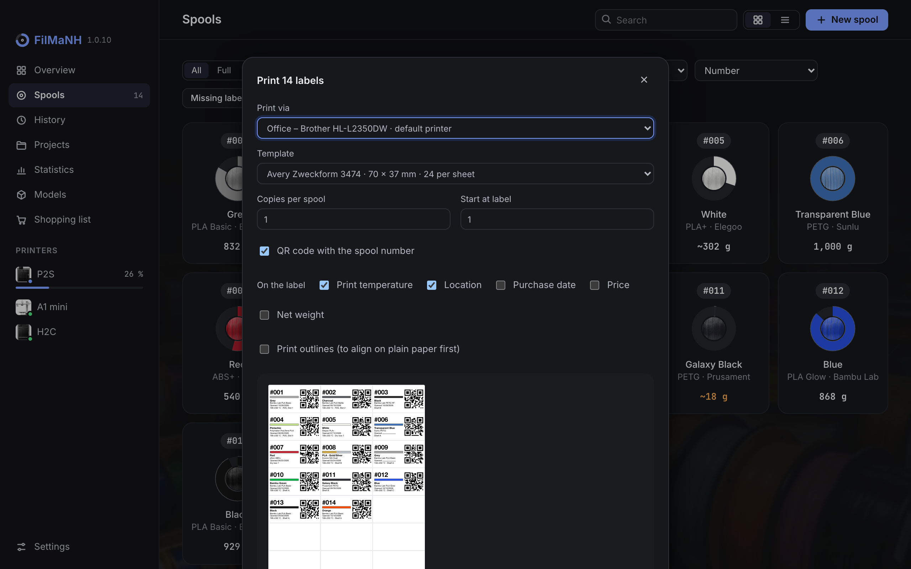

**Template** lists label rolls plus A4 sheets from Avery Zweckform and Herma and US Letter sheets from Avery, each with
its product number (equivalent ones combined), size and labels per sheet. If none fits, **Custom size …** sets up a
single label or a sheet with columns, rows, margins and gaps.

**Copies per spool** prints several identical labels, **Start at label** reuses partly used sheets. **Print
outlines** adds the outlines – to align on plain paper first. Keep the scale at 100 % in the print dialog. FilMaNH
remembers which spools have a label.

### Moisture

PETG, PCTG and PET show a notice after 30 days open, TPU and TPE after 14 days, PA, PPA, PC, PVA and BVOH after
7 days. The time counts from opening or the last drying. A spool in an AMS below 20 % humidity gets no notice.
**Dried** (on the notice or in the spool) resets the time.

## 6. Printers

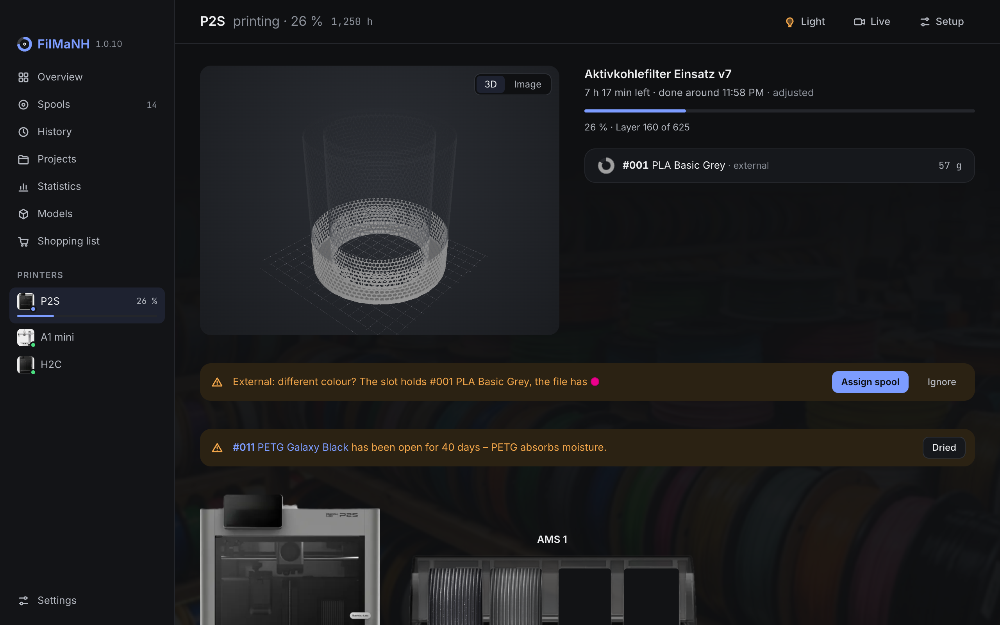

The sidebar lists all printers, with progress while printing; click one to open its page.

The current print in 3D in the colours of the assigned spools – the part already printed solid, the rest
see-through – plus progress, layer, remaining time and when it will be done. Below, the filaments of the print with
the spool in each slot (number as on the label); click one to reassign, and the model changes colour right away. **adjusted** means: this printer usually takes longer or shorter than it shows, and FilMaNH takes
that into account. This only happens after three prints and only if it is measurably more accurate.

When a print starts, FilMaNH checks:

- **Wrong material or different colour** than the print file expects, with the slot. **Assign spool** opens the
  selection for this slot with suggestions matching the print file; **Ignore** hides the hint for this print
  everywhere.
- **Spool will run out:** with the time it will be empty and whether a spare spool is in the AMS.
- **Abrasive filament** (with carbon or glass fibre, glow) on a stainless steel or brass nozzle: the nozzle wears,
  a hardened one is better. The printer reports which nozzle is installed.

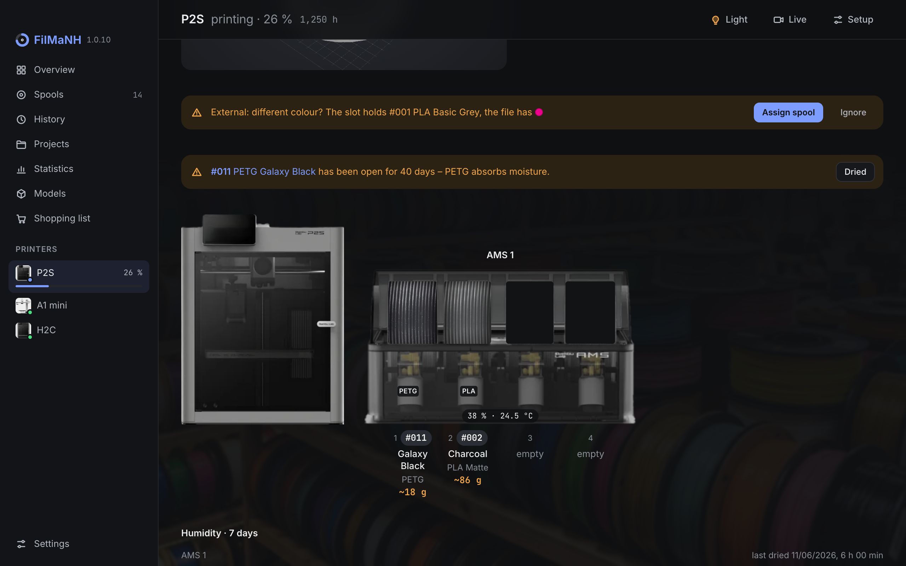

Further down: the printer and each AMS as a picture. Every spool sits in its window in its colour, with the
material on the feeder; the loaded slot is marked, a slot with filament but no assigned spool is dashed. Below that
number, name and remaining amount; click a slot to open the [assignment](#assign-a-spool). Humidity and temperature
are shown on the AMS, on the AMS HT in its display; a running drying cycle with its time left above. Without a
connection FilMaNH shows the saved assignments. Then the humidity of the last 7 days with the last drying, and the
external spool. H2D and H2C have two external holders (left and right); an empty one without an assigned spool is not
shown. Drag a spool from **Spools on the shelf** onto a slot to assign it. Also on the page: the
[maintenance](#maintenance), the latest prints of this printer, and at the very bottom model, firmware and IP address.
**Setup** at the top right opens the printer settings.

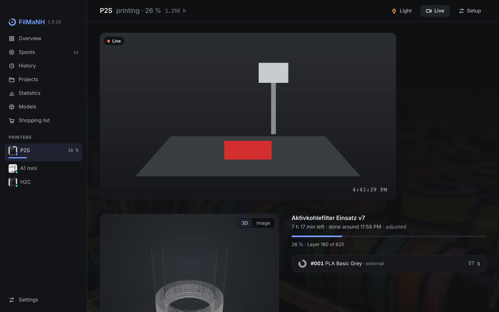

**Live** at the top right shows the camera image while the page is open; if it stalls, the top left shows how old it is.
On the Overview, **Live** on the printer card opens the page with the image right away. X1, H2D, H2S, H2C and P2S
deliver video, A1, A1 mini, P1P and P1S still images. For video, **LAN Mode Liveview** must be on at the printer
(printer settings; often off by default). If it is off, the printer page says so and the Overview shows no **Live**.
If the image stops, **Try again** reconnects. FilMaNH only watches and changes nothing on the printer.

Clicking the running image pops it out: it then runs only in its own window without a title bar. Drag to move the
window, drag its edges to resize; a click on the image opens the menu with **Always on top** and **Close**. **Back
into the app** on the printer page brings it back.

**Storage** shows, after **Show**, what is on the printer's SD card or internal storage: camera recordings,
timelapses and print files, each with count and size. **Delete …** removes a whole category; expanded, you can select
single files. FilMaNH asks first and only deletes while the printer is connected and not printing – never the
printer's system files or logs. Timelapses of prints in FilMaNH are saved to the print's folder first, print files too
with **Keep print files**, as far as the storage limit allows. **saved in FilMaNH** means the file is already on your
computer.

**Light** at the top right turns the printer’s chamber light on or off (on the H2C both chamber lights); in the
Overview, the bulb icon on the printer card does the same. It only appears while the printer is connected and reports
a chamber light. The chamber light is the only thing FilMaNH switches on the printer.

### Assign a spool

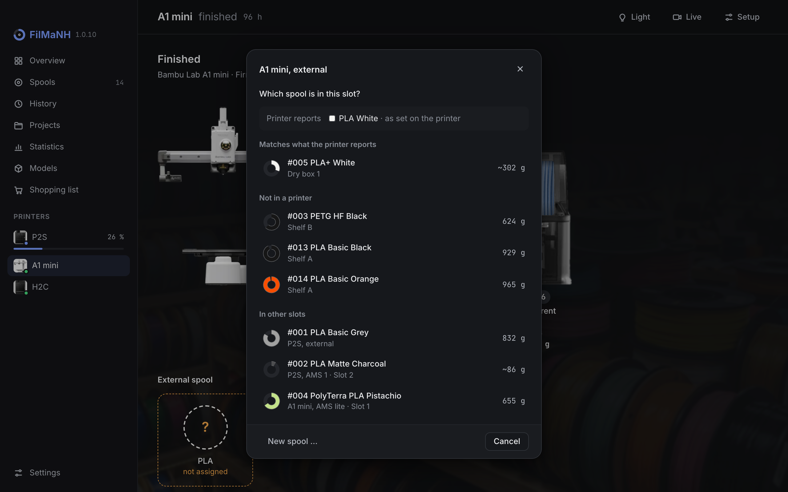

Clicking a slot asks **Which spool is in this slot?** Above the list it shows what is assigned in FilMaNH and what the
printer reports. The list shows matching spools first, then those not in any printer, then those in other slots – each
with its number, location or slot, and what is left. A spool from another slot moves here. **Slot is empty** clears
the assignment.

If the spool is not in stock yet, **New spool …** creates it and assigns it to this slot right away – during a print
it counts for that print. The search starts with the material and colour from the printer or the print file.

### Matching with the printer

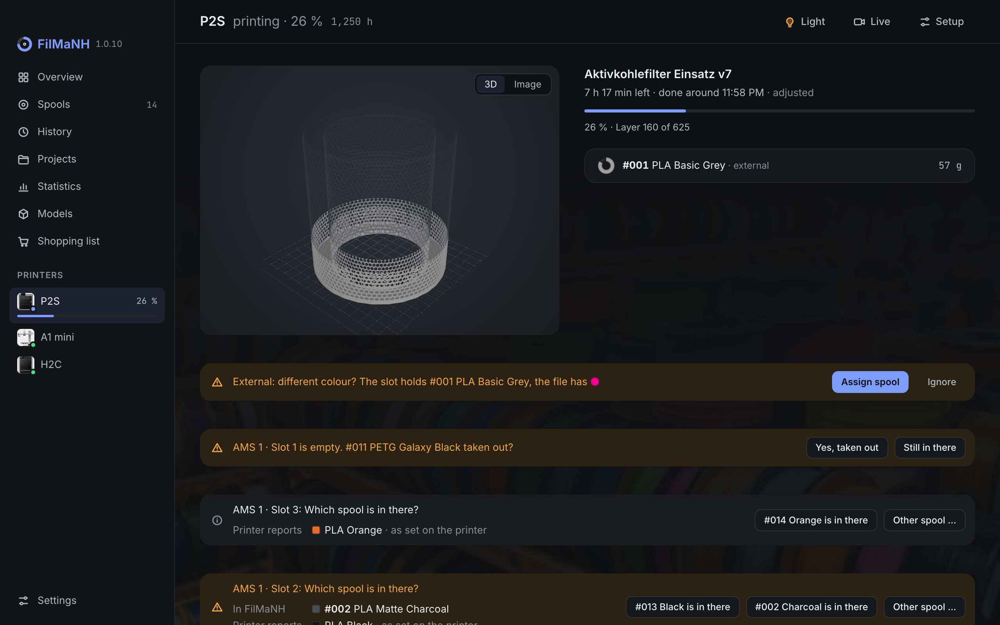

Every Bambu printer reports for each slot what is set (material, colour, the RFID chip for Bambu spools) and whether
filament is loaded. FilMaNH compares this with the assigned spool, even when nothing is printing:

- **Which spool is in there?** The printer reports a different material, a clearly different colour or a different
  RFID chip than the assigned spool – or none is assigned yet. Below it shows what is **In FilMaNH** and what the
  **Printer reports**. The buttons are the answers: **#… is in there** for the current spool or the one that matches
  the report; **Other spool …** or **Choose spool …** opens the picker.
- **… is empty. … taken out?** The printer reports the slot as empty. **Yes, taken out** clears the assignment,
  **Still in there** keeps it (e.g. when only the filament was unloaded).

Without a Bambu chip the printer cannot see the colour: it reports what is set for the slot on the printer or in Bambu
Studio (**as set on the printer**). That can differ from the spool that is loaded – the printer still prints whatever
is in the slot.

An answer applies until the printer reports something else; so does assigning by hand. Nothing is assigned without a
click – automatically only Bambu spools with RFID, as only their ID is unique.

### Maintenance

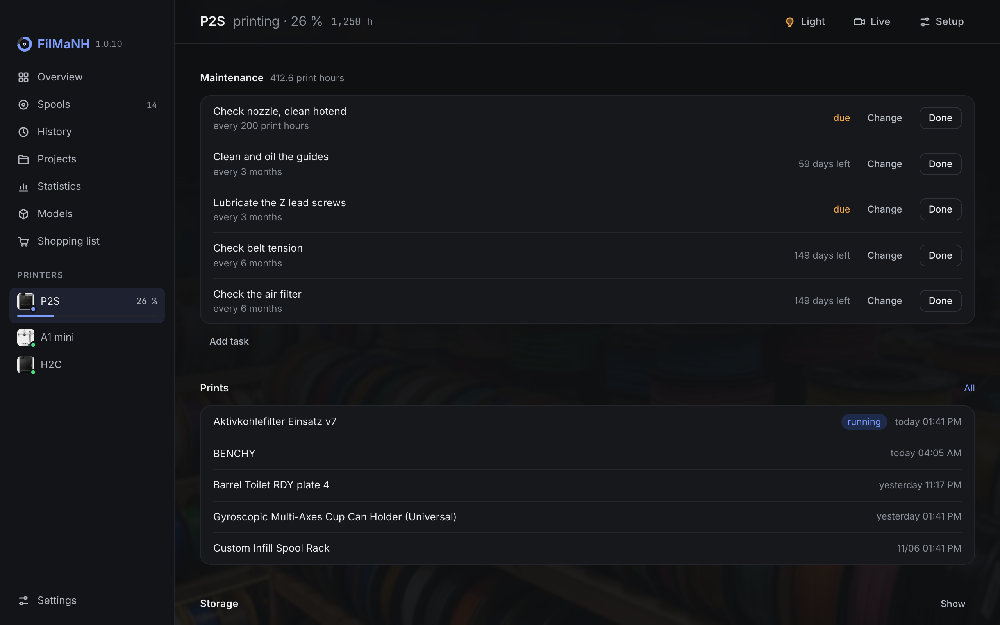

The printer page shows the maintenance plan: each task with its interval in print hours or in days, weeks or months,
and what is left until the next one. FilMaNH counts the print hours from the prints it has recorded. The first time,
it creates suggestions for the model:

- **Check nozzle, clean hotend:** every 200 print hours
- **Clean and oil the guides** and **Lubricate the Z lead screws:** every 3 months
- **Check belt tension:** every 6 months
- **Clean the carbon rods** (X1 and P1): every 30 days
- **Check the air filter** (enclosed printers): every 6 months

**Done** starts counting again from now. **Change** edits the name and interval or deletes the task, **Add task**
creates your own. Tasks that are due also appear on the overview, there with **Done** as well.

## 7. Check print file

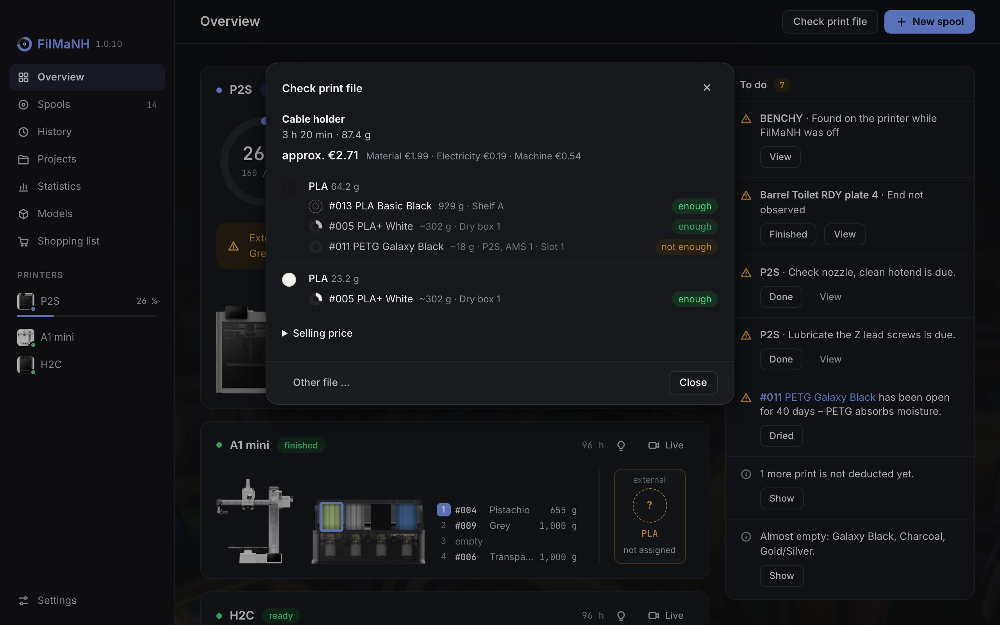

Find out before printing whether the filament is enough: in Bambu Studio export the sliced plate as `.gcode.3mf`
and drop it onto the FilMaNH window or choose it via **Check print file**. FilMaNH shows for each filament which
spools are enough and estimates the cost (material, electricity, machine). If no single spool is enough but two
identical ones are, it shows **enough together** with both numbers. If the filament is abrasive and the nozzle is
stainless steel or brass, a warning is shown. **Selling price** (expand) calculates a price from the costs, as in
[projects](#9-projects).

## 8. History

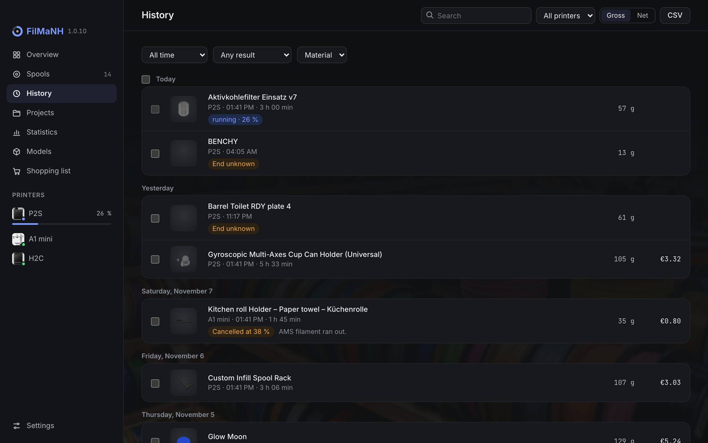

Every print with image, printer, time, duration, consumption and cost; if there is a photo of the finished part,
it replaces the preview. Click the image to see the print in 3D. Filter by period, result (Finished, Cancelled,
Running or open, Not deducted), printer and material; search; gross or net. **CSV** exports the list.
Page through at the bottom, **10**, **25** or **50 per page**.

**Delete:** tick prints (the box above the list selects all on the page), then **Delete** and **Really delete**. The
entry, print file, photos and timelapse are removed; the usage stays booked on the spools. Running prints cannot be
deleted.

### Print details

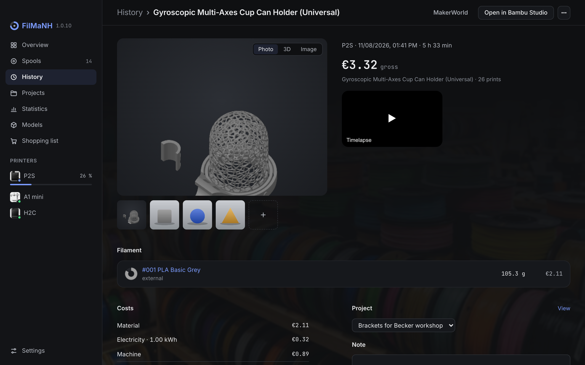

- **Photo:** the last frame of the timelapse, if “Timelapse” was switched on when sending the print. Without a
  timelapse, the last frame of the camera recording, if the printer records during the print (e.g. P2S). **3D** (in
  the spools’ colours) and **Image** show the print file.
- **Own photos:** below it, as many as you like – with **+** or by dragging images into the window. Without a frame
  from the timelapse or camera, the first one is shown large. A click opens the large view: **←** **→** to browse,
  **Esc** closes, **Delete** removes the photo.
- **Play timelapse.** With **Download timelapses** (Settings › Tracking) it is on your computer after the print;
  otherwise it comes from the printer when you play it. **Save …** keeps a copy; on a Mac an AVI becomes a `.mov`
  that QuickTime plays. If the timelapse was off during the print, this is shown here. Otherwise **Find timelapse**
  fetches it (or the last frame of the camera recording) from the printer afterwards.
- **Filament** per spool with amount (of which flushing) and cost; **Costs** broken down into material, electricity
  and machine, net and gross. During the print, the costs estimated from the print file are shown. If a spool has no
  price, it says **Price missing** or “+ ?” after the known amount (also in the history), with a link to the spool
  below.
- **Spool changed during the print** (e.g. to the spare spool in the AMS): the filament is listed with its sections
  per spool and layer; each section is deducted separately.
- **Open in Bambu Studio** opens the kept print file. If the model comes from MakerWorld, **MakerWorld** leads there.
- **Project:** assign the print to a [project](#9-projects) or create one with **New project …**; closed projects are
  not offered. **Selling price** (expand) calculates the price for this print. Below it a **Note**.
- **…** menu: **Mark as waste** (part unusable – counts as a failed print in the statistics; **Not waste** undoes
  it), **Undo deduction** (after that, FilMaNH only deducts again on **Deduct**) and, as long as nothing is deducted,
  **Find print file again**.
- FilMaNH checks every print file against the print: layer count and the filaments the printer actually uses. An
  older file with the same name is not used.
- **Not deducted – choose a spool.** appears when the printer reported no slot for a filament or the spool was only
  put into the slot after the print (it may already be meant for the next print). You choose the spool yourself and
  click **Deduct**; FilMaNH does not guess.
- **Print file not available** or without filament data: **Enter usage …** – spool and grams per row, **Another spool**
  for more, then **Deduct**. For Bambu spools FilMaNH suggests the amount from the RFID reading (“from RFID, rough”).
- **… ran out.** If the printer reports that a spool ran out, **Set remaining to 0** sets its remaining amount to 0.
- If objects were skipped on the printer, the full amount of the print file is still deducted; weighing makes the
  stock exact again.
- For cancelled prints the reason is shown at the top. All error messages of the printer during the print are listed
  under **Printer messages**.

### End unknown

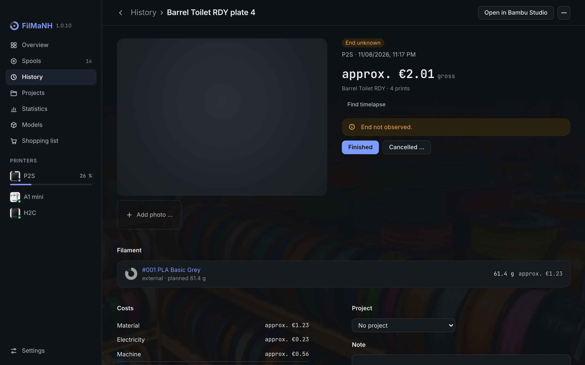

If FilMaNH could not see a print end and could not settle it later either: choose **Finished** or **Cancelled …**
with the layer, and the spool where needed. The deduction follows. If FilMaNH only found the print as a file on the
SD card (the computer was off), there is also **Not printed**.

## 9. Projects

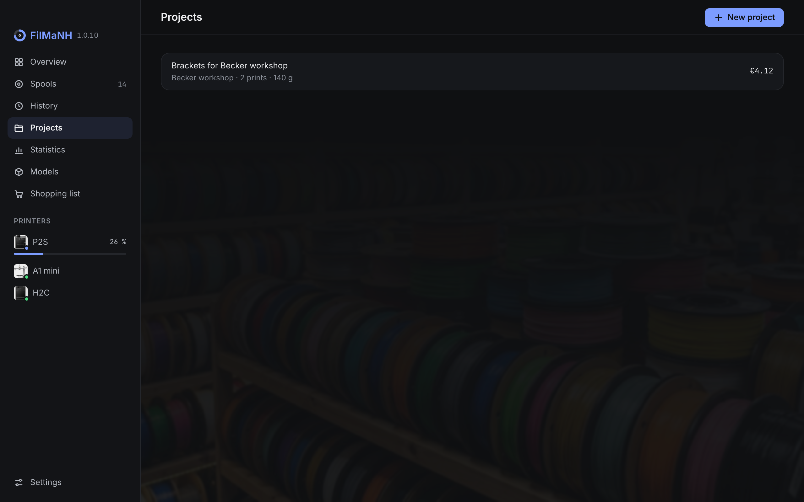

A project groups prints for a job or customer, with totals for filament, time and costs. **New project** creates
one. Prints are added with **Add prints** or in the print under **Project**.

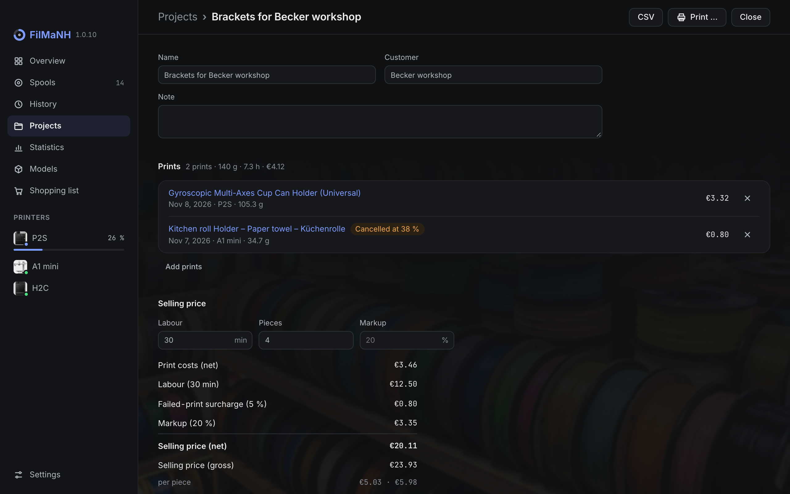

- **Name**, **Customer** and **Note**.
- **Prints** with date, printer, amount and cost; cancelled prints and waste are marked. **×** takes a print out again.
- **Selling price:** the print costs (material, electricity, machine) plus **Labour** at the hourly rate from
  Settings › Costs, on top of that the **Failed-print surcharge** and then the **Markup** – net, gross and per
  **piece**. The markup applies per project; left empty, the default from the settings applies.
- **Photos:** the project’s own photos and those of its prints, with a link to the print. **Add photo …** or drag
  images into the window; a click opens the large view.
- **CSV** exports the prints, **Print …** an overview as an A4 page with total and selling price (also as PDF in the
  print dialog).
- **Close** marks the project as closed, **Reopen** undoes that. **Delete project** deletes only the project and its
  photos; the prints stay.

## 10. Models

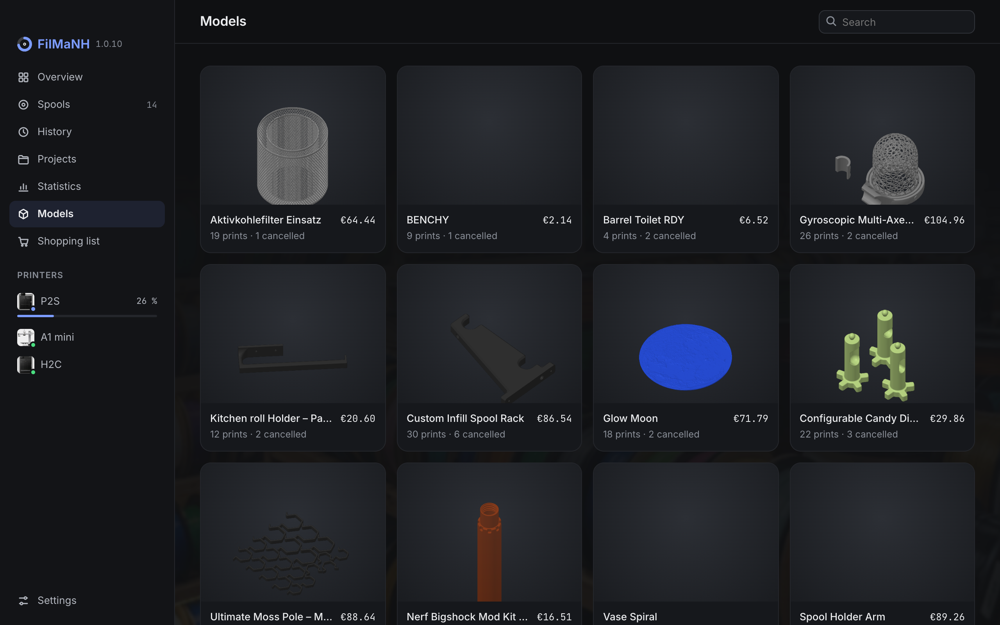

All prints grouped by model, with count, cost and cancellations; search by name.

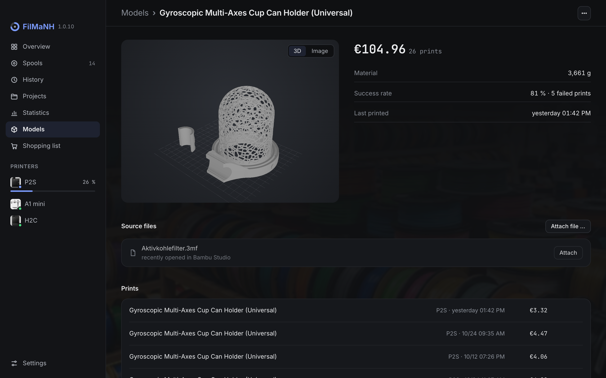

Cost, material, success rate and all prints of the model.

- **Source files:** **Attach file …** (or drag files into the window) takes project 3MF, STL, STEP and OBJ; FilMaNH
  keeps a copy in the data folder and suggests the files recently opened in Bambu Studio to **Attach**. **3D** shows
  the real model for STL and 3MF, **Open** opens the file with the program the system uses for it.
- **…** menu: **Rename** and **Merge with another model** (e.g. for two versions of the same model). **Detach** on a
  print removes it from this model.

## 11. Statistics

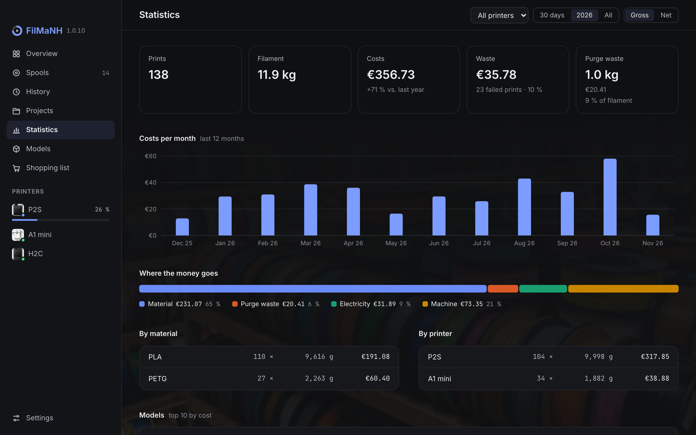

Filter by printer (if there are several) and period (**30 days**, the current year, **All**), gross or net. Waste
means prints cancelled after the first layer and prints marked as waste. Earlier prints taken over from the SD card
don’t count.

- **Key figures:** prints, filament, costs with the change from the previous period (the 30 days before, the same
  time last year or the previous month), waste and **purge waste**: filament flushed during color changes (including the
  prime tower), its cost and its share of the filament. If not all prints are deducted or prices are missing, this is
  noted below the costs.
- **Costs per month:** the last 12 months. Click a month to see its days; the whole page then shows that month.
  **Back** returns to the previous period.
- **Where the money goes:** material, purge waste, electricity and machine (printer purchase) as shares of the costs.
- **By material**, **By printer**, the most expensive **Models** and **Purge waste by model**.

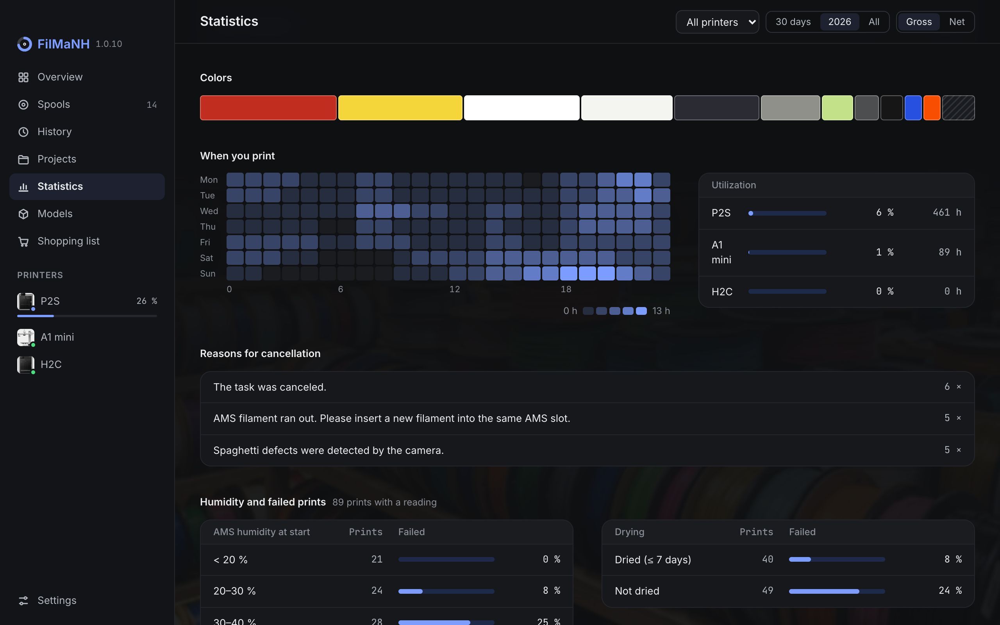

- **Colors:** the most printed colors, wider the more grams; hover for filament and amount.
- **When you print:** print hours by weekday and time of day (the stronger, the more) and the **utilization** of
  each printer: print hours relative to the hours in the period.
- **Reasons for cancellation:** the most common messages of cancelled prints.

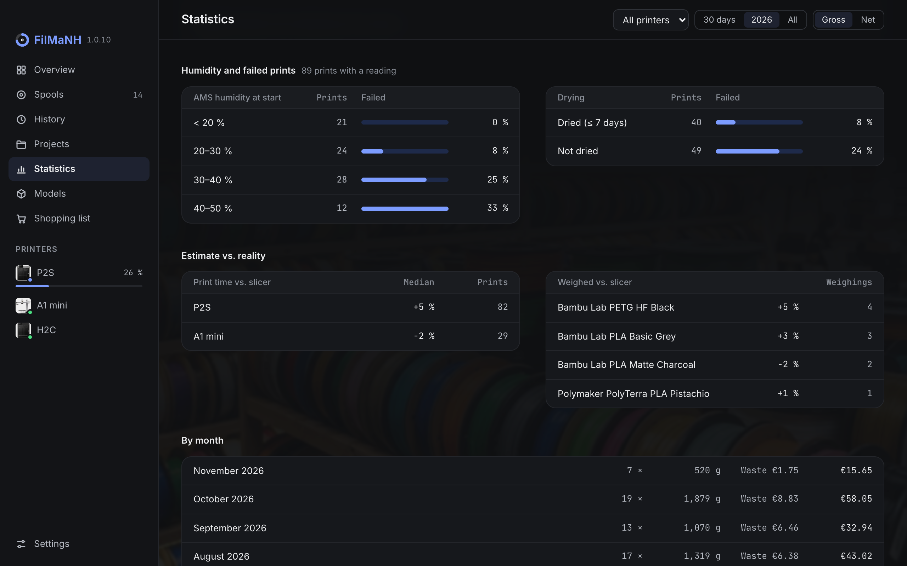

- **Humidity and failed prints:** the share of failed prints by AMS humidity at print start and by whether all spools
  of the print were dried in the 7 days before. Only from 20 prints with a reading, each row from 5 prints. Prints
  from the external spool have no reading. Can be switched off under Settings › Tracking.
- **Estimate vs. reality:** how much longer or shorter normally finished prints took than the slicer predicted
  (median, from 3 prints per printer), and how much weighed spools differ from the slicer weight (per filament, from
  all weighings).
- **By month** or **By day:** the figures behind the chart.
- **Stock:** the current stock, regardless of the period: value of the remaining filament, spools without use for
  more than 6 months, and spools that have been open for more than 60 days and not dried since.

## 12. Shopping list

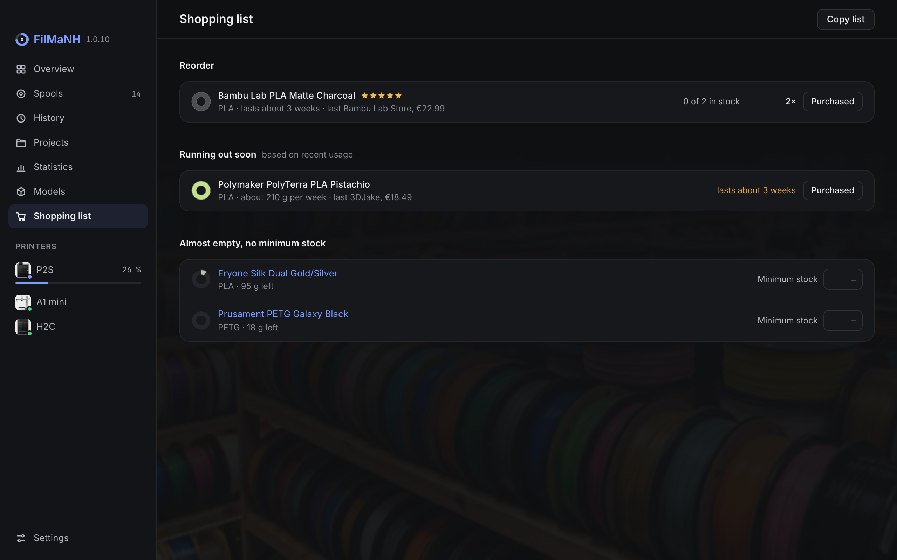

Set a **Minimum stock** in spools for a filament (under Spool › Edit or here under **Almost empty, no minimum
stock**). When the stock falls below it, the filament is listed under **Reorder** with shop and last price; almost
empty spools don’t count. **Purchased** creates the new spool with the data of the last purchase. **Copy list**
copies the shopping list. Stars show your rating of the filament.

**Running out soon** lists filaments that, at the usage of the last 90 days, will be used up in less than 4 weeks –
even without a minimum stock. Each filament shows roughly how long the stock will last.

**Almost empty, no minimum stock** lists almost empty spools whose filament has no minimum stock; you can enter one
right there.

## 13. Settings

**General:** **Appearance** (System, Light, Dark), **Background image**, **Language** (as the system, Deutsch,
English, Español, Français, Italiano, Nederlands, Polski; if the system uses none of them, English), **Keep running
when closed**, **Launch at login** (recommended), **Notifications** (print finished, spool will run out, new spool
detected).

**Printers:** connected printers with model, address and status; **Remove** takes one out. **Search network** finds
more printers, also in another subnet if you like (**also in subnet**); **Use new address** takes over a printer that
is already set up under a new address. Or add one by IP address with name, access code and optionally its **purchase
price**. If the printer is already set up, the button reads **Update**: it takes over a new address and a new access
code, and the assignments stay.
**Print hours so far:** per printer, the value from its display. Total print hours (overview, printer page) are
this value plus the prints recorded since; without a value, only those recorded by FilMaNH.

**Chamber light:** per printer, **Turn off after the print** – never, immediately or after 1, 5, 10 or 30 minutes.
This only applies to a finished print; after a cancel or failure the light stays on. If a new print starts during the
wait or someone switches the light, it stays as it is. **On at print start** turns the light on when each print
begins. Both only while FilMaNH is running and connected to the printer.

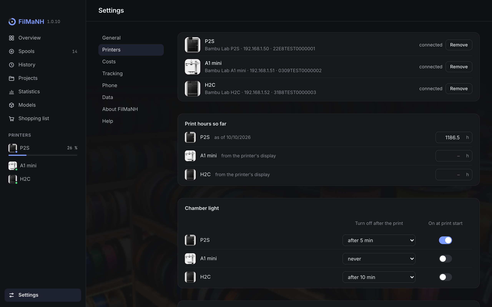

**Costs:** currency, VAT and whether prices are shown **Gross** or **Net**. All amounts on this page are shown and
entered that way; internally FilMaNH calculates net. The VAT applies to electricity, printer purchase,
selling price and new spools; each spool keeps its own rate. On a new installation, currency and VAT are preset for
the system’s country (USA and Canada 0 %, since sales tax there varies by state or province; without a recognised
country euro and 19 %).

- **Electricity:** **Electricity price** per kWh and the power of each printer. Without your own value FilMaNH uses
  Bambu’s measured average for the model and the print’s material (e.g. A1 mini with PLA 80 W, P2S 200 W) – not the
  maximum power, which the printer only needs briefly while heating up.
- **Printer purchase:** **Purchase price** and **Service life** per printer (default 5,000 print hours); next to them
  is what that comes to **per print hour** (e.g. €799 over 5,000 h = €0.16). This amount times the print time is added to every booked print, older ones too, always with the current purchase price. With **Include in costs** off, the purchase
  counts nowhere.
- **Selling price:** **Hourly rate for your work**, default **Markup** (can be changed per project) and **Failed-print
  surcharge** – for the price calculator in projects, prints and Check print file. The hourly rate only applies to the
  **Labour** time you enter there, never to the print time.

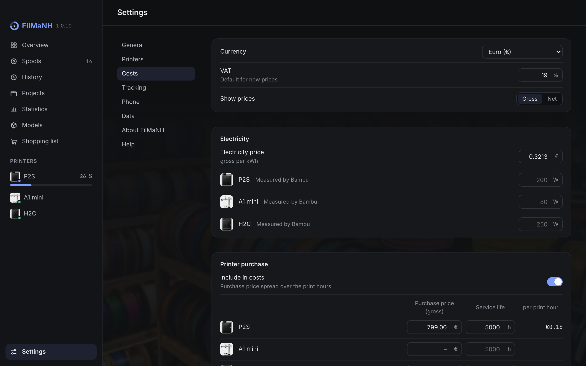

**Tracking:** threshold for “almost empty”, learn correction from weighings, humidity in statistics, create Bambu spools with RFID
automatically, keep print files (file and image, or image only), download timelapses and the maximum space print
files and timelapses may use.

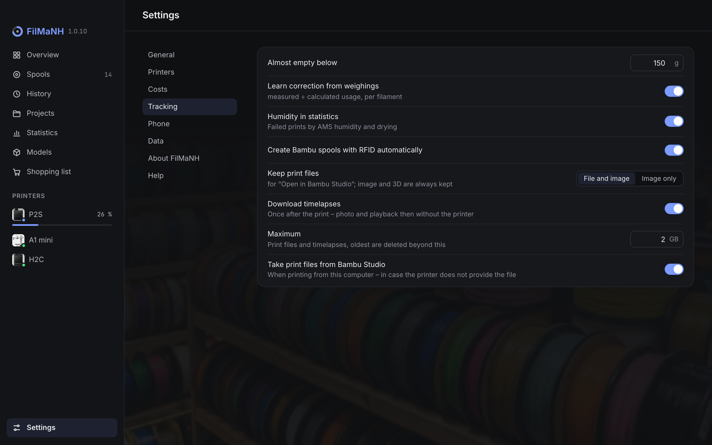

- **Download timelapses:** once after the print, as soon as the printer has finished writing it. Photo, playback
  and saving then no longer need the printer.
- **Take print files from Bambu Studio:** when you print from Bambu Studio on this computer, Bambu Studio briefly
  stores the print file and FilMaNH takes it. This way usage is booked even if the printer does not provide the
  file. Nothing to set up.
- **Humidity in statistics:** shows “Humidity and failed prints” in Statistics. FilMaNH always records the
  humidity at print start, even when the switch is off.

**Phone:** pairing with the FilMaNH app for iPhone or Android (the iPhone app is coming soon to the App Store).
**Show QR code** starts pairing: tap **Pair with computer** in the app and scan the code. You can pair as many phones
as you like; each one is listed under **Paired devices** and can be removed there with **Remove**. The connection stays
on your home network and is encrypted. When you pair for the first time, macOS or Windows asks whether FilMaNH may
accept connections: **Allow** (on Windows for private networks). On Windows, the **Windows Firewall** row shows
whether the phone app gets through; if not, **Allow** sets that up.

As long as no phone is paired, **Phone app** appears at the bottom of the sidebar: a click shows what the apps do,
with a QR code to download the Android app. **Hide** removes the hint.

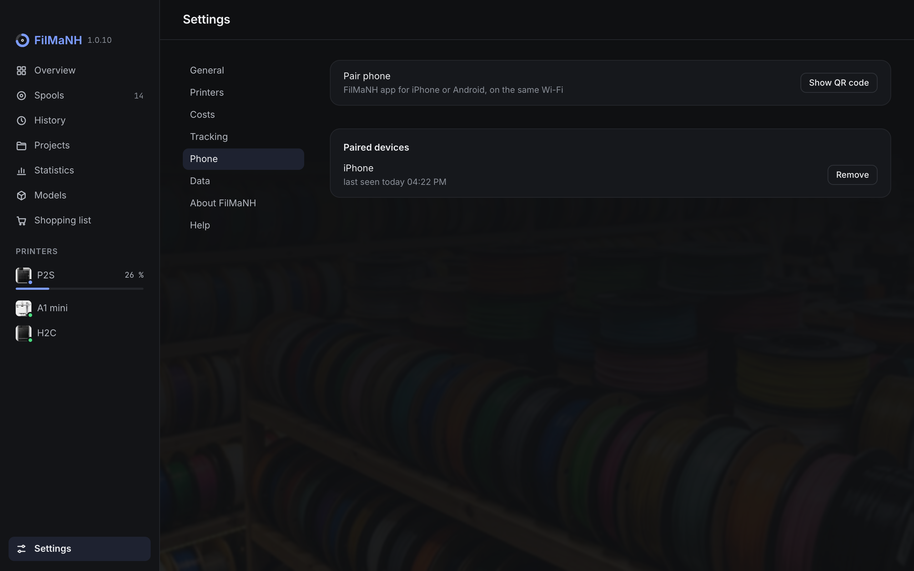

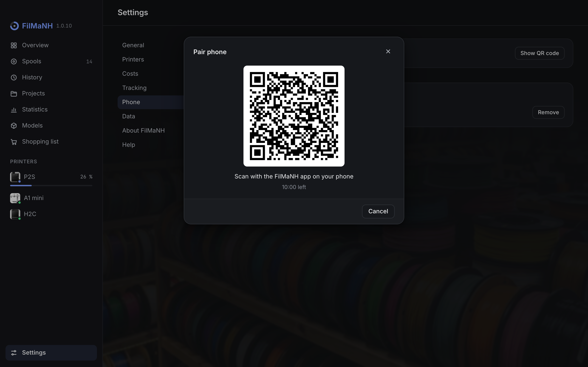

What the apps can do is described in the handbooks for [iPhone](iphone.md) and [Android](android.md).

**Data:**

- **Backup:** daily and automatic, the last 14; **Back up now** creates one right away, **Open folder** shows them.
  **Restore …** brings a backup back, and FilMaNH then restarts.
- **Export** of all data as JSON; **Import** replaces the current data, which is kept as a backup.
- **Print history** as CSV with all costs, net and gross; **Data folder** › **Open** shows the app’s folder.
- Backup and export contain the database: spools, bookings, prints and settings – not photos, print files, 3D views,
  timelapses and source files. Those are in the data folder (`drucke`, `fotos`, `modelle`); copy it along when moving
  to another computer.
- **Import from Spoolman** reads spools from a Spoolman server (enter the address, **Check**) or a Spoolman export
  file (**File …**). First it shows what was found, then a second click imports the new spools. Archived spools and
  spools with a diameter other than 1.75 mm are left out; importing again creates no duplicates.

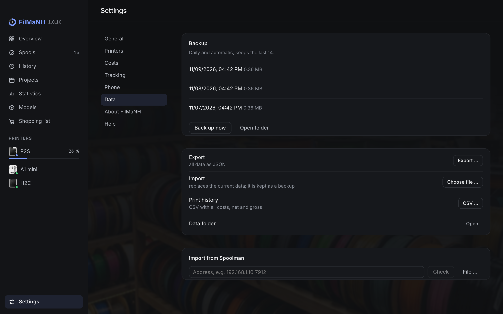

**About FilMaNH:** version, filament catalog with its date (**Update** loads the latest), updates, **Diagnostics ›
Copy** (for support, without serial numbers, addresses and codes), licenses. The installed version is also shown at
the top of the sidebar; it turns red when an update is available.
**GitHub › Open** takes you to the project page; **Recommend › Copy link** puts its link on the clipboard – to share wherever you like.

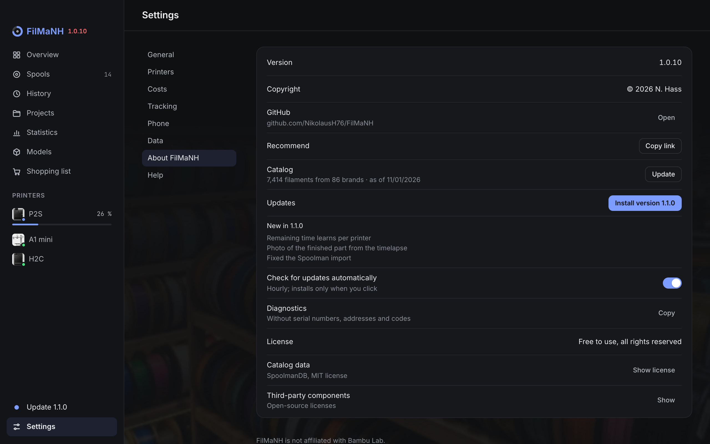

**Updates:** With **Check for updates automatically** (on by default) FilMaNH checks for a new version every hour;
**Check for updates** checks right away. If there is one, **Update …** appears in the sidebar and **New in …** shows
what changes; **Install version …** downloads, verifies, installs and restarts. Nothing is installed without your
click.

**Help:** this handbook in the app’s language, plus the handbooks of the phone apps, with search across all chapters.
**F1** opens it from anywhere.

## 14. Running in the background

Closing the window doesn’t quit FilMaNH – prints keep being tracked (Settings › General › **Keep running when
closed**, on by default).

- **macOS:** icon at the top right of the menu bar. During a print it shows a spool in the colour of the filament
  being printed, with the progress next to it; when several printers print, there is one spool per printer and the
  percentages in the same order. Quit completely with ⌘Q or **Quit** in the icon’s menu.
- **Windows:** icon at the bottom right in the notification area, during a print in the colour of the filament (one
  spool per printer); the tooltip lists all printers with progress. Windows 11 first puts new icons under the **^**
  arrow; you can drag it from there onto the taskbar. Quit completely with **Quit** in the icon’s menu (right-click).

With **Launch at login** (Settings › General) FilMaNH starts in the background right after you log in.

## 15. Keyboard and scanner

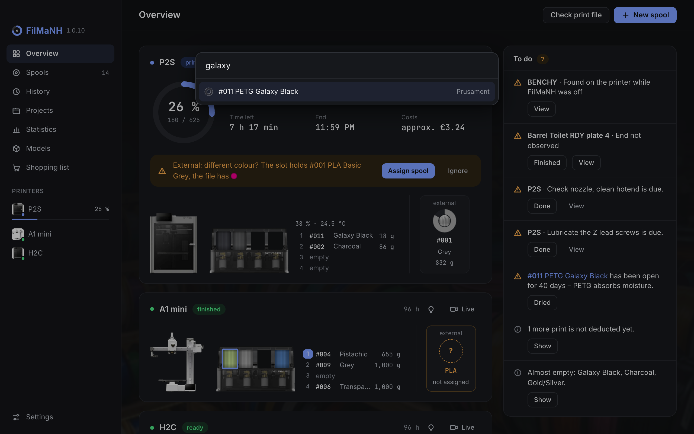

- **⌘K** (Mac) or **Ctrl+K** (Windows): search spools, printers, prints, models and commands.
- **F1**: [help](#13-settings).
- **⌘[** or **⌘←** (Mac) or **Alt+←** (Windows), the back button of the mouse or the arrow before the page title: one
  step back along the way you came; **⌘]** or **Alt+→** or the forward button of the mouse goes forward again.
- Drop a `.gcode.3mf` onto the window: check print file. Drop images onto a print or project: add them as photos.
  Drop files onto a model: attach them as source files.
- A barcode scanner reading the QR code of a FilMaNH label opens that spool directly.
- Scanning the EAN of a spool or its box opens **New spool** – for a known EAN with the filament already selected.

## 16. Data and privacy

- All data stays on your computer, including print files, photos and timelapses, in the app’s data folder
  (Settings › Data › **Data folder** › **Open**).
- With **Take print files from Bambu Studio**, FilMaNH reads the print files Bambu Studio stores while printing on
  this computer – nothing else.
- No account, no cloud. FilMaNH reads from the printers and never controls them – except the chamber light, which it
  switches only when you click or as you set it. On a printer's storage it only deletes files you select under
  **Storage** and confirm. Access codes are stored in the system keychain.
- The camera image (**Live**) only comes on a click, directly from the printer into the window, and is not saved.
- As long as a phone is paired or the pairing QR code is open, FilMaNH accepts encrypted connections on your local
  network (port 47474, or one of the next nine if it is in use); only paired phones get any data. Once no phone is
  paired any more, the service stops after a few minutes. Nothing goes to the internet.
- FilMaNH only goes online to check for updates, to update the catalog (when you click), for a Spoolman import if
  you start one, and for a shop link when you paste one or scan it with your phone (then FilMaNH fetches exactly that
  page – never an address on your own network).

The full privacy statement for the program and the apps: [DATENSCHUTZ.md](../DATENSCHUTZ.md) (German and English).

## 17. FAQ

**The printer isn’t found.** Is it switched on and on the same network? If it is on a different subnet, enter the
subnet (“also in subnet”) or the IP address under Settings › Printers. If a printer from that subnet is already set
up, FilMaNH searches there automatically.

**A printer shows “connecting …” although it is switched on.** Printers accept only a few direct connections from the
network at the same time. These include Bambu Studio or Orca Slicer (when they are connected directly to the
printer), Home Assistant and similar programs – but not the Bambu Handy app, which goes through Bambu’s cloud.
FilMaNH keeps trying by itself and catches up on the print once it is connected again; the print itself is not
affected. If it stays that way, close another connected program or update the printer’s firmware.

**“macOS denies FilMaNH access to the local network”.** System Settings › Privacy & Security › **Local Network**: turn
on FilMaNH (the **Open System Settings** button on the overview takes you there), then restart FilMaNH. If it is
already on, switch it off and on once.

**The printer got a new IP address.** If a printer is unreachable for a few minutes, FilMaNH looks for it on the
network itself and connects to the new address. If that doesn’t work: under Settings › Printers **Search network** and
**Use new address**, or enter the new IP address and **Update** – name, assignments and history are kept.

**“Wrong access code”.** The code on the printer has changed (e.g. after a reset). Under Settings › Printers enter
the IP address and the new code and click **Update** – assignments and history are kept.

**Do I have to switch on LAN-only mode or developer mode on the printer?** No. Only the video under **Live** needs
**LAN Mode Liveview** on (see [Printers](#6-printers)).

**Live shows no image.** “Video over LAN is off on the printer”: switch on **LAN Mode Liveview** at the printer.
“Camera busy”: close other live views, e.g. in Bambu Studio. If there is a firewall between computer and printer,
ports 322 and 6000 must be open.

**The stock is off.** Weigh the spool. Over time FilMaNH learns from your weighings and calculates more precisely.

**The costs say “Price missing”.** A spool of the print has no price. Enter it under Spool › Edit; FilMaNH then
recalculates the costs of prints already deducted.

**My computer was off or asleep during a print.** FilMaNH catches up on the print when it wakes up or starts next and
deducts it – even if the printer has been switched off in the meantime.

**How do I get a photo of the finished part?** Switch on the timelapse in Bambu Studio when sending the print – it
is set for each print (**Print plate › Timelapse**).
If the printer records with its camera, you get the photo even without a timelapse. Otherwise add your own photos in
the print details.

**Something doesn’t work.** On GitHub, fill in the form **Fehler melden / Report a bug** under
[Issues](https://github.com/NikolausH76/FilMaNH/issues/new/choose). The diagnostics help: in the app under Settings ›
About FilMaNH › **Diagnostics** › **Copy**, then paste them into the form – without serial numbers, addresses and
codes. The diagnostics also include the end of the error log (connection errors, prints not deducted, crashes), again
without serial numbers, addresses or print names. The log itself is `fehlerprotokoll.log` in the data folder.

---

© 2026 N. Hass. FilMaNH is an independent project and not affiliated with Bambu Lab.
