# FilMaNH for Android – Handbook

*[Deutsch](../handbuch/android.md) · English · [Handbook for the computer](README.md)*

The Android app works together with FilMaNH on your computer: scan spools, put them in slots, weigh, photograph and
edit them. The data stays on the computer. The phone only connects to it on your home network, encrypted.

1. [Installing](#1-installing)
2. [Pairing](#2-pairing)
3. [Printers](#3-printers)
4. [Spools](#4-spools)
5. [New spool](#5-new-spool)
6. [Scan](#6-scan)
7. [Settings](#7-settings)
8. [FAQ](#8-faq)

---

## 1. Installing

- Android 9 or later.
- On the phone, download **[FilMaNH-Android.apk](https://github.com/NikolausH76/FilMaNH/releases/latest/download/FilMaNH-Android.apk)** – or scan the QR code on the
  [main page](../README.en.md#download) with your phone.
- Open the file. The first time, Android asks whether the browser or the Files app may install apps: allow it, then
  **Install**.
- Updates: install the new APK the same way. Pairing and settings are kept. From app version 1.1.3 on, the app shows
  **New app version … – tap to download** below the top bar as soon as FilMaNH on the computer belongs to a newer app
  (also in the settings: **Download app version …**). Tapping it downloads the APK in the browser. The app itself does
  not go online for this – it learns it from the computer.

On the computer: FilMaNH 0.5 or later is running (the window may be closed), and **Settings › iPhone** is switched on
(off by default). The section is called “iPhone” on the computer but applies to Android too. Phone and computer are on
the same Wi-Fi.

## 2. Pairing

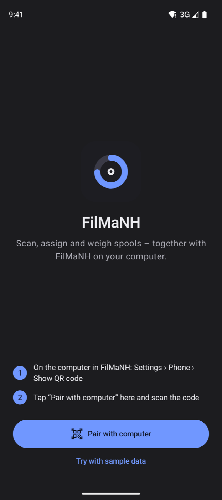

1. On the computer in FilMaNH: **Settings › iPhone › Show QR code**.
2. On the phone, tap **Pair with computer**, scan the code and confirm with **Pair**. The first time, Android asks for
   camera access: allow it.

The phone's camera app can read the code too; the link opens FilMaNH straight to the confirmation.

**Try with sample data** shows the app without a computer, with made-up spools; changes are not saved.

## 3. Printers

  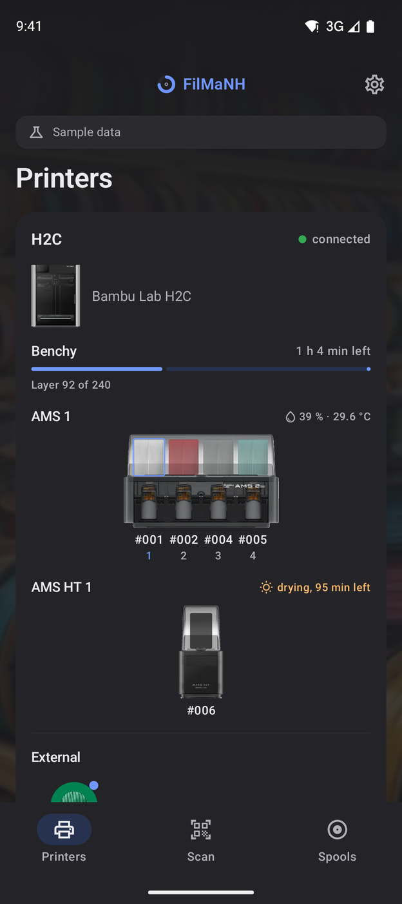
  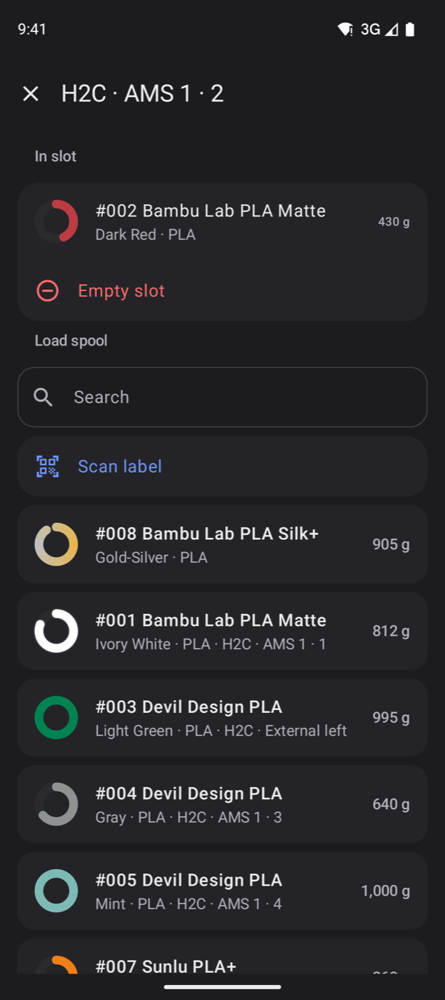

All printers with state, current print, time left and layer. Below, each AMS with slots 1–4 and its humidity (while
drying, the time left), then the external spool (left/right on H2D and H2C).

A slot opens the picker: **In slot** shows the spool, **Empty slot** takes it out. Under **Load spool** matching
spools come first (same material as the printer reports for the slot, then spools not loaded anywhere), or **Scan
label** and pick the spool by its QR code.

## 4. Spools

  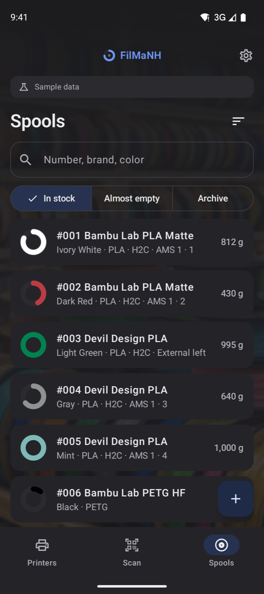
  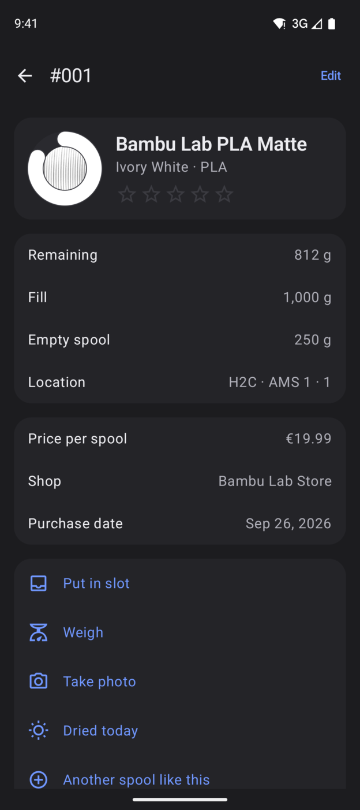
  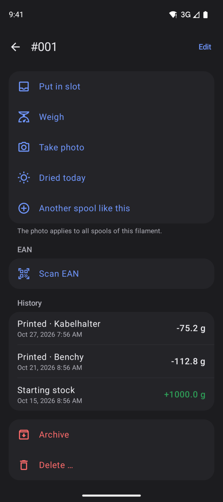

Search by number, brand and color; filters **In stock**, **Almost empty** and **Archive**. The icon at the top right
sorts by number, remaining or brand.

A spool shows remaining, fill, empty spool, location, price, shop and purchase date, and the **History** of all
bookings. The stars rate the filament; tapping the same star again clears the rating. Below:

- **Put in slot** – pick printer and slot.
- **Weigh** – see below.
- **Take photo** – the photo applies to all spools of this filament.
- **Dried today** – resets the humidity timer.
- **Another spool like this** – new spool of the same filament.
- **Scan EAN** – remember the spool's barcode; tapping an EAN removes it.
- **Archive** – put an empty spool away.
- **Delete …** – remove a spool created by mistake; only works without deducted prints (FilMaNH 0.7 or later).

### Weigh

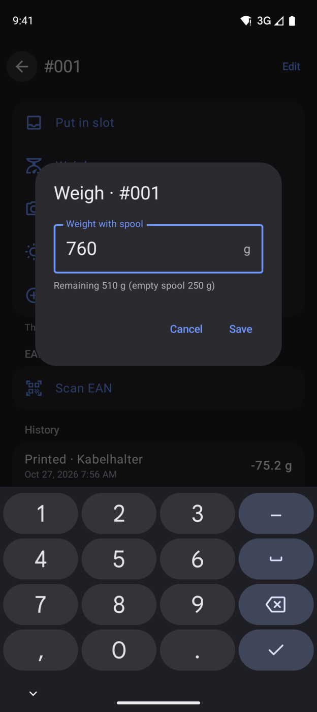

Weigh the spool including the reel and type in the weight. FilMaNH subtracts the empty weight and shows the remaining
amount right away.

### Edit

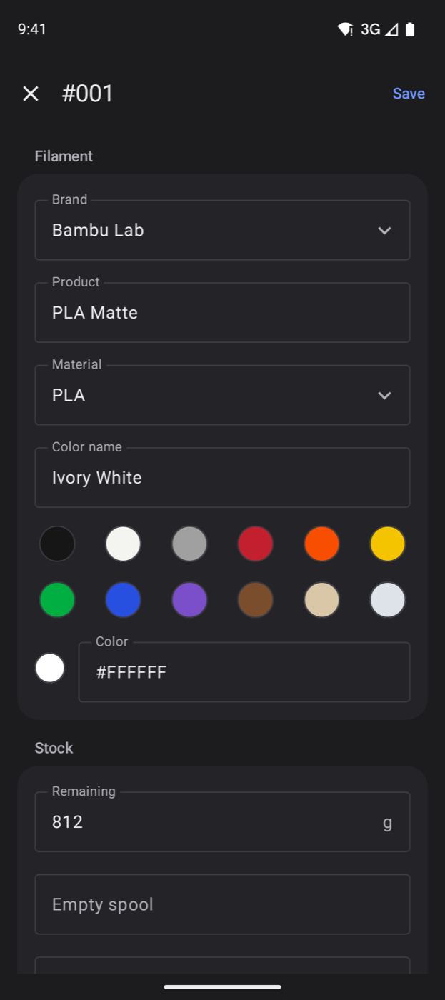

**Edit** at the top right. Brand, product, material, color name and color apply to the filament, i.e. to all spools
of this kind. The color comes from the color library (Standard, Matte, Silk, Galaxy, Transparent, Multicolor) or
is set by hand; **+** adds colors for gradient and multicolor filament. Also remaining, empty spool, location, minimum stock, price (gross or net), VAT, shop, purchase date,
**Opened on**, batch and note.

## 5. New spool

  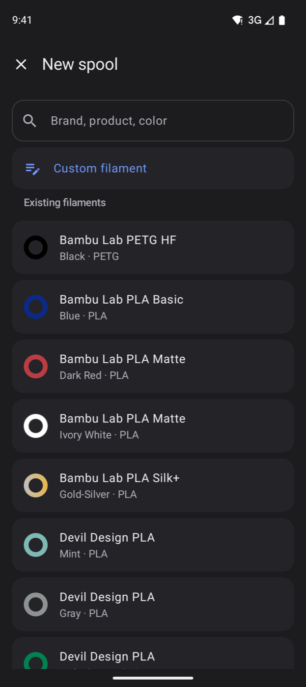
  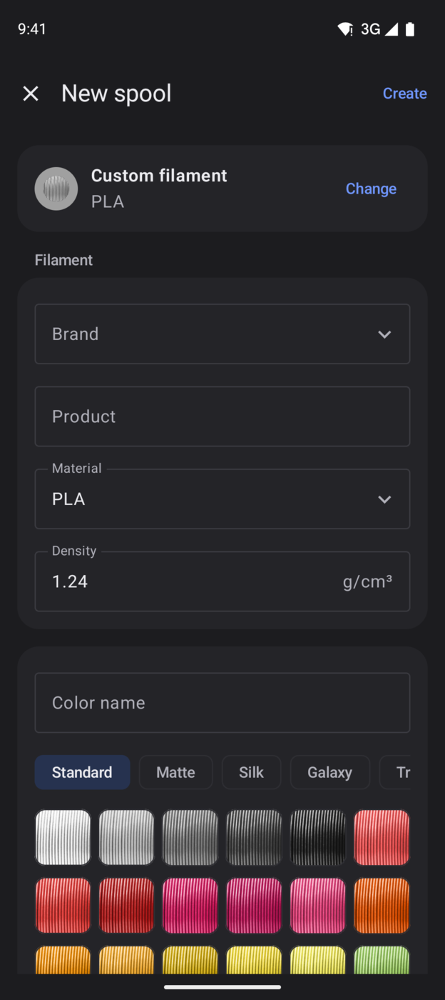

**+** at the bottom right of the spool list. The search covers the computer's catalog (brand, product, color).
**Custom filament** to enter it yourself (color as when editing), below it the **Existing filaments**. Then fill, purchase, location and
quantity, then **Create**.

The computer prints the label: its spool list shows **Missing labels** with all new spools (FilMaNH 0.6 or later).

## 6. Scan

The **Scan** section recognises:

- **FilMaNH label** (QR code) – opens the spool.
- **EAN** (barcode on spool or box) – shows the spools with this EAN. Then **Create new spool** or **Create another
  spool**, **Assign to existing spool** or **Continue on the computer**: there, **New spool** opens with the EAN.
- **Link** (e.g. a product page) – **Send to computer** opens **New spool** there, and FilMaNH reads name, price and
  shop from the page.
- **Pairing code** – pairs with the computer.

## 7. Settings

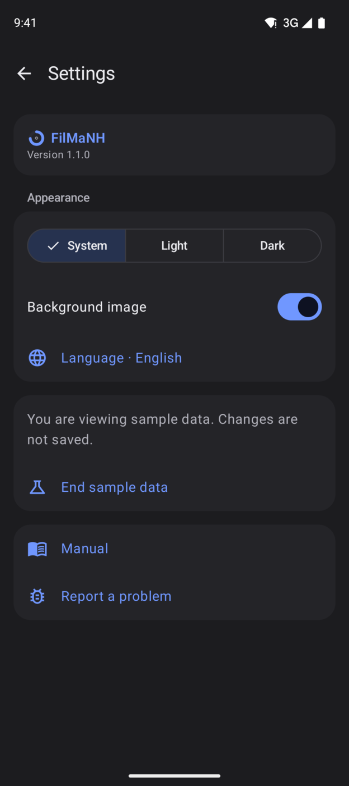

Gear at the top right.

- **Appearance:** System, Light or Dark. **Background image** on or off.
- **Language:** English or German; a tap opens Android's language setting for FilMaNH.
- **Computer:** name, status and address. **Pair again** replaces the pairing, **Unpair** removes it. On the
  computer, the phone can also be removed under **Settings › iPhone** (**Remove**).
- **Manual** and **Report a problem**.

## 8. FAQ

**"Computer not reachable"?** FilMaNH must be running on the computer, **Settings › iPhone** must be on, and the phone
must be on the same Wi-Fi.

If FilMaNH runs on a **Windows PC**, the Windows Firewall often blocks it: on the computer, under **Settings › iPhone**,
click **Allow** next to **Windows Firewall** and confirm the Windows prompt.

**Does it work away from home?** No. The app only talks to the computer on your home network; nothing goes to the
internet.

**Why not from Google Play?** The app comes as a file to install first. Google Play is planned.

**Several phones?** Yes, each one is paired separately.
