# FilMaNH for iPhone – Handbook

*[Deutsch](../handbuch/iphone.md) · English · [Handbook for the computer](README.md)*

The iPhone app works together with FilMaNH on your computer: scan spools, put them in slots, weigh, photograph and
edit them. The data stays on the computer. The iPhone only connects to it on your home network, encrypted. The app is
coming soon to the App Store.

1. [Requirements](#1-requirements)
2. [Pairing](#2-pairing)
3. [Printers](#3-printers)
4. [Spools](#4-spools)
5. [New spool](#5-new-spool)
6. [Scan](#6-scan)
7. [Settings](#7-settings)
8. [Widget](#8-widget)
9. [FAQ](#9-faq)

---

## 1. Requirements

- FilMaNH runs on the computer (Mac or Windows). The window may be closed.
- An iPhone with iOS 17 or later on the same Wi-Fi as the computer.

## 2. Pairing

  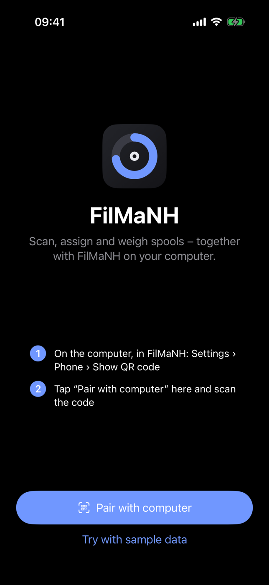
  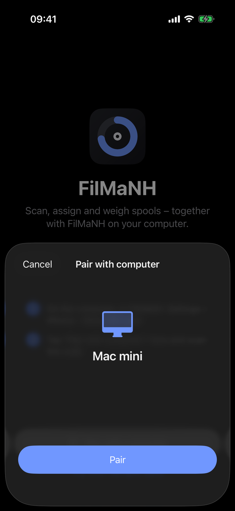

1. On the computer in FilMaNH: **Settings › Phone › Show QR code**.
2. On the iPhone, tap **Pair with computer**, scan the code and confirm with **Pair**.
3. The first time, iOS asks about the camera and the **local network**: allow both. Without the local network the
   iPhone cannot find the computer.

The iPhone’s Camera app can read the code too; the link opens FilMaNH straight at the confirmation.

**Try with sample data** shows the app without a computer, with made-up spools; changes are not saved.

## 3. Printers

  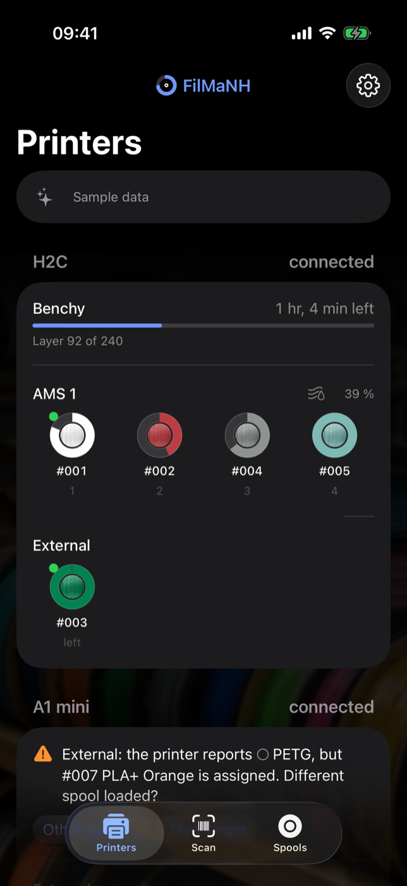
  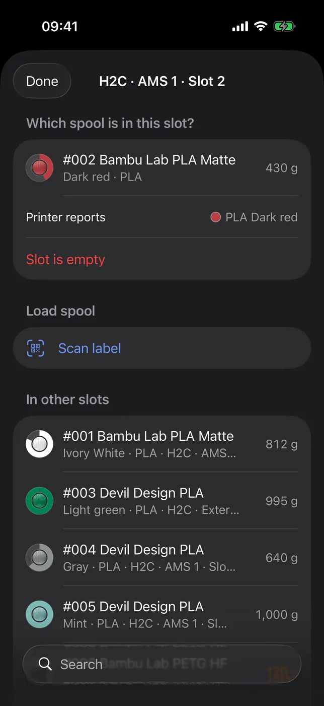
  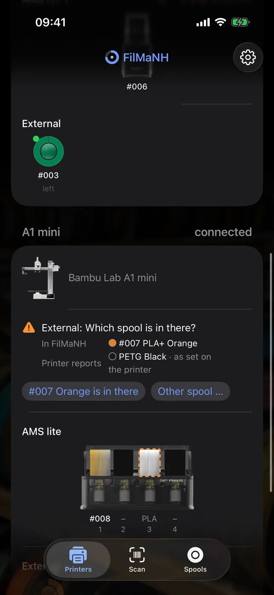

All printers with picture, connection and the current print with layer and time left. Below, each AMS as a
picture: every spool in its colour in its window, the loaded slot marked, a slot with filament but no assigned spool
dashed; under each window the spool number or the reported material. Plus humidity and temperature (while drying, the
time left), then the external spool (left/right with two nozzles, as on H2D and H2C).

A slot opens the picker: **In slot** shows the spool, **Empty slot** takes it out. Under **Load spool** matching
spools come first (same material as the printer reports for the slot, then spools not loaded anywhere), with a search
– or **Scan label** and pick the spool by its QR code (an EAN works too if it belongs to exactly one spool).

If a slot doesn’t match what the printer reports, a notice appears on the printer’s card while it is connected – as
on the computer (see [Matching with the printer](README.md#matching-with-the-printer)): **Yes**, **Other …**,
**Assign**, **Assign #…**, **Other spool …**, **That’s right**, **Yes, removed** or **Still there**.

## 4. Spools

  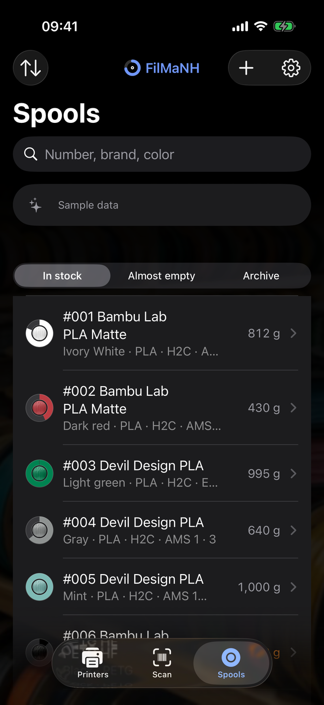
  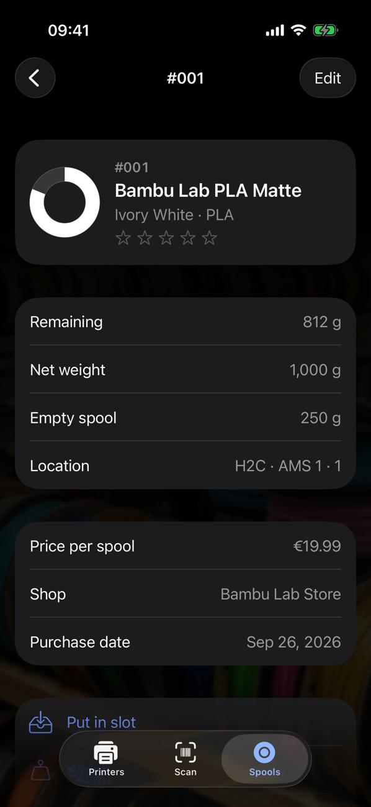
  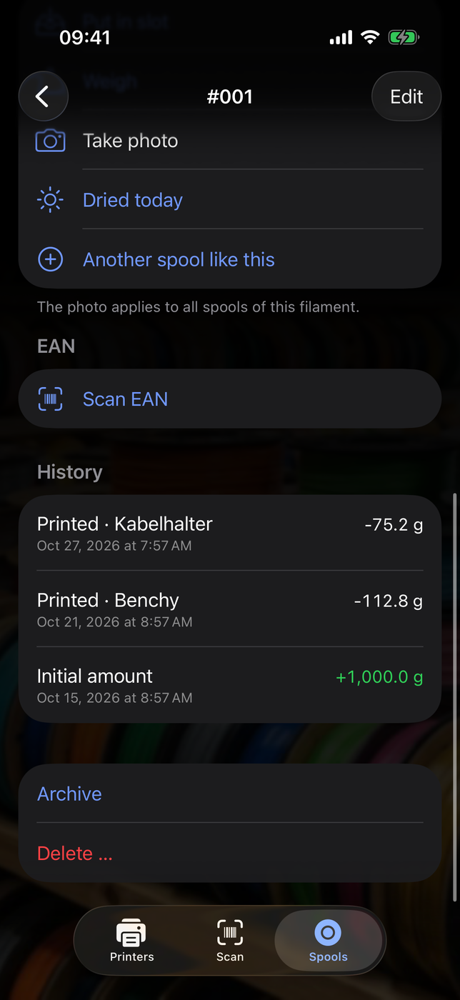

Search by number, brand, colour, material and product; filters **In stock**, **Almost empty** and **Archive**. The
arrows at the top left sort by number, remaining or brand.

A spool shows remaining, fill, empty spool, location, when it was last weighed and dried, price, shop, purchase date,
opening date, batch and note, plus the **History** of bookings (the latest; **Full history** shows all). The stars
rate the filament; tapping the same star again clears the rating. Below:

- **Put in slot** – pick printer and slot.
- **Weigh** – see below.
- **Take photo** – the photo applies to all spools of this filament; **Remove photo** takes it away again.
- **Dried today** – resets the humidity timer.
- **Another spool like this** – new spool of the same filament.
- **Scan EAN** – remember the spool's barcode; tap an EAN to remove it.
- **Archive** – put the spool away; **Unarchive** brings an archived one back.
- **Delete …** – remove a spool created by mistake; only works without deducted prints.

### Weigh

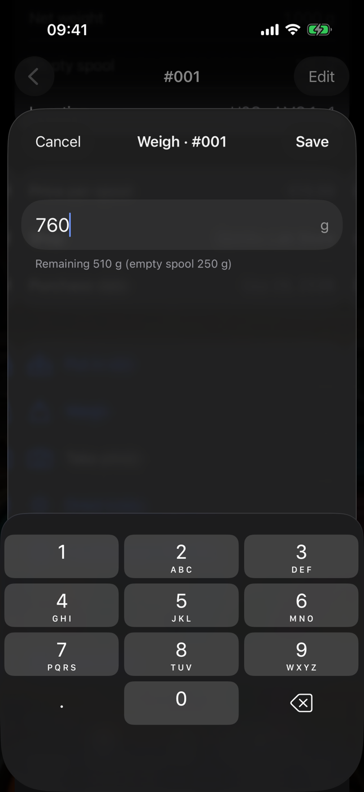

Weigh the spool including the reel and type in the weight. FilMaNH subtracts the empty weight and shows the remaining
amount right away. This needs the empty spool weight – if it is missing, enter it under **Edit** at **Empty spool**.

### Edit

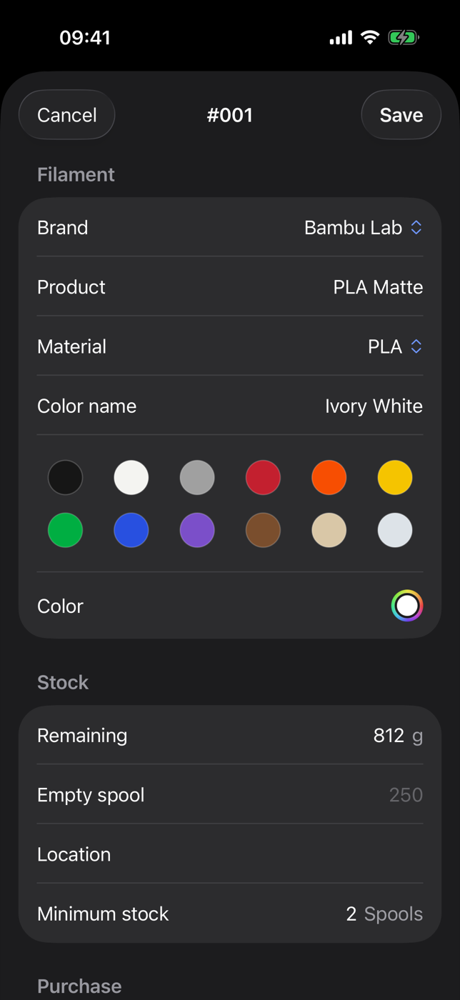

**Edit** at the top right. Brand, product, material, colour name and colour apply to the filament, i.e. to all spools
of this kind. The colour comes from the colour library (Standard, Matte, Silk, Galaxy, Transparent, Multicolor) or
is set by hand; **+** adds colours for gradient and multicolour filament. Also remaining, empty spool, storage location, minimum stock, price (gross or net), VAT, shop, purchase
date, **Opened on**, batch and note. If the price of a spool that has already been printed with changes,
**Recalculate costs of past prints with the new price** recalculates those as well.

## 5. New spool

  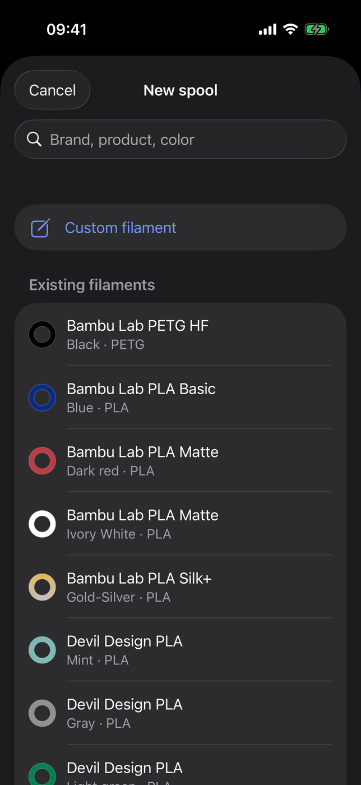
  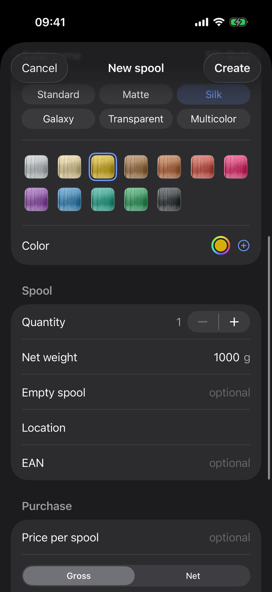

**+** at the top right. The search covers your existing filaments and the computer's catalog (brand, product,
colour). **Custom filament** to enter it yourself (colour as when editing), below it the **Existing filaments** and
the **Catalog**. Then fill, empty spool, price, purchase, location, EAN and count, then **Create**.

The computer prints the label: its spool list shows **Missing labels** with all new spools.

## 6. Scan

The **Scan** tab recognises:

- **FilMaNH label** (QR code) – opens the spool.
- **EAN** (barcode on spool or box) – shows the spools with this EAN. Then **Create another spool** and **Assign to
  another spool**, for a new EAN **Create new spool** and **Assign to existing spool** – or **Continue on the
  computer**: there, **New spool** opens with the EAN.
- **Link** (e.g. a product page) – **Send to computer** opens **New spool** there, and FilMaNH reads name, price and
  shop from the page.
- **Pairing code** – pairs with the computer.

## 7. Settings

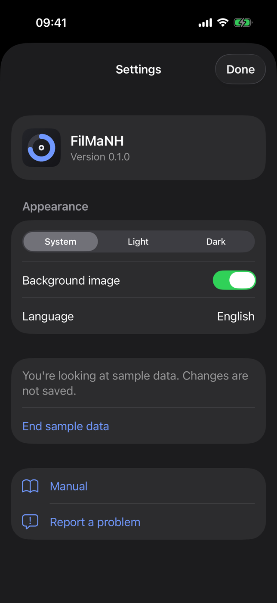

Gear at the top right. The app version is shown at the top.

- **Appearance:** System, Light or Dark. **Background image** on or off.
- **Language:** Deutsch, English, Español, Français, Italiano, Nederlands, Polski – as the iPhone, otherwise English; a tap opens the iOS settings for FilMaNH.
- **Computer:** name, status, FilMaNH version and address. **Pair again** replaces the pairing, **Unpair** removes
  it. On the computer, an iPhone can also be removed under **Settings › Phone** (**Remove**). If the computer can’t be
  reached, **Allow “Local Network”** leads to the iOS setting.
- With sample data: **End sample data**.
- **Manual** and **Report a problem**.

## 8. Widget

The **Prints** widget (app version 1.2 and later) comes in small and medium for the home screen and for the lock
screen. It shows the running prints with printer, progress, the expected end (“done at 5:54 PM”) and a dot in the
colour of the spool currently printing – small shows one print or up to three in brief, medium up to three. On the
lock screen it shows the first print as a line or as a ring with the percentage. To add
it: touch and hold the home screen › **Edit** › **Add Widget** › **FilMaNH**. Tapping the widget opens the app.

The widget fetches the status from the computer itself, only on your home network. iOS decides how often; the app
updates it right away when it has new data. Without a connection it shows the last status with its time, for up to
12 hours.

## 9. FAQ

**"Computer not reachable"?** FilMaNH must be running on the computer, and the iPhone must be on the same Wi-Fi. In the iOS settings under FilMaNH, **Local Network** must be allowed.
Until then the app shows the last status with its time; changes only work again once the computer can be reached.

**“The app and FilMaNH on the computer don’t match”?** Update the app and FilMaNH on the computer to the latest
version.

If FilMaNH runs on a **Windows PC**, the Windows Firewall often blocks it: on the computer, under **Settings › Phone**,
click **Allow** next to **Windows Firewall** and confirm the Windows prompt.

**Does it work away from home?** No. The app only talks to the computer on your home network; nothing goes to the
internet.

**Several iPhones?** Yes, each one is paired separately.
