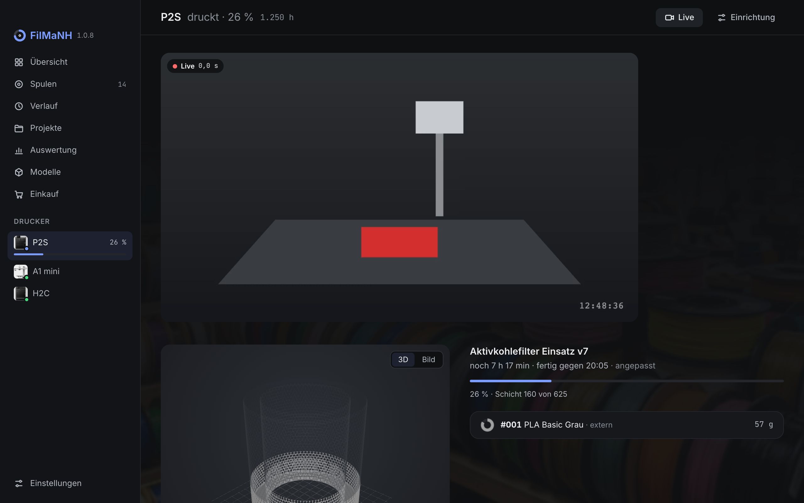
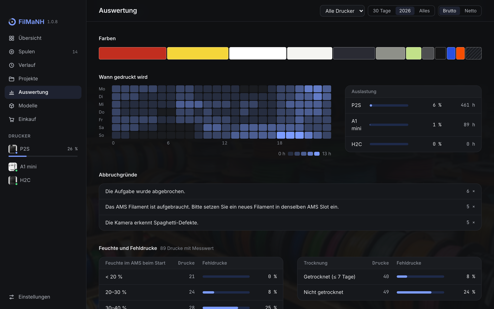
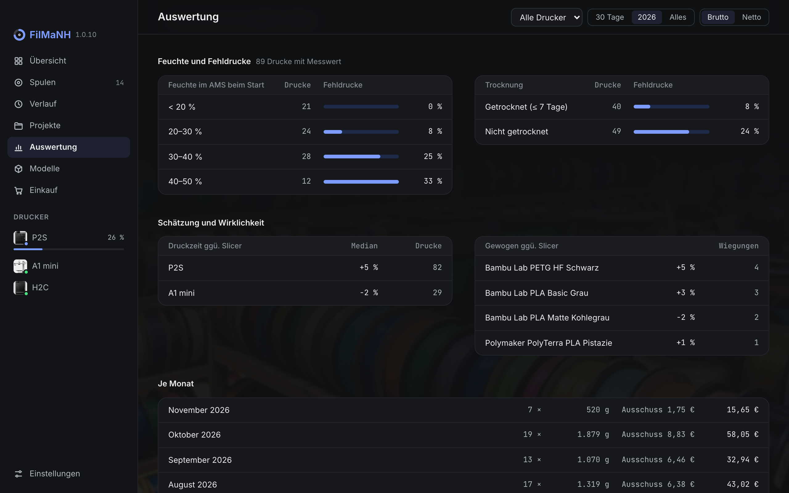

# FilMaNH – Handbuch

*Deutsch · [English](../handbook/README.md) · [iPhone-App](iphone.md) · [Android-App](android.md)*

FilMaNH verwaltet deine Filamentspulen und bucht den Verbrauch jedes Drucks automatisch ab. Das Programm läuft
lokal auf deinem Rechner und liest die Bambu-Lab-Drucker im Netzwerk aus; auf einem Drucker löscht es nur Dateien,
wenn du es bestätigst.

1. [Installation](#1-installation)
2. [Ersteinrichtung](#2-ersteinrichtung)
3. [So arbeitet FilMaNH](#3-so-arbeitet-filmanh)
4. [Übersicht](#4-übersicht)
5. [Spulen](#5-spulen)
6. [Drucker](#6-drucker)
7. [Druckdatei prüfen](#7-druckdatei-prüfen)
8. [Verlauf](#8-verlauf)
9. [Projekte](#9-projekte)
10. [Modelle](#10-modelle)
11. [Auswertung](#11-auswertung)
12. [Einkauf](#12-einkauf)
13. [Einstellungen](#13-einstellungen)
14. [Im Hintergrund](#14-im-hintergrund)
15. [Tastatur und Scanner](#15-tastatur-und-scanner)
16. [Daten und Datenschutz](#16-daten-und-datenschutz)
17. [Häufige Fragen](#17-häufige-fragen)

---

## 1. Installation

Download unter [Releases](https://github.com/NikolausH76/FilMaNH/releases/latest).

**macOS** (Apple Silicon und Intel): `FilMaNH_…_universal.dmg` öffnen und FilMaNH in den Ordner „Programme“
ziehen. Die App ist von Apple geprüft (notarisiert); beim ersten Öffnen nur bestätigen, dass die aus dem Internet
geladene App geöffnet werden soll. Nicht direkt aus dem DMG starten – dort lassen sich keine Updates einspielen.
Läuft FilMaNH doch einmal aus dem DMG, bietet die Übersicht **In Programme verschieben** an.

**Windows 10/11** (64 Bit): `FilMaNH_…_x64-setup.exe` starten. Bei „Der Computer wurde durch Windows geschützt“:
**Weitere Informationen › Trotzdem ausführen**. Administratorrechte sind nicht nötig.

Rechner und Drucker müssen im selben Netzwerk erreichbar sein. Am Drucker muss nichts umgestellt werden. FilMaNH
verbindet sich mit den Ports 8883 (Zustand) und 990 (Druckdateien) des Druckers, für das Kamerabild mit 322 (Video)
bzw. 6000 (Einzelbilder) – liegt eine Firewall dazwischen, müssen sie offen sein.

## 2. Ersteinrichtung

Beim ersten Start sucht FilMaNH die Drucker im Netzwerk und fragt für jeden einzeln, ob er hinzugefügt werden soll.

- **Zugangscode:** Ist Bambu Studio auf dem Rechner eingerichtet, übernimmt FilMaNH den Code von dort. Sonst steht
  er am Drucker unter **Einstellungen › WLAN**.
- **Kaufpreis** (optional): für die Maschinenkosten, siehe [Einstellungen](#13-einstellungen).
- **Kein Drucker gefunden:** Liegt der Drucker in einem anderen Netz (z.B. einem eigenen Netz für Smart-Home-Geräte),
  das Netz wie `192.168.2` oder die IP-Adresse des Druckers eingeben.

Danach fragt FilMaNH, was mit den Drucken passieren soll, die schon auf der Speicherkarte liegen:

- **Ab jetzt beginnen:** Alte Drucke bleiben außen vor.
- **Frühere Drucke in den Verlauf übernehmen:** Sie erscheinen im Verlauf und unter Modelle, es wird aber nichts
  von Spulen abgebucht, und in der Auswertung zählen sie nicht.

Zum Schluss fragt FilMaNH nach dem **Strompreis** je kWh (für die Stromkosten der Drucke) und ob es **mit dem Rechner
starten** soll – empfohlen, so verfolgt FilMaNH jeden Druck.

Die Einrichtung lässt sich mit **Später einrichten** überspringen und unter Einstellungen › Drucker nachholen.

## 3. So arbeitet FilMaNH

- Jede Spule hat eine Nummer (#001, #002 …) und einen Restbestand.
- Steckt eine Spule im AMS oder am externen Halter, ist sie diesem Slot zugeordnet. **Bambu-Spulen mit RFID** legt
  FilMaNH beim Einlegen selbst an. Bei allen anderen fragt es einmal, welche Spule das ist.
- **Am Ende jedes Drucks** liest FilMaNH aus der Druckdatei, wie viel Filament aus welchem Slot verbraucht wurde,
  und bucht es von der Spule ab, das Spülen beim Farbwechsel eingeschlossen. Bei einem Abbruch wird nur bis zur
  erreichten Schicht gebucht.
- **War der Rechner aus oder im Ruhezustand**, holt FilMaNH beim Aufwachen bzw. nächsten Start nach, was der Drucker in
  der Zwischenzeit gedruckt hat. Ist der Drucker dann nicht erreichbar, entscheidet FilMaNH aus Beginn und geplanter
  Dauer: Ist das erwartete Ende deutlich vorbei, wird gebucht; meldet der Drucker später anderes, wird korrigiert.
  Was sich nicht sicher klären lässt, erscheint als Hinweis und wird mit einem Klick bestätigt.
- **Nicht gebucht?** Ist ein Druck vorbei, aber nicht gebucht (z.B. weil keine Spule zugeordnet war), steht oben auf
  jeder Seite ein rotes Banner **Nicht gebucht**, bis es erledigt ist, und es kommt eine Mitteilung.
- **Wiegen** macht den Bestand genau. Aus den Wiegungen lernt FilMaNH, wie stark der echte Verbrauch je Filament
  von der Berechnung abweicht, und rechnet das ab der zweiten Wiegung ein (abschaltbar unter Einstellungen ›
  Erfassung).
- **„ca.“** vor einem Gewicht heißt: geschätzt, kann etwas abweichen. Wiegen macht den Wert wieder genau.

## 4. Übersicht

- **Drucker** links, druckende zuerst: beim laufenden Druck Fortschritt mit Schicht, Restzeit, Ende und geschätzte
  Kosten; Hinweise zu diesem Druck (falsches Material, andere Farbe, abrasives Filament, Spule reicht nicht) direkt
  darunter. Dann Drucker und AMS als Bild: jede Spule in ihrer Farbe, der geladene Slot markiert, ein Slot mit
  Filament, aber ohne zugeordnete Spule gestrichelt; daneben je Slot Nummer, Farbe und Rest, dazu Feuchte und
  Temperatur des AMS und eine laufende Trocknung. Abgesetzt die externe Spule. Ein Klick auf den Drucker öffnet ihn.
  Rechts im Kopf der Karte: die Druckstunden gesamt und **Live** (siehe [Drucker](#6-drucker)).
- **Zuletzt gedruckt** mit Menge und Kosten.
- **Zu erledigen** rechts, jeweils mit der passenden Aktion:
  - Druck mit offenem Ende ([Ende offen](#ende-offen)): **Fertig gedruckt** bucht mit einem Klick, wenn alle Spulen
    des Drucks bekannt sind, sonst **Ansehen**.
  - Nicht gebuchte Drucke, auch solche, deren Druckdatei nicht zu bekommen war.
  - Slots, die nicht zur Meldung des Druckers passen ([Abgleich mit dem Drucker](#abgleich-mit-dem-drucker)).
  - Fällige [Wartung](#wartung) mit **Erledigt**.
  - Spulen im Drucker, die zu lange offen sind ([Feuchte](#feuchte)), mit **Getrocknet**.
  - Spulen im Drucker ohne Preis mit **Preis eintragen** – erst, sobald irgendeine Spule einen Preis hat.
  - Bambu-Spulen, deren Rest laut RFID um 15 Prozentpunkte oder mehr vom berechneten abweicht: **Wiegen** oder
    **Ignorieren**. In den letzten 7 Tagen gewogene Spulen bleiben außen vor.
  - Fast leere Spulen; **Anzeigen** öffnet sie in der Spulenliste.

## 5. Spulen

Filter nach Zustand (Voll, Angebrochen, Fast leer, Leer, Archiv), Material, Hersteller und Lagerort; Suche,
Ansicht als **Raster** oder **Liste**. **Etiketten** druckt Etiketten für alle angezeigten Spulen. **Fehlende
Etiketten** steht da, sobald neue Spulen noch kein Etikett haben (auch am Handy angelegte), und druckt genau diese.

Die **Sortierung** (Nummer, Füllstand in beide Richtungen, Name, Hersteller, Material, zuletzt benutzt, neueste
zuerst) bleibt gespeichert. Filter und Suche bleiben, wenn du aus einer Spule zurückkommst.

### Neue Spule

Hersteller, Material oder Farbe ins Suchfeld tippen, z.B. „sunlu petg weiß“. Filamente, die du schon hast, stehen
oben unter **Vorhanden**, darunter der **Katalog** mit über 7.000 Filamenten; die Auswahl füllt Farbe, Füllmenge und
Leergewicht aus. Dazu optional Preis (brutto oder netto), Lagerort und **Anzahl**: Bei 3 entstehen drei Spulen mit
eigener Nummer. Steht ein Filament nicht im Katalog: **Ohne Katalog** und selbst eintragen.
Auch deine eigenen Filamentprofile aus Bambu Studio stehen im Katalog.

Unter **Weitere Angaben**: Füllung, **Rest jetzt** (für eine schon angebrochene Spule; leer heißt voll), leere Spule,
MwSt, Kaufdatum, Händler, Charge und EAN.

Die **Farbe** kommt dann aus über 80 Filamentfarben, sortiert nach **Standard**, **Matt**, **Seide**, **Galaxy**,
**Transparent** und **Mehrfarbig** – oder du stellst sie selbst ein. **+** fügt weitere Farben hinzu (bis zu acht),
für Verlaufs- und mehrfarbiges Filament.

Das Suchfeld nimmt auch eine **EAN** (Strichcode auf Spule oder Karton) und einen **Shop-Link**:

- **EAN:** scannen oder eintippen und Enter. Beim ersten Mal das Filament auswählen, FilMaNH merkt sich die EAN.
  Beim nächsten Mal ist das Filament schon gewählt, mit Preis und Händler der letzten Spule.
- **Shop-Link:** den Link zur Produktseite einfügen. FilMaNH liest Name, Preis und Shop von der Seite und schlägt
  passende Filamente aus dem Katalog vor; Preis (in deiner Währung) und Shop werden übernommen. Das klappt nicht bei
  jedem Shop – manche geben diese Daten nicht heraus.

Nach dem Anlegen bietet FilMaNH an, gleich das Etikett zu drucken. Bambu-Spulen mit RFID müssen nicht angelegt
werden – einlegen genügt.

### Spule im Detail

Restbestand, Ort (Slot oder Lagerort; ein Klick ändert ihn), Material, Preis, Feuchte, **Bewertung** und jede
Buchung im Verlauf. Ist der Rest nur geschätzt, steht **Seit … nicht gewogen.** mit **Wiegen** dabei. **Mehr** zeigt
Restwert und Preis je kg, Genauigkeit, Charge, wann die Spule angelegt, geöffnet und getrocknet wurde, Bambu-ID, EAN,
die gelernte **Korrektur** (wirkt ab der zweiten Wiegung), Mindestbestand und Notiz.

Ein Klick auf eine Buchung im Verlauf zeigt Quelle und Genauigkeit. Wiegungen und Korrekturen lassen sich dort mit
**Rückgängig** zurücknehmen, Drucke im Druck mit **Buchung zurücknehmen**.

Ist die Spule fast leer oder unter 30 %, listet **Reste aufbrauchen** einfarbige Modelle im selben Material, die du
schon gedruckt hast und für die der Rest noch reicht.

**Wiegen** steht oben. Im Menü **…**: Bearbeiten, Rest korrigieren, Ort ändern, Weitere Spule wie diese, Etikett
drucken, Foto hinzufügen (bzw. ändern und entfernen), Archivieren (bzw. **Zurückholen**) und Löschen. Ein **Foto**
gilt für alle Spulen dieses Filaments und zeigt die echte Farbe in der Mitte des Rings; ohne Foto steht dort die
Struktur des Filaments in seiner Farbe – glänzend bei Seide, mit Glitzer bei Galaxy.

**Löschen** entfernt eine Spule endgültig, etwa eine versehentlich angelegte. Das geht nur, solange kein Druck mit ihr
gebucht ist; sonst **Archivieren** – das behält Verlauf und Kosten.

Die **Bewertung** (1–5 Sterne) gilt für das Filament, also für alle Spulen dieser Sorte; derselbe Stern noch einmal
löscht sie. Unter **Bearbeiten** lassen sich EANs von Hand eintragen, mehrere durch Komma getrennt (z.B. mit Spule
und Refill). Dort lassen sich auch **Hersteller**, **Bezeichnung**, **Material** und **Farbe** ändern (mit derselben Farbauswahl
wie beim Anlegen); das gilt für alle Spulen dieses Filaments.

Bekommt eine Spule erst nachträglich einen **Preis**, rechnet FilMaNH die Kosten ihrer schon gebuchten Drucke damit
nach. Ändert sich ein vorhandener Preis, bleiben die bisherigen Kosten – außer mit **Kosten bisheriger Drucke mit
dem neuen Preis rechnen**.

### Wiegen

Spule samt Rolle wiegen und das Gewicht eintragen. FilMaNH zieht das Leergewicht ab und übernimmt den Rest. Ohne
Leergewicht geht das nicht – dann unter **Bearbeiten** bei **Leere Spule** eintragen. Weicht das Ergebnis deutlich
vom gerechneten Rest ab, sagt FilMaNH das (fehlt ein Druck? stimmt das Leergewicht?).

**Rest korrigieren** setzt den Rest direkt, auf Wunsch mit Grund.

### Etiketten

Auf dem Etikett: Nummer, Farbe (davor das Material, wenn es nicht schon in der Bezeichnung steht), Hersteller und
Bezeichnung, wann die Spule geöffnet wurde, und ein QR-Code mit der Nummer (abschaltbar: **QR-Code mit der
Spulennummer**). Bei ungeöffneten Spulen steht „Geöffnet“ mit einem Strich zum Eintragen von Hand. Unter **Auf dem
Etikett** kommen auf Wunsch **Drucktemperatur**
(laut Filamentkatalog, wo bekannt), **Lagerort**, **Kaufdatum**, **Preis** und **Füllmenge** in eine Zusatzzeile; das
Etikett rückt dafür etwas zusammen, eine zu lange Zeile wird gekürzt. FilMaNH merkt sich die Auswahl.

Unter **Drucken über:**

- **Brother QL per USB** (Mac, z.B. QL-570): FilMaNH druckt direkt, ohne Treiber. Unter **Format** stehen alle
  Rollen, die der Drucker kann; die eingelegte ist markiert. Passt das gewählte Format nicht zur eingelegten Rolle,
  sagt FilMaNH das und druckt nicht; nach dem Wechsel **Erneut prüfen**. Das Etikett passt sich dem Format an, die
  Vorschau zeigt genau das Druckbild.
- **Drucker des Systems:** jeder eingerichtete Drucker mit Namen und Modell, der Standarddrucker ist markiert.
  FilMaNH druckt direkt darauf, ohne weiteren Dialog – Etikettendrucker (Brother, Dymo, Niimbot, Phomemo, Zebra,
  Rollo) ebenso wie ein Bürodrucker für Etikettenbögen.
- **Druckdialog des Systems …** öffnet den gewohnten Dialog, etwa um als PDF zu sichern.

Die Vorschau zeigt alle Etiketten bzw. alle Bögen so, wie sie gedruckt werden.

Unter **Vorlage** stehen Etikettenrollen sowie A4-Bögen von Avery Zweckform und Herma und US-Letter-Bögen von Avery,
jeweils mit Bestellnummer (gleichwertige zusammengefasst), Größe und Anzahl je Bogen. Passt keine, legt
**Eigene Größe …** ein einzelnes Etikett oder einen Bogen mit Spalten, Zeilen, Rändern und Abständen an.

**Anzahl je Spule** druckt mehrere gleiche Etiketten, **Beginnen bei Etikett** nutzt angefangene Bögen weiter.
**Rahmen mitdrucken** druckt die Umrisse mit – zum Ausrichten erst auf Normalpapier. Im Druckdialog die Skalierung
auf 100 % lassen. FilMaNH merkt sich, welche Spulen ein Etikett haben.

### Feuchte

PETG, PCTG und PET zeigen nach 30 Tagen offen einen Hinweis, TPU und TPE nach 14 Tagen, PA, PPA, PC, PVA und BVOH
nach 7 Tagen. Gezählt wird ab dem Öffnen bzw. der letzten Trocknung. Steckt die Spule in einem AMS mit unter 20 %
Feuchte, gibt es keinen Hinweis. **Getrocknet** (am Hinweis oder in der Spule) setzt die Zeit zurück.

## 6. Drucker

In der Seitenleiste stehen alle Drucker, beim Drucken mit Fortschritt; ein Klick öffnet die Seite des Druckers.

Der laufende Druck in 3D in den Farben der zugeordneten Spulen – der schon gedruckte Teil voll, der Rest
durchscheinend –, dazu Fortschritt, Schicht, Restzeit und Uhrzeit des Endes. Darunter die Filamente des Drucks mit der
Spule im Slot (Nummer wie auf dem Etikett); ein Klick darauf ordnet neu zu, das Modell färbt sich sofort um. **angepasst** heißt: Dieser Drucker braucht erfahrungsgemäß länger oder kürzer, als er anzeigt, und FilMaNH
rechnet das ein. Das geschieht erst ab drei Drucken und nur, wenn es nachweislich genauer ist.

Beim Druckstart prüft FilMaNH:

- **Falsches Material oder andere Farbe** als in der Druckdatei vorgesehen, mit dem Slot. **Spule zuordnen** öffnet
  die Auswahl für diesen Slot, Vorschläge passend zur Druckdatei; **Ignorieren** blendet den Hinweis für diesen Druck
  überall aus.
- **Spule reicht nicht:** mit Uhrzeit, wann sie leer wird, und ob eine Ersatzspule im AMS steckt.
- **Abrasives Filament** (mit Kohle- oder Glasfaser, Glow) auf einer Düse aus Edelstahl oder Messing: Die Düse
  verschleißt, besser eine gehärtete. Welche Düse eingebaut ist, meldet der Drucker.

Weiter unten: Drucker und AMS als Bild. Jede Spule steht in ihrer Farbe im Fenster, auf der Zuführung das Material;
der geladene Slot ist markiert, ein Slot mit Filament, aber ohne zugeordnete Spule gestrichelt. Darunter Nummer,
Name und Rest; ein Klick auf einen Slot öffnet die [Zuordnung](#spule-zuordnen). Feuchte und Temperatur stehen auf
dem AMS, beim AMS HT in seiner Anzeige; eine laufende Trocknung mit Restzeit darüber. Ohne Verbindung zeigt FilMaNH
die gespeicherten Zuordnungen. Danach der Feuchteverlauf der letzten 7 Tage mit der letzten Trocknung und die externe
Spule. H2D und H2C haben zwei externe Halter (links und rechts); ein leerer, nicht zugeordneter wird nicht gezeigt.
Eine Spule aus **Spulen im Regal** auf einen Slot ziehen ordnet sie zu. Dazu die [Wartung](#wartung), die letzten
Drucke dieses Druckers und ganz unten Modell, Firmware und IP-Adresse. **Einrichtung** oben rechts führt zu den
Druckereinstellungen.

**Live** oben rechts zeigt das Kamerabild, solange die Seite offen ist; hängt es, steht links oben, wie alt es ist. In
der Übersicht öffnet **Live** an der Druckerkarte die Seite gleich mit Bild. X1, H2D, H2S, H2C und P2S
liefern Video, A1, A1 mini, P1P und P1S Einzelbilder. Für Video muss am Drucker **LAN Mode Liveview** eingeschaltet
sein (Einstellungen am Drucker, oft ab Werk aus). Ist es aus, steht das auf der Druckerseite, und die Übersicht zeigt
kein **Live**. Bricht das Bild ab, verbindet **Erneut versuchen** neu. FilMaNH sieht nur zu und ändert am Drucker
nichts.

Ein Klick aufs laufende Bild koppelt es aus: Es läuft dann nur noch in einem eigenen Fenster ohne Titelleiste. Ziehen
verschiebt das Fenster, an den Rändern ändert sich die Größe; ein Klick ins Bild öffnet das Menü mit **Immer im
Vordergrund** und **Schließen**. **Zurück ins Programm** auf der Druckerseite holt es wieder herein.

Während eines Drucks stehen unten im Fenster Restzeit, Schicht und – bei mehrfarbigen Drucken – die Zeit bis zum
nächsten Farbwechsel, mit einem Punkt in der Farbe, die dann kommt. **Restzeit**, **Schicht** und **Nächster
Farbwechsel** im Menü blenden die Angaben einzeln ein und aus.

**Speicher** zeigt nach **Anzeigen**, was auf der Speicherkarte bzw. im internen Speicher des Druckers liegt:
Kameraaufzeichnungen, Zeitraffer und Druckdateien, je mit Zahl und Größe. **Löschen …** entfernt einen ganzen Bereich;
aufgeklappt lassen sich einzelne Dateien auswählen. FilMaNH fragt vorher nach und löscht nur, wenn der Drucker
verbunden ist und nicht druckt – System- und Protokolldateien des Druckers nie. Zeitraffer von Drucken in FilMaNH
sichert es vorher im Druckordner, Druckdateien bei **Druckdateien aufbewahren** ebenso, soweit die Speichergrenze
reicht. **in FilMaNH gesichert** heißt: Die Datei liegt schon auf dem Rechner.

**Licht** oben rechts schaltet das Innenlicht des Druckers an oder aus (beim H2C beide Innenlichter), in der Übersicht
das Lampensymbol an der Druckerkarte. Es erscheint nur, wenn der Drucker verbunden ist und ein Innenlicht meldet. Das
Innenlicht ist das Einzige, was FilMaNH am Drucker schaltet.

### Spule zuordnen

Ein Klick auf einen Slot fragt **Welche Spule steckt in diesem Slot?** Darüber steht, was FilMaNH zugeordnet hat und
was der Drucker meldet. Die Liste zeigt zuerst die Spulen, die dazu passen, dann die, die in keinem Drucker stecken,
zuletzt die aus anderen Slots – jeweils mit Nummer, Lagerort bzw. Slot und Rest. Eine Spule aus einem anderen Slot
wechselt hierher. **Slot ist leer** löst die Zuordnung.

Fehlt die Spule noch im Bestand, legt **Neue Spule …** sie an und ordnet sie gleich diesem Slot zu – bei laufendem
Druck gilt sie für ihn. Die Suche beginnt mit Material und Farbe vom Drucker bzw. aus der Druckdatei.

### Abgleich mit dem Drucker

Jeder Bambu-Drucker meldet je Slot, was eingestellt ist (Material, Farbe, bei Bambu-Spulen der RFID-Chip) und ob
Filament steckt. FilMaNH vergleicht das mit der zugeordneten Spule, auch ohne laufenden Druck:

- **Welche Spule steckt drin?** Der Drucker meldet anderes Material, eine deutlich andere Farbe oder einen anderen
  RFID-Chip als die zugeordnete Spule – oder es ist noch keine zugeordnet. Darunter steht, was **In FilMaNH**
  zugeordnet ist und was der **Drucker meldet**. Die Knöpfe sind die Antworten: **#… steckt drin** für die bisherige
  Spule oder die eine, die zur Meldung passt; **Andere Spule …** bzw. **Spule wählen …** öffnet die Auswahl.
- **… ist leer. … herausgenommen?** Der Slot ist laut Drucker leer. **Ja, herausgenommen** löst die Zuordnung,
  **Steckt noch drin** behält sie (z.B. wenn nur das Filament ausgefahren ist).

Ohne Bambu-Chip sieht der Drucker die Farbe nicht: Er meldet, was für den Slot am Drucker oder in Bambu Studio
eingestellt ist (**am Drucker eingestellt**). Das kann von der eingelegten Spule abweichen – gedruckt wird trotzdem,
was im Slot steckt.

Eine Antwort gilt, bis der Drucker etwas anderes meldet; ebenso eine Zuordnung von Hand. Zugeordnet wird nur auf Klick
– automatisch nur Bambu-Spulen mit RFID, denn nur deren Kennung ist eindeutig.

### Wartung

Auf der Druckerseite steht der Wartungsplan: jede Aufgabe mit ihrem Abstand in Druckstunden oder Tagen, Wochen bzw.
Monaten und dem, was bis zur nächsten bleibt. Die Druckstunden zählt FilMaNH aus den erfassten Drucken. Beim ersten
Mal legt es Vorschläge für das Modell an:

- **Düse prüfen, Hotend reinigen:** alle 200 Druckstunden
- **Führungen reinigen und ölen** und **Z-Spindeln schmieren:** alle 3 Monate
- **Riemenspannung prüfen:** alle 6 Monate
- **Kohlefaserstangen reinigen** (X1 und P1): alle 30 Tage
- **Luftfilter prüfen** (geschlossene Drucker): alle 6 Monate

**Erledigt** zählt ab jetzt neu. **Ändern** passt Name und Abstand an oder löscht die Aufgabe, **Aufgabe hinzufügen**
legt eigene an. Fällige Aufgaben stehen auch in der Übersicht, dort ebenfalls mit **Erledigt**.

## 7. Druckdatei prüfen

Vor dem Druck klären, ob das Filament reicht: In Bambu Studio die geslicte Platte als `.gcode.3mf` exportieren und
auf das FilMaNH-Fenster ziehen oder über **Druckdatei prüfen** auswählen. FilMaNH zeigt je Filament, welche
Spulen reichen, und schätzt die Kosten (Material, Strom, Maschine). Reicht keine Spule allein, aber zwei gleiche
zusammen, steht **reicht zusammen** mit beiden Nummern. Ist das Filament abrasiv und die Düse aus Edelstahl oder
Messing, steht eine Warnung dabei. **Verkaufspreis** (aufklappen) rechnet aus den Kosten einen Preis wie bei den
[Projekten](#9-projekte).

## 8. Verlauf

Jeder Druck mit Bild, Drucker, Uhrzeit, Dauer, Verbrauch und Kosten; gibt es ein Foto vom fertigen Teil, steht es
statt der Vorschau. Ein Klick auf das Bild zeigt den Druck in 3D. Filter nach Zeitraum, Ergebnis (Fertig,
Abgebrochen, Läuft oder offen, Nicht gebucht), Drucker und Material, Suche, Brutto oder Netto. **CSV** exportiert die
Liste. Unten blättern, wahlweise **10**, **25** oder **50 je Seite**.

**Löschen:** Drucke anhaken (das Kästchen über der Liste wählt alle der Seite), dann **Löschen** und **Wirklich
löschen**. Eintrag, Druckdatei, Fotos und Zeitraffer verschwinden; der Verbrauch bleibt auf den Spulen gebucht.
Laufende Drucke lassen sich nicht löschen.

### Druck im Detail

- **Foto:** das letzte Bild des Zeitraffers, wenn beim Senden des Drucks „Zeitraffer“ eingeschaltet war. Ohne
  Zeitraffer das letzte Bild der Kameraaufzeichnung, falls der Drucker während des Drucks aufzeichnet (z.B. P2S).
  **3D** (in den Farben der Spulen) und **Bild** zeigen die Druckdatei.
- **Eigene Fotos:** darunter beliebig viele – mit **+** oder indem du Bilder ins Fenster ziehst. Ohne Bild aus
  Zeitraffer oder Kamera steht das erste groß. Ein Klick öffnet die große Ansicht: **←** **→** blättern, **Esc**
  schließt, **Löschen** entfernt das Foto.
- **Zeitraffer** abspielen. Mit **Zeitraffer herunterladen** (Einstellungen › Erfassung) liegt er nach dem Druck auf
  dem Rechner, sonst kommt er beim Abspielen vom Drucker. **Speichern …** sichert ihn; auf dem Mac wird ein AVI dabei
  zu einer `.mov`, die QuickTime abspielt. War der Zeitraffer beim Drucken aus, steht das hier. Sonst holt
  **Zeitraffer suchen** ihn (oder das letzte Bild der Kameraaufzeichnung) nachträglich vom Drucker.
- **Filament** je Spule mit Menge (davon Spülen) und Kosten; **Kosten** aufgeschlüsselt nach Material, Strom und
  Maschine, netto und brutto. Während des Drucks stehen die aus der Druckdatei geschätzten Kosten da. Hat eine Spule
  keinen Preis, steht **Preis fehlt** bzw. „+ ?“ hinter dem bekannten Betrag (auch im Verlauf), darunter die Spule
  mit Link.
- **Spule im Druck gewechselt** (z.B. auf die Ersatzspule im AMS): Das Filament steht mit seinen Abschnitten je Spule
  und Schicht da; gebucht wird je Abschnitt.
- **In Bambu Studio öffnen** öffnet die aufbewahrte Druckdatei. Stammt das Modell von MakerWorld, führt
  **MakerWorld** dorthin.
- **Projekt:** den Druck einem [Projekt](#9-projekte) zuordnen oder mit **Neues Projekt …** eines anlegen;
  abgeschlossene Projekte stehen nicht zur Auswahl. **Verkaufspreis** (aufklappen) rechnet den Preis für diesen
  Druck. Darunter eine **Notiz**.
- Menü **…**: **Als Ausschuss markieren** (Teil unbrauchbar – zählt in der Auswertung als Fehldruck; **Kein
  Ausschuss** hebt das auf), **Buchung zurücknehmen** (danach bucht FilMaNH erst wieder auf **Buchen**) und, solange
  nicht gebucht ist, **Druckdatei neu suchen**.
- Jede Druckdatei prüft FilMaNH am Inhalt: Schichtzahl und die Filamente, die der Drucker tatsächlich nutzt. Eine
  ältere Datei gleichen Namens wird so nicht verwendet.
- **Nicht gebucht – Spule wählen.** erscheint, wenn der Drucker für ein Filament keinen Slot gemeldet hat oder die
  Spule erst nach dem Druck in den Slot kam (sie könnte schon für den nächsten Druck sein). Die Spule wählst du selbst
  und klickst **Buchen**; FilMaNH rät sie nicht.
- **Druckdatei nicht verfügbar** oder ohne Filamentangaben: **Verbrauch eintragen …** – je Zeile Spule und Gramm,
  **Weitere Spule** für mehrere, dann **Buchen**. Bei Bambu-Spulen schlägt FilMaNH die Menge aus der RFID-Anzeige vor
  („laut RFID, grob“).
- **… lief leer.** Meldet der Drucker, dass eine Spule leer gelaufen ist, setzt **Rest auf 0 setzen** ihren Rest auf 0.
- Hat der Drucker Objekte übersprungen, ist trotzdem die volle Menge der Druckdatei gebucht; Wiegen macht den Bestand
  wieder genau.
- Bei Abbrüchen steht der Grund oben. Alle Fehlermeldungen des Druckers während des Drucks stehen unter **Meldungen
  des Druckers**.

### Ende offen

Konnte FilMaNH das Ende eines Drucks nicht beobachten und auch später nicht sicher klären: **Fertig gedruckt**
oder **Abgebrochen …** mit der Schicht wählen, wo nötig auch die Spule. Danach wird gebucht. Hat FilMaNH den Druck
nur als Datei auf der Speicherkarte gefunden (der Rechner war aus), gibt es zusätzlich **Nicht gedruckt**.

## 9. Projekte

Ein Projekt fasst Drucke für einen Auftrag oder Kunden zusammen, mit Summen für Filament, Zeit und Kosten.
**Neues Projekt** legt eines an. Drucke kommen über **Drucke hinzufügen** dazu oder im Druck unter **Projekt**.

- **Name**, **Kunde** und **Notiz**.
- **Drucke** mit Datum, Drucker, Menge und Kosten; abgebrochene und Ausschuss sind markiert. **×** nimmt einen Druck
  wieder heraus.
- **Verkaufspreis:** die Druckkosten (Material, Strom, Maschine) plus **Arbeitszeit** zum Stundensatz aus
  Einstellungen › Kosten, darauf der **Zuschlag für Fehldrucke** und darauf der **Aufschlag** – netto, brutto und je
  **Stück**. Der Aufschlag gilt je Projekt; leer bleibt die Vorgabe aus den Einstellungen.
- **Fotos:** eigene Fotos des Projekts und die seiner Drucke, mit Link zum Druck. **Foto hinzufügen …** oder Bilder
  ins Fenster ziehen; ein Klick öffnet die große Ansicht.
- **CSV** exportiert die Drucke, **Drucken …** eine Übersicht als A4-Seite mit Summe und Verkaufspreis (im Druckdialog
  auch als PDF).
- **Abschließen** markiert das Projekt als abgeschlossen, **Wieder öffnen** hebt das auf. **Projekt löschen** löscht
  nur das Projekt und seine Fotos; die Drucke bleiben.

## 10. Modelle

Alle Drucke nach Modell zusammengefasst, mit Anzahl, Kosten und Abbrüchen; Suche nach dem Namen.

Kosten, Material, Erfolgsquote und alle Drucke des Modells.

- **Quelldateien:** **Datei anhängen …** (oder Dateien ins Fenster ziehen) nimmt Projekt-3MF, STL, STEP und OBJ auf;
  FilMaNH legt eine Kopie im Datenordner ab und schlägt die zuletzt in Bambu Studio geöffneten Dateien zum
  **Anhängen** vor. **3D** zeigt bei STL und 3MF das echte Modell, **Öffnen** öffnet die Datei mit dem Programm, das
  das System dafür nimmt.
- Menü **…**: **Umbenennen** und **Mit anderem Modell zusammenführen** (z.B. für zwei Versionen desselben Modells).
  **Abtrennen** an einem Druck löst ihn aus diesem Modell.

## 11. Auswertung

Filter nach Drucker (bei mehreren) und Zeitraum (**30 Tage**, das laufende Jahr, **Alles**), Brutto oder Netto.
Ausschuss sind nach der ersten Schicht abgebrochene und als Ausschuss markierte Drucke. Von der Speicherkarte
übernommene frühere Drucke zählen nicht.

- **Kennzahlen:** Drucke, Filament, Kosten mit der Änderung zum Vorzeitraum (die 30 Tage davor, dieselbe Zeit im
  Vorjahr bzw. der Vormonat), Ausschuss und **Spülabfall**: beim Farbwechsel gespültes Filament (auch im Spülturm),
  seine Kosten und sein Anteil am Filament. Sind nicht alle Drucke gebucht oder fehlen Preise, steht das unter den
  Kosten.
- **Kosten je Monat:** die letzten 12 Monate. Ein Klick auf einen Monat zeigt seine Tage, und die ganze Seite gilt
  dann für diesen Monat; **Zurück** führt zum vorigen Zeitraum.
- **Wofür das Geld geht:** Material, Spülabfall, Strom und Maschine (Anschaffung der Drucker) als Anteile der Kosten.
- **Je Material**, **Je Drucker**, die teuersten **Modelle** und **Spülabfall je Modell**.

- **Farben:** die meistgedruckten Farben, je mehr Gramm, desto breiter; beim Darüberfahren Filament und Menge.
- **Wann gedruckt wird:** Druckstunden nach Wochentag und Uhrzeit (je kräftiger, desto mehr) und die **Auslastung**
  je Drucker: Druckstunden im Verhältnis zu den Stunden des Zeitraums.
- **Abbruchgründe:** die häufigsten Meldungen abgebrochener Drucke.

- **Feuchte und Fehldrucke:** Anteil der Fehldrucke nach der Feuchte im AMS beim Druckstart und danach, ob alle
  Spulen des Drucks in den 7 Tagen davor getrocknet wurden. Erst ab 20 Drucken mit Messwert, jede Zeile ab 5 Drucken.
  Drucke von der externen Spule haben keinen Messwert. Abschaltbar unter Einstellungen › Erfassung.
- **Schätzung und Wirklichkeit:** wie viel länger oder kürzer normal beendete Drucke dauerten als vom Slicer
  vorhergesagt (Median, ab 3 Drucken je Drucker), und um wie viel gewogene Spulen vom Gewicht laut Slicer abweichen
  (je Filament, aus allen Wiegungen).
- **Je Monat** bzw. **Je Tag:** die Zahlen hinter dem Diagramm.
- **Lager:** der aktuelle Bestand, unabhängig vom Zeitraum: Wert der Restmengen, Spulen ohne Verbrauch seit über
  6 Monaten und Spulen, die seit über 60 Tagen offen und seitdem nicht getrocknet sind.

## 12. Einkauf

Für ein Filament einen **Mindestbestand** in Spulen festlegen (unter Spule › Bearbeiten oder hier unter **Fast leer,
ohne Mindestbestand**). Fällt der Bestand darunter, steht es unter **Nachkaufen**, mit Händler und letztem Preis;
fast leere Spulen zählen dabei nicht mit. **Gekauft** legt die neue Spule mit den Daten des letzten Kaufs an.
**Liste kopieren** kopiert die Einkaufsliste. Sterne zeigen deine Bewertung des Filaments.

**Bald leer** zeigt Filamente, die nach dem Verbrauch der letzten 90 Tage in weniger als 4 Wochen aufgebraucht sind,
auch ohne Mindestbestand. Bei jedem Filament steht, wie lange der Bestand noch ungefähr reicht.

**Fast leer, ohne Mindestbestand** listet fast leere Spulen, deren Filament keinen Mindestbestand hat; dort lässt er
sich gleich eintragen.

## 13. Einstellungen

**Allgemein:** **Darstellung** (System, Hell, Dunkel), **Hintergrundbild**, **Sprache** (wie das System, Deutsch,
English, Español, Français, Italiano, Nederlands, Polski; spricht das System keine davon, Englisch), **Beim Schließen
weiterlaufen**, **Mit dem Rechner starten** (empfohlen), **Mitteilungen** (Druck fertig, Spule reicht nicht, neue
Spule erkannt).

**Drucker:** verbundene Drucker mit Modell, Adresse und Zustand; **Entfernen** nimmt einen heraus. **Im Netzwerk
suchen** findet weitere Drucker, auf Wunsch auch in einem anderen Netz (**auch in Netz**); einen schon eingerichteten
Drucker unter neuer Adresse übernimmt **Neue Adresse übernehmen**. Oder per IP-Adresse mit Name, Zugangscode und auf
Wunsch gleich mit **Kaufpreis** hinzufügen. Ist der Drucker schon eingerichtet, heißt der Knopf **Aktualisieren**: Er
übernimmt neue Adresse und neuen Zugangscode, die Zuordnungen bleiben.
**Druckstunden bisher:** je Drucker der Wert vom Display. Die Druckstunden gesamt (Übersicht, Seite des
Druckers) sind dieser Wert plus die danach erfassten Drucke; ohne Wert nur die von FilMaNH erfassten.

**Innenlicht:** je Drucker **Nach dem Druck ausschalten** – nie, sofort oder nach 1, 5, 10 oder 30 Minuten. Das gilt
nur für einen fertigen Druck; nach einem Abbruch oder Fehler bleibt das Licht an. Beginnt in der Wartezeit ein neuer
Druck oder schaltet jemand das Licht, bleibt es, wie es ist. **Beim Druckstart an** schaltet das Licht zu Beginn jedes
Drucks ein. Beides nur, solange FilMaNH läuft und mit dem Drucker verbunden ist.

**Kosten:** Währung, Mehrwertsteuer und ob Preise **Brutto** oder **Netto** angezeigt werden. Alle Beträge auf dieser
Seite werden so angezeigt und eingegeben; intern rechnet FilMaNH netto. Die Mehrwertsteuer gilt für Strom,
Anschaffung, Verkaufspreis und neue Spulen; jede Spule behält ihren Satz. Bei einer neuen Installation sind Währung
und Mehrwertsteuer nach dem Land des Systems vorbelegt (USA und Kanada 0 %, weil die Umsatzsteuer dort je nach Staat
bzw. Provinz verschieden ist; für ein Land, das FilMaNH nicht kennt, Euro und 0 %; ganz ohne Land Euro und 19 %).

- **Strom:** **Strompreis** je kWh und die Leistung jedes Druckers. Ohne eigene Leistung nimmt FilMaNH Bambus
  gemessenen Durchschnitt für das Modell und das Material des Drucks (z.B. A1 mini mit PLA 80 W, P2S 200 W) – nicht
  die Höchstleistung, die der Drucker nur kurz beim Aufheizen braucht.
- **Anschaffung der Drucker:** je Drucker **Kaufpreis** und **Nutzungsdauer** (Vorgabe 5.000 Druckstunden); daneben
  steht, was das **je Druckstunde** ausmacht (z.B. 799 € über 5.000 h = 0,16 €). Dieser Betrag mal der Druckzeit kommt zu jedem gebuchten Druck, auch zu älteren, immer mit dem aktuellen Kaufpreis. Ist **In die Kosten einrechnen** aus, zählt die
  Anschaffung nirgends mit.
- **Verkaufspreis:** **Stundensatz für deine Arbeit**, Vorgabe für den **Aufschlag** (je Projekt änderbar) und
  **Zuschlag für Fehldrucke** – für den Preisrechner in Projekten, Drucken und Druckdatei prüfen. Der Stundensatz
  zählt nur für die **Arbeitszeit**, die du dort einträgst, nie für die Druckzeit.

**Erfassung:** Grenze für „fast leer“, Korrektur aus Wiegungen lernen, Feuchte in der Auswertung, Bambu-Spulen mit RFID automatisch anlegen,
Druckdateien aufbewahren (Datei und Bild, oder nur Bild), Zeitraffer herunterladen und wie viel Platz Druckdateien
und Zeitraffer höchstens belegen.

- **Zeitraffer herunterladen:** einmal nach dem Druck, sobald der Drucker ihn fertig geschrieben hat. Foto,
  Abspielen und Speichern brauchen dann den Drucker nicht mehr.
- **Druckdateien aus Bambu Studio übernehmen:** Druckst du aus Bambu Studio auf diesem Rechner, legt Bambu Studio
  die Druckdatei kurz ab, und FilMaNH übernimmt sie. So wird auch gebucht, wenn der Drucker die Datei nicht
  herausgibt. Einzurichten ist nichts.
- **Feuchte in der Auswertung:** zeigt in der Auswertung „Feuchte und Fehldrucke“. Die Feuchte beim Druckstart
  hält FilMaNH immer fest, auch wenn der Schalter aus ist.

**Handy:** Koppeln mit der FilMaNH-App für iPhone oder Android (die iPhone-App erscheint demnächst im App Store).
**QR-Code zeigen** öffnet das Koppeln: In der App **Mit Rechner koppeln** antippen und den Code scannen. Es lassen sich
beliebig viele Handys koppeln; jedes steht unter **Gekoppelte Geräte** und lässt sich dort wieder **Entfernen**. Die
Verbindung bleibt im Heimnetz und ist verschlüsselt. Beim ersten Koppeln fragen macOS bzw. Windows, ob FilMaNH
Verbindungen annehmen darf: **Erlauben** (unter Windows für private Netzwerke). Unter Windows zeigt die Zeile
**Windows-Firewall**, ob die Handy-App durchkommt; sonst richtet **Freigeben** das ein.

Solange kein Handy gekoppelt ist, steht unten in der Seitenleiste **Handy-App**: Ein Klick zeigt, was die Apps können,
mit QR-Code zum Laden der Android-App. **Ausblenden** entfernt den Hinweis.

Was die Apps können, steht in den Handbüchern für [iPhone](iphone.md) und [Android](android.md).

**Daten:**

- **Sicherung:** täglich automatisch, die letzten 14 Stände; **Jetzt sichern** legt sofort eine an, **Ordner öffnen**
  zeigt sie. **Wiederherstellen …** holt einen Stand zurück, FilMaNH startet dann neu.
- **Export** aller Daten als JSON; **Import** ersetzt die aktuellen Daten, sie bleiben als Sicherung erhalten.
- **Druckverlauf** als CSV mit allen Kosten, netto und brutto; **Datenordner** › **Öffnen** zeigt den Ordner der App.
- Sicherung und Export enthalten die Datenbank: Spulen, Buchungen, Drucke und Einstellungen – nicht Fotos,
  Druckdateien, 3D-Ansichten, Zeitraffer und Quelldateien. Die liegen im Datenordner (`drucke`, `fotos`, `modelle`);
  wer umzieht, kopiert ihn mit.
- Die Sicherungen liegen ebenfalls im Datenordner, also auf derselben Platte. **Zweiter Ordner** › **Ordner wählen
  …** kopiert jede Sicherung zusätzlich an einen zweiten Ort – eine andere Platte, einen Stick oder einen
  Cloud-Ordner; auch dort bleiben die letzten 14 Stände. Ist der Ordner gerade nicht erreichbar, meldet FilMaNH das
  und holt die Kopien später nach. Stände, die es nur dort gibt, stehen mit in der Liste und lassen sich
  wiederherstellen – etwa nach einer Neuinstallation.
- **Aus Spoolman übernehmen** liest Spulen aus einem Spoolman-Server (Adresse eingeben, **Prüfen**) oder einer
  Spoolman-Exportdatei (**Datei …**). Erst steht da, was gefunden wurde, dann übernimmt ein zweiter Klick die neuen
  Spulen. Archivierte und Spulen mit anderem Durchmesser als 1,75 mm bleiben außen vor; ein erneuter Import legt
  nichts doppelt an.

**Über FilMaNH:** Version, Filament-Katalog mit Stand (**Aktualisieren** lädt den neuesten), Updates, **Diagnose ›
Kopieren** (für die Hilfe, ohne Seriennummern, Adressen und Codes), Lizenzen. Die installierte Version steht auch
oben in der Seitenleiste; ist ein Update da, wird sie rot.
**GitHub › Öffnen** führt zur Projektseite, **Weiterempfehlen › Link kopieren** legt ihren Link in die Zwischenablage – zum Teilen, wo du willst.

**Updates:** Mit **Automatisch nach Updates suchen** (ab Werk an) sucht FilMaNH stündlich nach einer neuen Version;
**Nach Updates suchen** sucht sofort. Gibt es eine, steht **Update …** in der Seitenleiste und unter **Neu in …**,
was sich ändert; ein Klick auf **Version … installieren** lädt, prüft, installiert und startet neu. Ohne Klick wird
nichts installiert.

**Hilfe:** dieses Handbuch in der Sprache der App, dazu die Handbücher der Handy-Apps, mit Suche über alle Kapitel.
**F1** öffnet es von überall.

## 14. Im Hintergrund

Das Fenster zu schließen beendet FilMaNH nicht – Drucke werden weiter verfolgt (Einstellungen › Allgemein ›
**Beim Schließen weiterlaufen**, ab Werk an).

- **macOS:** Symbol oben rechts in der Menüleiste. Während eines Drucks zeigt es eine Spule in der Farbe des
  Filaments, das gerade gedruckt wird, daneben den Fortschritt; drucken mehrere Drucker, steht je Drucker eine Spule
  da, die Prozente in derselben Reihenfolge. Ganz beenden mit ⌘Q oder **Beenden** im Menü des Symbols.
- **Windows:** Symbol unten rechts im Infobereich, während eines Drucks in der Farbe des Filaments (je Drucker eine
  Spule); der Tooltip nennt alle Drucker mit Fortschritt. Windows 11 legt neue Symbole zunächst unter den Pfeil **^**; von
  dort lässt es sich auf die Taskleiste ziehen. Ganz beenden mit **Beenden** im Menü des Symbols (Rechtsklick).

Mit **Mit dem Rechner starten** (Einstellungen › Allgemein) läuft FilMaNH nach dem Hochfahren gleich im Hintergrund.

## 15. Tastatur und Scanner

- **⌘K** (Mac) bzw. **Strg+K** (Windows): Suche nach Spulen, Druckern, Drucken, Modellen und Befehlen.
- **F1**: [Hilfe](#13-einstellungen).
- **⌘[** oder **⌘←** (Mac) bzw. **Alt+←** (Windows), die Zurück-Taste der Maus oder der Pfeil vor dem Titel: einen
  Schritt zurück auf dem Weg, den man gekommen ist; **⌘]** bzw. **Alt+→** oder die Vor-Taste der Maus wieder vor.
- Eine `.gcode.3mf` auf das Fenster ziehen: Druckdatei prüfen. Bilder auf einen Druck oder ein Projekt ziehen: als
  Fotos hinzufügen. Dateien auf ein Modell ziehen: als Quelldateien anhängen.
- Ein Barcodescanner, der den QR-Code eines FilMaNH-Etiketts liest, öffnet direkt die Spule.
- Scannt er die EAN einer Spule oder ihres Kartons, öffnet sich **Neue Spule** – bei einer bekannten EAN mit dem
  Filament schon gewählt.

## 16. Daten und Datenschutz

- Alle Daten liegen auf deinem Rechner, auch Druckdateien, Fotos und Zeitraffer, im Datenordner der App
  (Einstellungen › Daten › **Datenordner** › **Öffnen**).
- Mit **Druckdateien aus Bambu Studio übernehmen** liest FilMaNH die Druckdateien, die Bambu Studio beim Drucken
  auf diesem Rechner ablegt – nichts sonst.
- Kein Konto, keine Cloud. FilMaNH liest die Drucker aus und steuert sie nicht – bis auf das Innenlicht, das es nur
  auf Klick oder nach deiner Einstellung schaltet. Auf dem Speicher eines Druckers löscht es nur Dateien, die du
  unter **Speicher** auswählst und bestätigst. Zugangscodes liegen im Schlüsselbund des Systems.
- Das Kamerabild (**Live**) kommt nur auf Klick direkt vom Drucker ins Fenster und wird nicht gespeichert.
- Solange ein Handy gekoppelt ist oder der QR-Code zum Koppeln offen ist, nimmt FilMaNH im lokalen Netzwerk
  verschlüsselte Verbindungen an (Port 47474, ist er belegt, einer der nächsten neun); Daten bekommen nur gekoppelte
  Handys. Ist kein Handy mehr gekoppelt, geht der Dienst nach wenigen Minuten aus. Ins Internet geht dabei nichts.
- Ins Internet geht FilMaNH nur für die Update-Suche, die Katalog-Aktualisierung (auf Klick), einen
  Spoolman-Import, wenn du einen startest, und für einen Shop-Link, wenn du einen einfügst oder mit dem Handy
  scannst (dann ruft FilMaNH genau diese Seite ab – nie eine Adresse im eigenen Netzwerk).

Die vollständige Datenschutzerklärung für Programm und Apps: [DATENSCHUTZ.md](../DATENSCHUTZ.md).

## 17. Häufige Fragen

**Der Drucker wird nicht gefunden.** Drucker eingeschaltet und im selben Netzwerk? Liegt er in einem anderen Netz,
unter Einstellungen › Drucker das Netz („auch in Netz“) oder die IP-Adresse eingeben. Ist schon ein Drucker aus
diesem Netz eingerichtet, sucht FilMaNH dort von selbst mit.

**Bei einem Drucker steht „verbinde …“, obwohl er an ist.** Drucker nehmen nur wenige direkte Verbindungen aus dem
Netzwerk gleichzeitig an. Dazu zählen auch Bambu Studio oder Orca Slicer (wenn sie direkt mit dem Drucker verbunden
sind), Home Assistant und ähnliche Programme – die Bambu-Handy-App nicht, sie läuft über Bambus Cloud. FilMaNH
versucht es selbst weiter und holt den Druck nach, sobald es wieder verbunden ist; der Druck wird dadurch nicht
gestört. Bleibt es dabei, ein anderes verbundenes Programm schließen oder die Firmware des Druckers aktualisieren.

**„macOS verweigert FilMaNH den Zugriff aufs lokale Netzwerk“.** Systemeinstellungen › Datenschutz & Sicherheit ›
**Lokales Netzwerk**: FilMaNH einschalten (der Knopf **Systemeinstellungen öffnen** in der Übersicht und beim
Hinzufügen eines Druckers führt hin), dann FilMaNH neu starten. Ist es schon an, einmal aus- und wieder einschalten.

**Der Drucker hat eine neue IP-Adresse bekommen.** Ist ein Drucker einige Minuten nicht erreichbar, sucht FilMaNH ihn
selbst im Netz und verbindet sich unter der neuen Adresse. Klappt das nicht: unter Einstellungen › Drucker **Im
Netzwerk suchen** und **Neue Adresse übernehmen** oder die neue IP-Adresse eingeben und **Aktualisieren** – Name,
Zuordnungen und Verlauf bleiben erhalten.

**„Zugangscode falsch“.** Der Code am Drucker hat sich geändert (z.B. nach einem Zurücksetzen). Unter Einstellungen ›
Drucker die IP-Adresse und den neuen Code eingeben und **Aktualisieren** – Zuordnungen und Verlauf bleiben.

**Muss ich am Drucker den LAN-Modus oder Entwicklermodus einschalten?** Nein. Nur für das Video unter **Live** muss
**LAN Mode Liveview** an sein (siehe [Drucker](#6-drucker)).

**Live zeigt kein Bild.** „Video über LAN ist am Drucker aus“: am Drucker **LAN Mode Liveview** einschalten.
„Kamera belegt“: andere Live-Ansichten schließen, etwa in Bambu Studio. Liegt eine Firewall zwischen Rechner und
Drucker, müssen die Ports 322 bzw. 6000 offen sein.

**Der Bestand stimmt nicht.** Spule wiegen. Mit der Zeit lernt FilMaNH aus den Wiegungen und rechnet genauer.

**Bei den Kosten steht „Preis fehlt“.** Eine Spule des Drucks hat keinen Preis. Unter Spule › Bearbeiten eintragen;
die Kosten schon gebuchter Drucke rechnet FilMaNH dann nach.

**Der Rechner war während eines Drucks aus oder hat geschlafen.** FilMaNH holt den Druck beim Aufwachen bzw. nächsten
Start nach und bucht ihn – auch wenn der Drucker inzwischen aus ist.

**Wie bekomme ich ein Foto vom fertigen Teil?** Beim Senden des Drucks in Bambu Studio den Zeitraffer einschalten –
das gilt für jeden Druck einzeln (**Druckplatte drucken › Zeitraffer**).
Zeichnet der Drucker mit der Kamera auf, kommt das Foto auch ohne Zeitraffer. Sonst eigene Fotos im Druck
hinzufügen.

**Etwas funktioniert nicht.** Auf GitHub unter [Issues](https://github.com/NikolausH76/FilMaNH/issues/new/choose) das
Formular **Fehler melden / Report a bug** ausfüllen. Hilfreich ist die Diagnose: in der App unter Einstellungen ›
Über FilMaNH › **Diagnose** › **Kopieren**, dann in das Formular einfügen – ohne Seriennummern, Adressen und Codes.
Die Diagnose enthält auch das Ende des Fehlerprotokolls (Verbindungsfehler, nicht gebuchte Drucke, Abstürze), ebenfalls
ohne Seriennummern, Adressen und Namen von Drucken. Das Protokoll selbst liegt als `fehlerprotokoll.log` im Datenordner.

---

© 2026 N. Hass. FilMaNH ist ein unabhängiges Projekt und nicht mit Bambu Lab verbunden.
