# FilMaNH – Handbuch

*Deutsch · [English](../handbook/README.md) · [iPhone-App](iphone.md) · [Android-App](android.md)*

FilMaNH verwaltet deine Filamentspulen und bucht den Verbrauch jedes Drucks automatisch ab. Das Programm läuft
lokal auf deinem Rechner und liest die Bambu-Lab-Drucker im Netzwerk nur aus.

1. [Installation](#1-installation)
2. [Ersteinrichtung](#2-ersteinrichtung)
3. [So arbeitet FilMaNH](#3-so-arbeitet-filmanh)
4. [Übersicht](#4-übersicht)
5. [Spulen](#5-spulen)
6. [Drucker](#6-drucker)
7. [Druckdatei prüfen](#7-druckdatei-prüfen)
8. [Verlauf](#8-verlauf)
9. [Projekte](#9-projekte)
10. [Modelle](#10-modelle)
11. [Auswertung](#11-auswertung)
12. [Einkauf](#12-einkauf)
13. [Einstellungen](#13-einstellungen)
14. [Im Hintergrund](#14-im-hintergrund)
15. [Tastatur und Scanner](#15-tastatur-und-scanner)
16. [Daten und Datenschutz](#16-daten-und-datenschutz)
17. [Häufige Fragen](#17-häufige-fragen)

---

## 1. Installation

Download unter [Releases](https://github.com/NikolausH76/FilMaNH/releases/latest).

**macOS** (Apple Silicon und Intel): `FilMaNH_…_universal.dmg` öffnen und FilMaNH in den Ordner „Programme“
ziehen. Die App ist von Apple geprüft (notarisiert); beim ersten Öffnen nur bestätigen, dass die aus dem Internet
geladene App geöffnet werden soll. Nicht direkt aus dem DMG starten – dort lassen sich keine Updates einspielen.
Läuft FilMaNH doch einmal aus dem DMG, bietet die Übersicht **In Programme verschieben** an.

**Windows 10/11** (64 Bit): `FilMaNH_…_x64-setup.exe` starten. Bei „Der Computer wurde durch Windows geschützt“:
**Weitere Informationen › Trotzdem ausführen**. Administratorrechte sind nicht nötig.

Rechner und Drucker müssen im selben Netzwerk erreichbar sein. Am Drucker muss nichts umgestellt werden. FilMaNH
verbindet sich mit den Ports 8883 (Zustand) und 990 (Druckdateien) des Druckers – liegt eine Firewall dazwischen,
müssen beide offen sein.

## 2. Ersteinrichtung

Beim ersten Start sucht FilMaNH die Drucker im Netzwerk und fragt für jeden einzeln, ob er hinzugefügt werden soll.

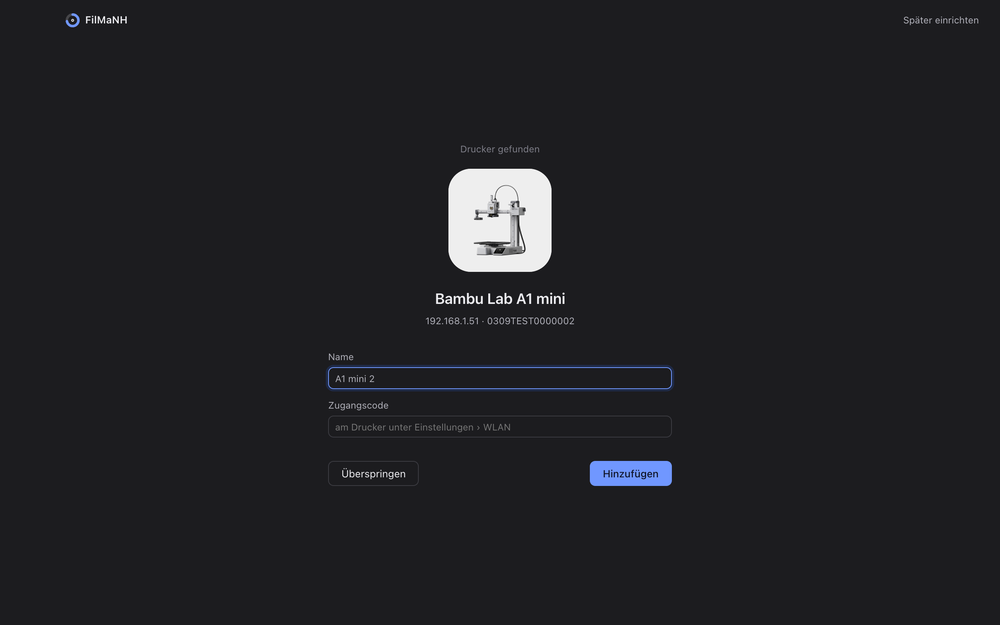

- **Zugangscode:** Ist Bambu Studio auf dem Rechner eingerichtet, übernimmt FilMaNH den Code von dort. Sonst steht
  er am Drucker unter **Einstellungen › WLAN**.
- **Kein Drucker gefunden:** Liegt der Drucker in einem anderen Netz (z.B. einem eigenen Netz für Smart-Home-Geräte),
  das Netz wie `192.168.2` oder die IP-Adresse des Druckers eingeben.

Danach fragt FilMaNH, was mit den Drucken passieren soll, die schon auf der Speicherkarte liegen:

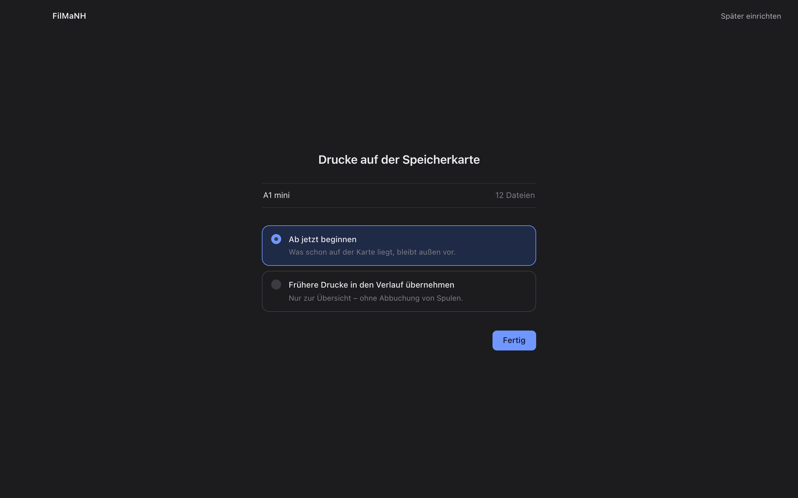

- **Ab jetzt beginnen:** Alte Drucke bleiben außen vor.
- **Frühere Drucke in den Verlauf übernehmen:** Sie erscheinen im Verlauf und unter Modelle, es wird aber nichts
  von Spulen abgebucht.

Zum Schluss fragt FilMaNH nach dem **Strompreis** je kWh (für die Stromkosten der Drucke) und ob es **mit dem Rechner
starten** soll – empfohlen, so verfolgt FilMaNH jeden Druck.

Die Einrichtung lässt sich mit **Später einrichten** überspringen und unter Einstellungen › Drucker nachholen.

## 3. So arbeitet FilMaNH

- Jede Spule hat eine Nummer (#001, #002 …) und einen Restbestand.
- Steckt eine Spule im AMS oder am externen Halter, ist sie diesem Slot zugeordnet. **Bambu-Spulen mit RFID** legt
  FilMaNH beim Einlegen selbst an. Bei allen anderen fragt es einmal, welche Spule das ist.
- **Am Ende jedes Drucks** liest FilMaNH aus der Druckdatei, wie viel Filament aus welchem Slot verbraucht wurde,
  und bucht es von der Spule ab, das Spülen beim Farbwechsel eingeschlossen. Bei einem Abbruch wird nur bis zur
  erreichten Schicht gebucht.
- **War der Rechner aus oder im Ruhezustand**, holt FilMaNH beim Aufwachen bzw. nächsten Start nach, was der Drucker in
  der Zwischenzeit gedruckt hat. Ist der Drucker dann nicht erreichbar, entscheidet FilMaNH aus Beginn und geplanter
  Dauer: Ist das erwartete Ende deutlich vorbei, wird gebucht; meldet der Drucker später anderes, wird korrigiert.
  Was sich nicht sicher klären lässt, erscheint als Hinweis und wird mit einem Klick bestätigt.
- **Nicht gebucht?** Ist ein Druck vorbei, aber nicht gebucht (z.B. weil keine Spule zugeordnet war), steht oben auf
  jeder Seite ein rotes Banner **Nicht gebucht**, bis es erledigt ist, und es kommt eine Mitteilung.
- **Wiegen** macht den Bestand genau. Aus den Wiegungen lernt FilMaNH, wie stark der echte Verbrauch je Filament
  von der Berechnung abweicht, und rechnet das künftig ein.
- **„ca.“** vor einem Gewicht heißt: geschätzt, kann etwas abweichen. Wiegen macht den Wert wieder genau.

## 4. Übersicht

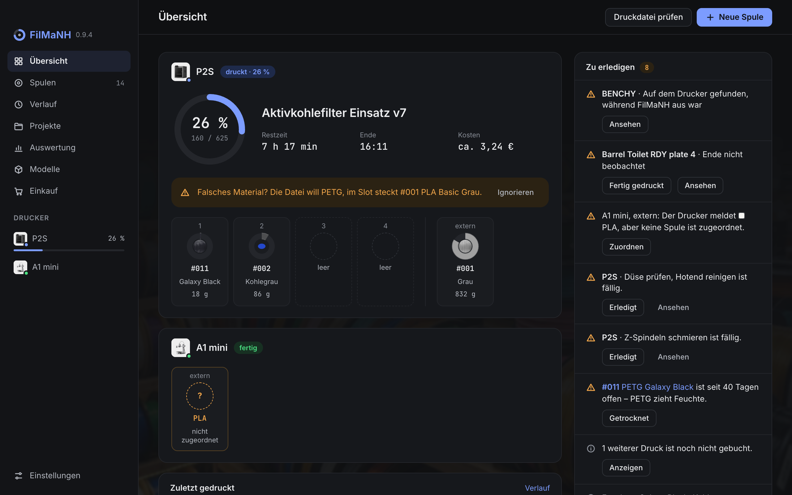

- **Drucker** links, druckende zuerst: beim laufenden Druck Fortschritt mit Schicht, Restzeit, Ende und geschätzte
  Kosten; Hinweise zu diesem Druck (falsches Material, Spule reicht nicht) direkt darunter. Die Slots zeigen je Spule
  Nummer, Farbe und Rest: je AMS die Slots 1–4 (bei mehreren AMS mit Überschrift), abgesetzt die externe Spule. Ein
  Klick auf den Drucker öffnet ihn.
- **Zuletzt gedruckt** mit Menge und Kosten.
- **Zu erledigen** rechts: alles, was Aufmerksamkeit braucht – Druck mit offenem Ende, Slots, die nicht zur Meldung des
  Druckers passen ([Abgleich mit dem Drucker](#abgleich-mit-dem-drucker)), fällige [Wartung](#wartung), Feuchte,
  nicht gebuchte Drucke, fast leere Spulen –, jeweils mit der passenden Aktion.

## 5. Spulen

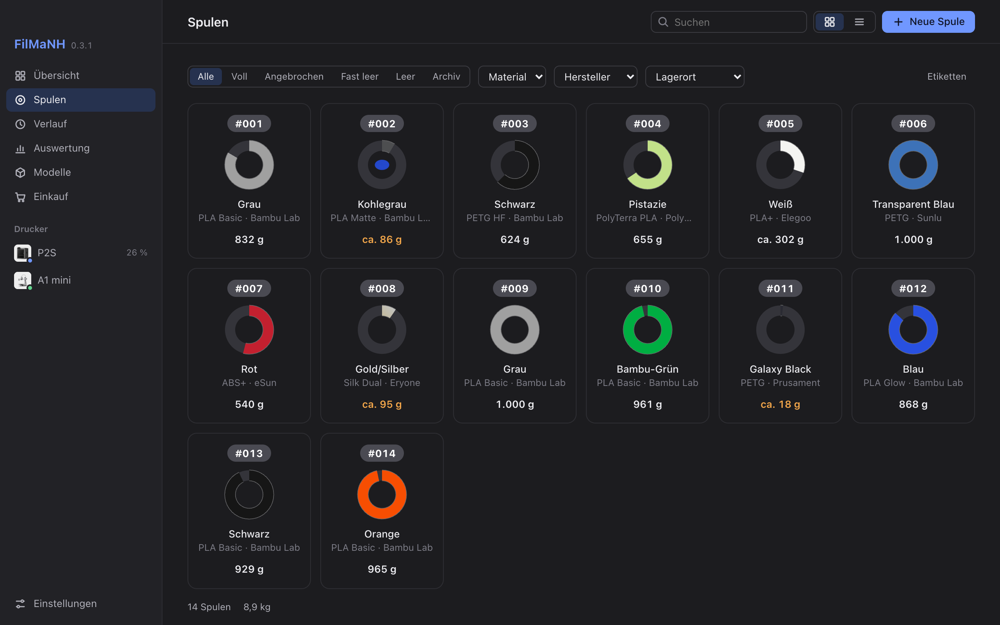

Filter nach Zustand (Voll, Angebrochen, Fast leer, Leer, Archiv), Material, Hersteller und Lagerort; Suche,
Kachel- oder Listenansicht. **Etiketten** druckt Etiketten für alle angezeigten Spulen. **Fehlende Etiketten** steht
da, sobald neue Spulen noch kein Etikett haben (auch am iPhone angelegte), und druckt genau diese.

### Neue Spule

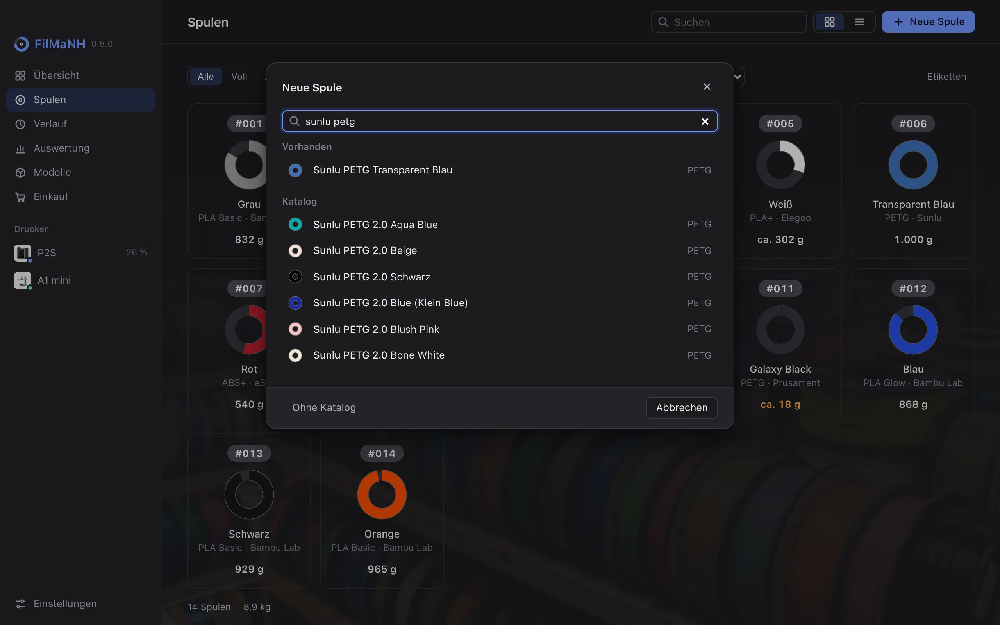

Hersteller, Material oder Farbe ins Suchfeld tippen, z.B. „sunlu petg weiß“. Der Katalog kennt über 7.000
Filamente; die Auswahl füllt Farbe, Füllmenge und Leergewicht aus. Dazu optional Preis (brutto oder netto),
Lagerort und **Anzahl**: Bei 3 entstehen drei Spulen mit eigener Nummer. Steht ein Filament nicht im Katalog:
**Ohne Katalog** und selbst eintragen.
Auch deine eigenen Filamentprofile aus Bambu Studio stehen im Katalog.

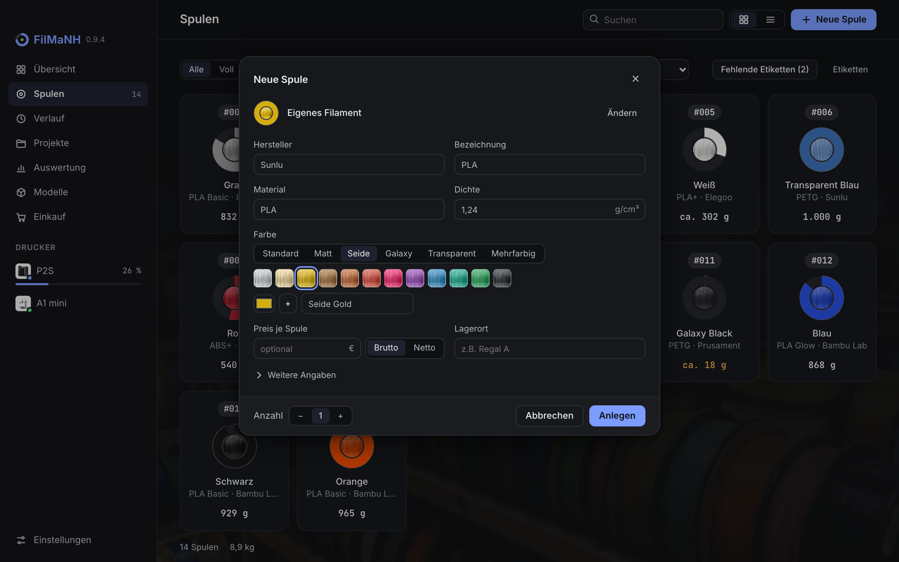

Die **Farbe** kommt dann aus über 80 Filamentfarben, sortiert nach **Standard**, **Matt**, **Seide**, **Galaxy**,
**Transparent** und **Mehrfarbig** – oder du stellst sie selbst ein. **+** fügt weitere Farben hinzu (bis zu acht),
für Verlaufs- und mehrfarbiges Filament.

Das Suchfeld nimmt auch eine **EAN** (Strichcode auf Spule oder Karton) und einen **Shop-Link**:

- **EAN:** scannen oder eintippen und Enter. Beim ersten Mal das Filament auswählen, FilMaNH merkt sich die EAN.
  Beim nächsten Mal ist das Filament schon gewählt, mit Preis und Händler der letzten Spule.
- **Shop-Link:** den Link zur Produktseite einfügen. FilMaNH liest Name, Preis und Shop von der Seite und schlägt
  passende Filamente aus dem Katalog vor; Preis (in deiner Währung) und Shop werden übernommen. Das klappt nicht bei
  jedem Shop – manche geben diese Daten nicht heraus.

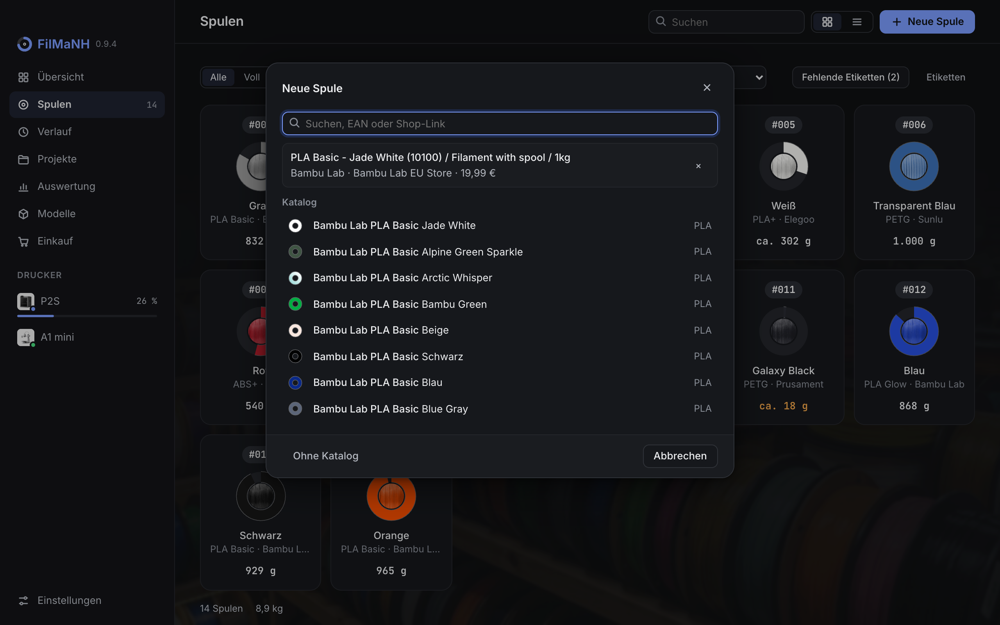

Nach dem Anlegen bietet FilMaNH an, gleich das Etikett zu drucken. Bambu-Spulen mit RFID müssen nicht angelegt
werden – einlegen genügt.

### Spule im Detail

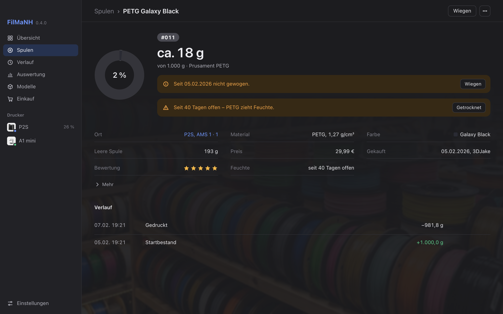

Restbestand, Ort (Slot oder Lagerort), Material, Preis, Feuchte, **Bewertung** und jede Buchung im Verlauf.
**Mehr** zeigt Charge, Genauigkeit, gelernte Korrektur, Mindestbestand, EAN und Notiz. **Reste aufbrauchen** listet Modelle, die du
schon gedruckt hast und für die der Rest noch reicht.

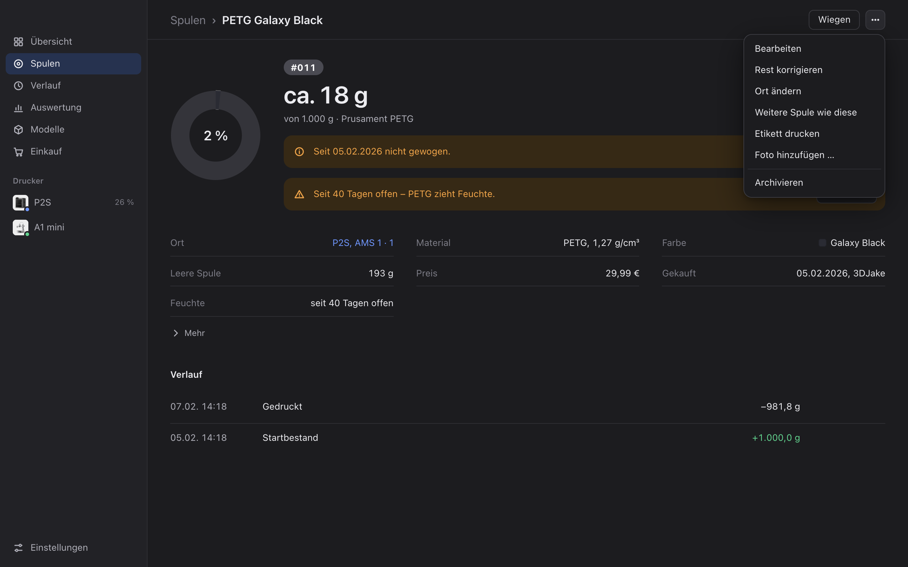

Im Menü **…**: Bearbeiten, Rest korrigieren, Ort ändern, Weitere Spule wie diese, Etikett drucken, Foto hinzufügen,
Archivieren und Löschen. Ein **Foto** der Spule zeigt die echte Farbe in der Mitte des Rings; ohne Foto steht dort
die Struktur des Filaments in seiner Farbe – glänzend bei Seide, mit Glitzer bei Galaxy.

**Löschen** entfernt eine Spule endgültig, etwa eine versehentlich angelegte. Das geht nur, solange kein Druck mit ihr
gebucht ist; sonst **Archivieren** – das behält Verlauf und Kosten.

Die **Bewertung** (1–5 Sterne) gilt für das Filament, also für alle Spulen dieser Sorte; derselbe Stern noch einmal
löscht sie. Unter **Bearbeiten** lassen sich EANs von Hand eintragen, mehrere durch Komma getrennt (z.B. mit Spule
und Refill). Dort lassen sich auch **Hersteller**, **Bezeichnung**, **Material** und **Farbe** ändern (mit derselben Farbauswahl
wie beim Anlegen); das gilt für alle Spulen dieses Filaments.

### Wiegen

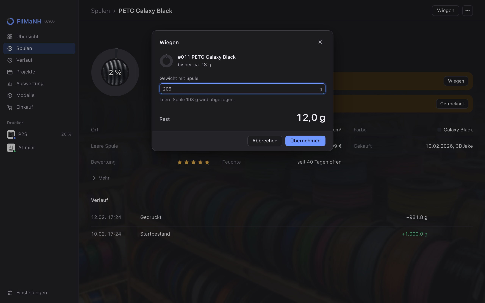

Spule samt Rolle wiegen und das Gewicht eintragen. FilMaNH zieht das Leergewicht ab und übernimmt den Rest.

### Etiketten

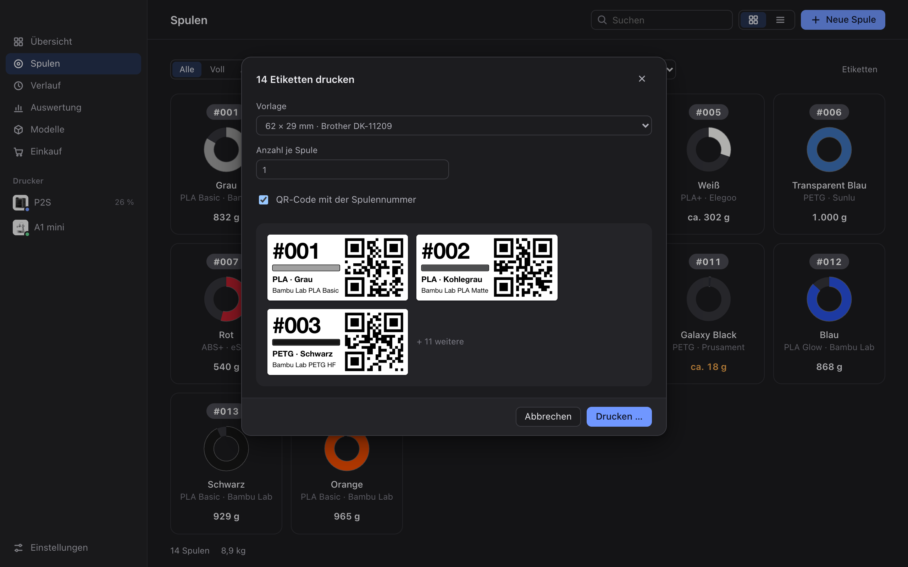

Auf dem Etikett: Nummer, Farbe (davor das Material, wenn es nicht schon in der Bezeichnung steht), Hersteller und
Bezeichnung, wann die Spule geöffnet wurde, und ein QR-Code mit der Nummer. Bei ungeöffneten Spulen steht
„Geöffnet“ mit einem Strich zum Eintragen von Hand. Unter **Auf dem Etikett** kommen auf Wunsch **Drucktemperatur**
(laut Filamentkatalog, wo bekannt), **Lagerort**, **Kaufdatum**, **Preis** und **Füllmenge** in eine Zusatzzeile; das
Etikett rückt dafür etwas zusammen, eine zu lange Zeile wird gekürzt. FilMaNH merkt sich die Auswahl.

Unter **Drucken über:**

- **Brother QL per USB** (Mac, z.B. QL-570): FilMaNH druckt direkt, ohne Treiber. Unter **Format** stehen alle
  Rollen, die der Drucker kann; die eingelegte ist markiert. Passt das gewählte Format nicht zur eingelegten Rolle,
  sagt FilMaNH das und druckt nicht; nach dem Wechsel **Erneut prüfen**. Das Etikett passt sich dem Format an, die
  Vorschau zeigt genau das Druckbild.
- **Drucker des Systems:** jeder eingerichtete Drucker mit Namen und Modell, der Standarddrucker ist markiert.
  FilMaNH druckt direkt darauf, ohne weiteren Dialog – Etikettendrucker (Brother, Dymo, Niimbot, Phomemo, Zebra,
  Rollo) ebenso wie ein Bürodrucker für Etikettenbögen.
- **Druckdialog des Systems …** öffnet den gewohnten Dialog, etwa um als PDF zu sichern.

Die Vorschau zeigt alle Etiketten bzw. alle Bögen so, wie sie gedruckt werden.

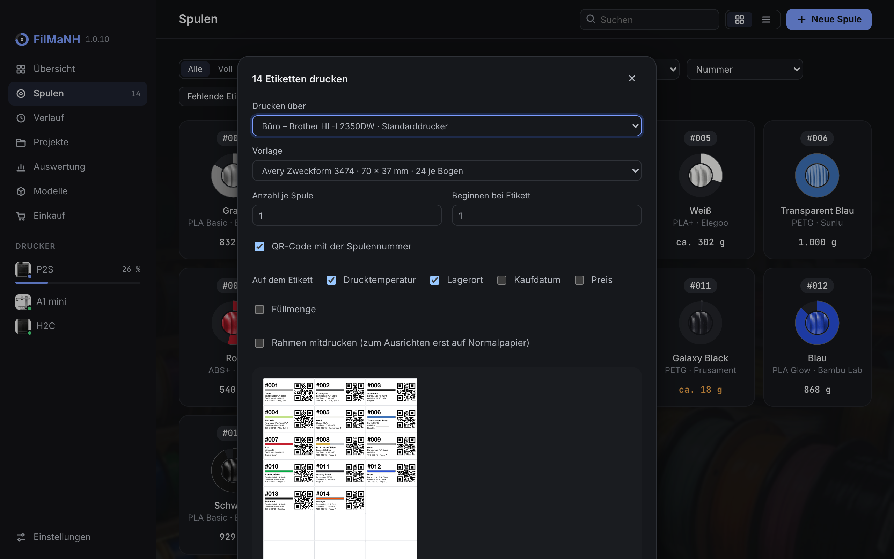

Unter **Vorlage** stehen Etikettenrollen sowie A4-Bögen von Avery Zweckform und Herma und US-Letter-Bögen von Avery,
jeweils mit Bestellnummer (gleichwertige zusammengefasst), Größe und Anzahl je Bogen. Passt keine, legt
**Eigene Größe …** ein einzelnes Etikett oder einen Bogen mit Spalten, Zeilen, Rändern und Abständen an.

**Anzahl je Spule** druckt mehrere gleiche Etiketten, **Beginnen bei Etikett** nutzt angefangene Bögen weiter.
**Rahmen mitdrucken** druckt die Umrisse mit – zum Ausrichten erst auf Normalpapier. Im Druckdialog die Skalierung
auf 100 % lassen. FilMaNH merkt sich, welche Spulen ein Etikett haben.

### Feuchte

PETG, PCTG und PET zeigen nach 30 Tagen offen einen Hinweis, TPU nach 14 Tagen, PA, PC, PVA und BVOH nach 7 Tagen.
**Getrocknet** setzt die Zeit zurück.

## 6. Drucker

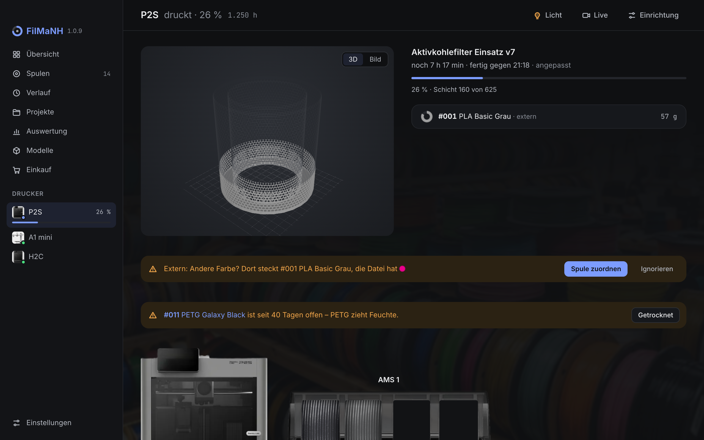

Der laufende Druck in 3D in den Farben der zugeordneten Spulen – der schon gedruckte Teil voll, der Rest
durchscheinend –, dazu Fortschritt, Schicht, Restzeit und Uhrzeit des Endes. Darunter die Filamente des Drucks mit der
Spule im Slot (Nummer wie auf dem Etikett); ein Klick darauf ordnet neu zu, das Modell färbt sich sofort um. **angepasst** heißt: Dieser Drucker braucht erfahrungsgemäß länger oder kürzer, als er anzeigt, und FilMaNH
rechnet das ein. Das geschieht erst ab drei Drucken und nur, wenn es nachweislich genauer ist.

Beim Druckstart prüft FilMaNH:

- **Falsches Material oder andere Farbe** als in der Druckdatei vorgesehen. **Ignorieren** blendet den Hinweis für
  diesen Druck überall aus.
- **Spule reicht nicht:** mit Uhrzeit, wann sie leer wird, und ob eine Ersatzspule im AMS steckt.
- **Abrasives Filament** (mit Kohle- oder Glasfaser, Glow) auf einer Düse aus Edelstahl oder Messing: Die Düse
  verschleißt, besser eine gehärtete. Welche Düse eingebaut ist, meldet der Drucker.

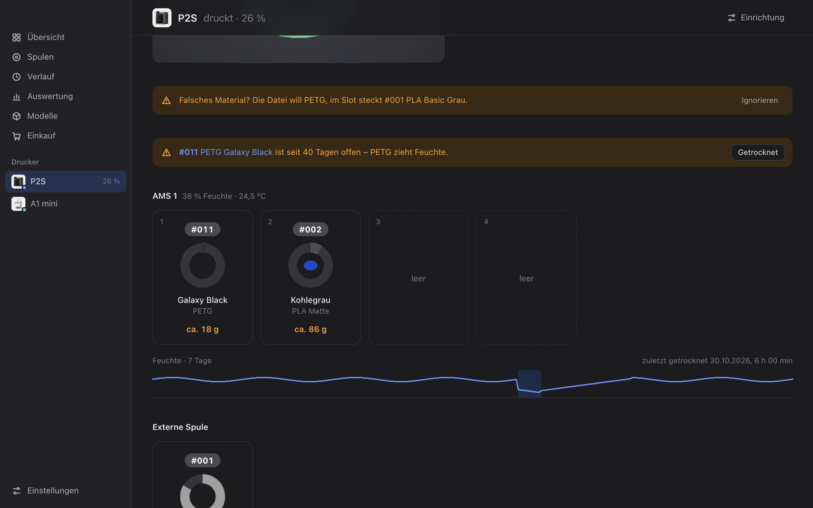

Weiter unten: das AMS mit Slots, Feuchte und Temperatur, der Feuchteverlauf der letzten 7 Tage und die externe
Spule. H2D und H2C haben zwei externe Halter (links und rechts); ein leerer, nicht zugeordneter wird nicht gezeigt. Eine Spule aus **Spulen im Regal** auf einen Slot ziehen ordnet sie zu. Darunter stehen alle Drucke dieses
Druckers. **Einrichtung** oben rechts führt zu den Druckereinstellungen.

### Spule zuordnen

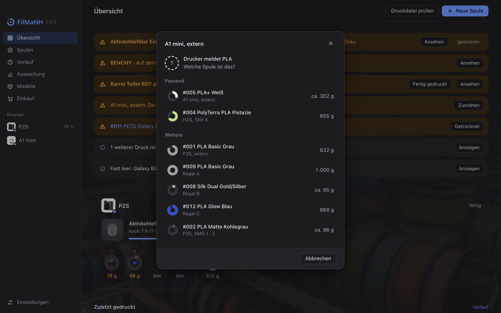

Steckt eine Spule ohne RFID im Slot, fragt FilMaNH, welche es ist: oben die passenden, darunter alle weiteren, jeweils
mit Nummer und Lagerort. Ein Klick auf den Slot öffnet die Auswahl jederzeit wieder, z.B. nach einem Spulenwechsel.

### Abgleich mit dem Drucker

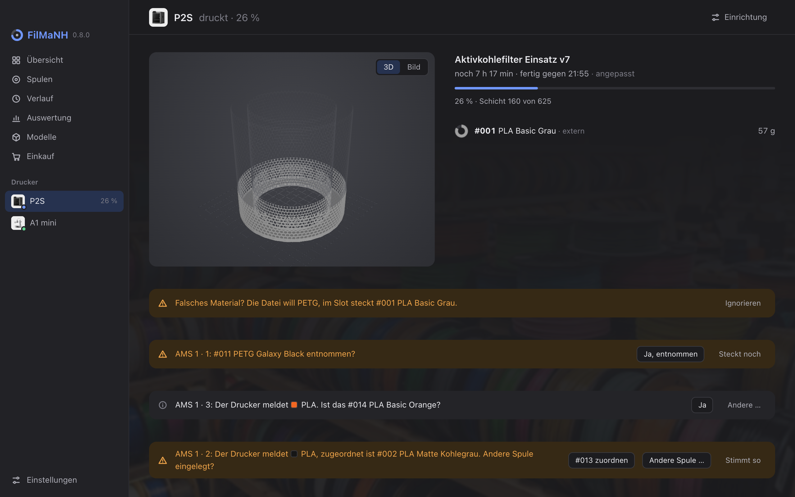

Jeder Bambu-Drucker meldet je Slot, was eingestellt ist (Material, Farbe, bei Bambu-Spulen der RFID-Chip) und ob
Filament steckt. FilMaNH vergleicht das mit der zugeordneten Spule, auch ohne laufenden Druck:

- **Ist das …?** Keine Spule zugeordnet, aber genau eine im Bestand passt. **Ja** ordnet sie zu, **Andere …** öffnet
  die Auswahl.
- **… aber keine Spule ist zugeordnet.** Es passen mehrere oder keine. **Zuordnen** öffnet die Auswahl.
- **Andere Spule eingelegt?** Der Drucker meldet anderes Material, eine deutlich andere Farbe oder einen anderen
  RFID-Chip. Passt genau eine Spule, ordnet **#… zuordnen** sie zu, sonst **Andere Spule …**. **Stimmt so** behält
  die Zuordnung.
- **… entnommen?** Der Slot ist laut Drucker leer. **Ja, entnommen** löst die Zuordnung, **Steckt noch** behält sie
  (z.B. wenn nur das Filament ausgefahren ist).

**Stimmt so** und **Steckt noch** gelten, bis der Drucker etwas anderes meldet; ebenso eine Zuordnung von Hand.
Zugeordnet wird nur auf Klick – automatisch nur Bambu-Spulen mit RFID, denn nur deren Kennung ist eindeutig.

### Wartung

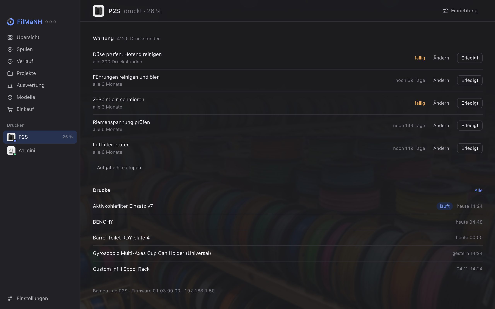

Auf der Druckerseite steht der Wartungsplan: jede Aufgabe mit ihrem Abstand in Druckstunden oder Tagen, Wochen bzw.
Monaten und dem, was bis zur nächsten bleibt. Die Druckstunden zählt FilMaNH aus den erfassten Drucken. Beim ersten
Mal legt es Vorschläge für das Modell an:

- **Düse prüfen, Hotend reinigen:** alle 200 Druckstunden
- **Führungen reinigen und ölen** und **Z-Spindeln schmieren:** alle 3 Monate
- **Riemenspannung prüfen:** alle 6 Monate
- **Kohlefaserstangen reinigen** (X1 und P1): alle 30 Tage
- **Luftfilter prüfen** (geschlossene Drucker): alle 6 Monate

**Erledigt** zählt ab jetzt neu. **Ändern** passt Name und Abstand an oder löscht die Aufgabe, **Aufgabe hinzufügen**
legt eigene an. Fällige Aufgaben stehen auch in der Übersicht, dort ebenfalls mit **Erledigt**.

## 7. Druckdatei prüfen

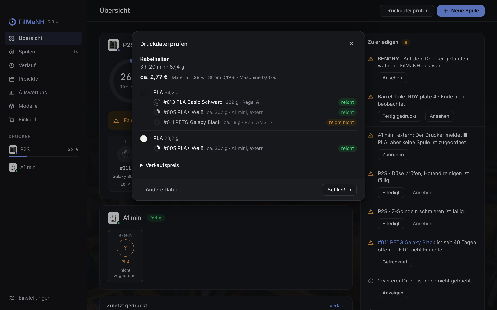

Vor dem Druck klären, ob das Filament reicht: In Bambu Studio die geslicte Platte als `.gcode.3mf` exportieren und
auf das FilMaNH-Fenster ziehen oder über **Druckdatei prüfen** auswählen. FilMaNH zeigt je Filament, welche
Spulen reichen, und schätzt die Kosten (Material, Strom, Maschine). Reicht keine Spule allein, aber zwei gleiche
zusammen, steht **reicht zusammen** mit beiden Nummern. Ist das Filament abrasiv und die Düse aus Edelstahl oder
Messing, steht eine Warnung dabei. **Verkaufspreis** (aufklappen) rechnet aus den Kosten einen Preis wie bei den
[Projekten](#9-projekte).

## 8. Verlauf

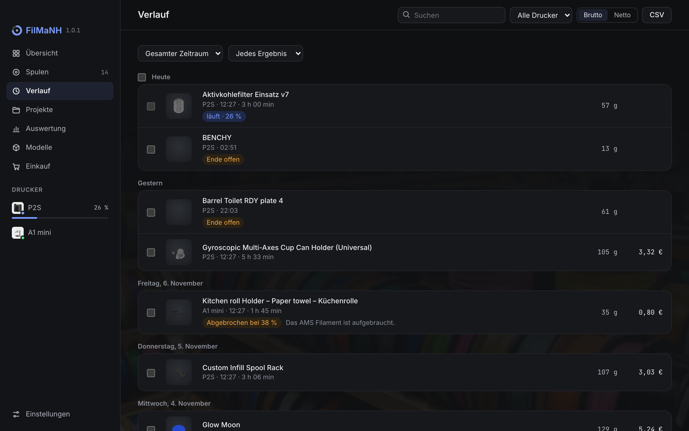

Jeder Druck mit Bild, Drucker, Uhrzeit, Dauer, Verbrauch und Kosten; gibt es ein Foto vom fertigen Teil, steht es
statt der Vorschau. Filter nach Zeitraum, Ergebnis und Drucker, Suche, Brutto oder Netto. **CSV** exportiert die
Liste. Unten blättern, wahlweise **10**, **25** oder **50 je Seite**.

**Löschen:** Drucke anhaken (das Kästchen über der Liste wählt alle der Seite), dann **Löschen** und **Wirklich
löschen**. Eintrag, Druckdatei, Foto und Zeitraffer verschwinden; der Verbrauch bleibt auf den Spulen gebucht.
Laufende Drucke lassen sich nicht löschen.

### Druck im Detail

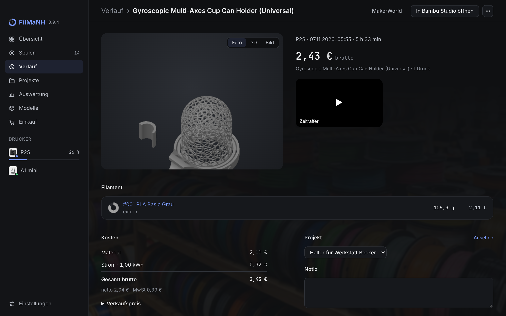

- **Foto:** das letzte Bild des Zeitraffers, wenn beim Senden des Drucks „Zeitraffer“ eingeschaltet war. Ohne
  Zeitraffer das letzte Bild der Kameraaufzeichnung, falls der Drucker während des Drucks aufzeichnet (z.B. P2S).
  Gibt es beides nicht, kannst du ein eigenes Foto hinzufügen. **3D** (in den Farben der Spulen) und **Bild** zeigen
  die Druckdatei.
- **Zeitraffer** abspielen. Mit **Zeitraffer herunterladen** (Einstellungen › Erfassung) liegt er nach dem Druck auf
  dem Rechner, sonst kommt er beim Abspielen vom Drucker. **Speichern …** sichert ihn; auf dem Mac wird ein AVI dabei
  zu einer `.mov`, die QuickTime abspielt. War der Zeitraffer beim Drucken aus, steht das hier.
- **Filament** je Spule mit Menge und Kosten; **Kosten** aufgeschlüsselt nach Material, Strom und Maschine, netto
  und brutto.
- **In Bambu Studio öffnen** öffnet die aufbewahrte Druckdatei. Stammt das Modell von MakerWorld, führt ein Link
  dorthin.
- **Projekt:** den Druck einem [Projekt](#9-projekte) zuordnen oder mit **Neues Projekt …** eines anlegen.
  **Verkaufspreis** (aufklappen) rechnet den Preis für diesen Druck.
- Menü **…**: Foto ersetzen, **Als Ausschuss markieren** (Teil unbrauchbar – zählt in der Auswertung als Fehldruck),
  Buchung zurücknehmen und, solange nicht gebucht ist, **Druckdatei neu suchen**.
- Jede Druckdatei prüft FilMaNH am Inhalt: Schichtzahl und die Filamente, die der Drucker tatsächlich nutzt. Eine
  ältere Datei gleichen Namens wird so nicht verwendet.
- **Nicht gebucht – Spule wählen.** erscheint, wenn der Drucker für ein Filament keinen Slot gemeldet hat oder die
  Spule erst nach dem Druck in den Slot kam (sie könnte schon für den nächsten Druck sein). Die Spule wählst du selbst;
  FilMaNH rät sie nicht. Nennt die Druckdatei keine Filamente, trägst du den Verbrauch wie ohne Druckdatei ein.
- Bei Abbrüchen steht die Meldung des Druckers dabei.

### Ende offen

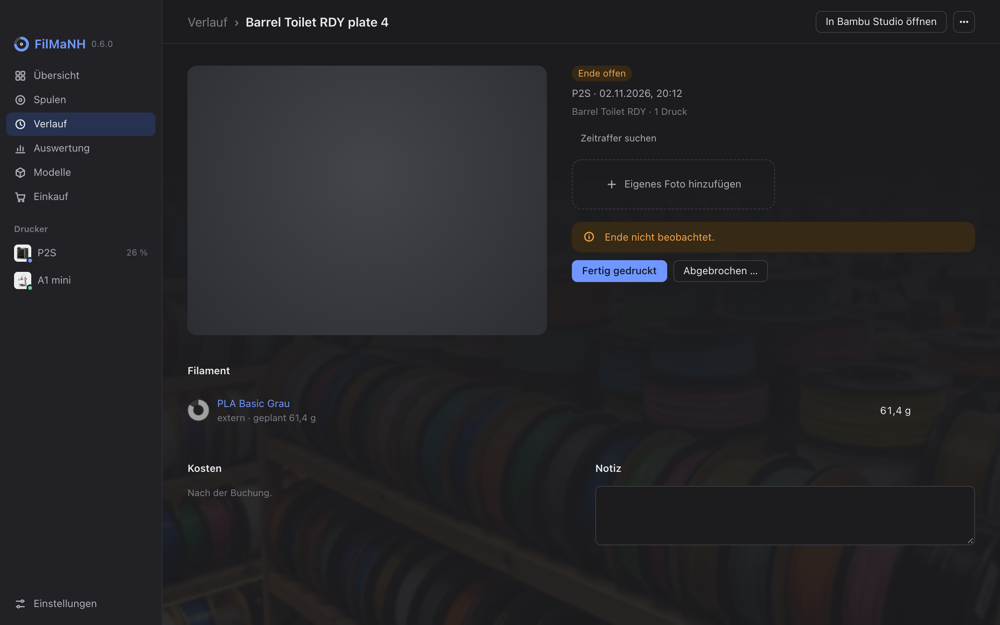

Konnte FilMaNH das Ende eines Drucks nicht beobachten und auch später nicht sicher klären: **Fertig gedruckt**
oder **Abgebrochen …** mit der Schicht wählen. Danach wird gebucht.

## 9. Projekte

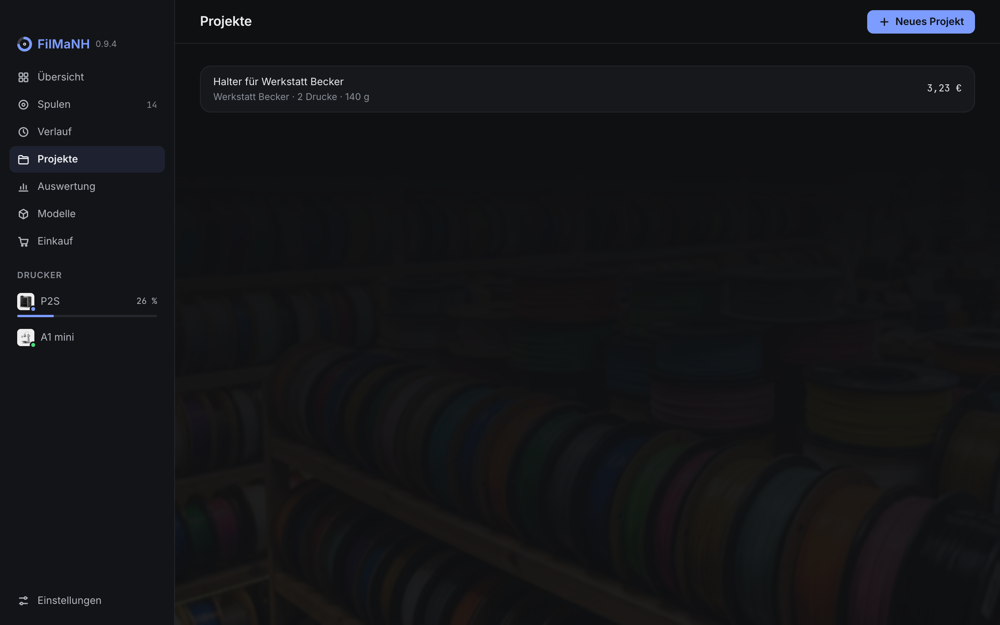

Ein Projekt fasst Drucke für einen Auftrag oder Kunden zusammen, mit Summen für Filament, Zeit und Kosten.
**Neues Projekt** legt eines an. Drucke kommen über **Drucke hinzufügen** dazu oder im Druck unter **Projekt**.

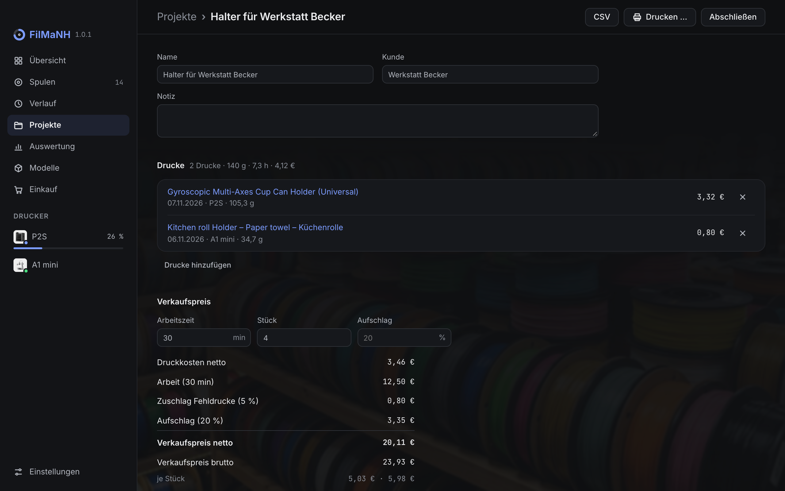

- **Name**, **Kunde** und **Notiz**.
- **Drucke** mit Datum, Drucker, Menge und Kosten; **×** nimmt einen Druck wieder heraus.
- **Verkaufspreis:** die Druckkosten (Material, Strom, Maschine) plus **Arbeitszeit** zum Stundensatz aus
  Einstellungen › Kosten, darauf der **Zuschlag für Fehldrucke** und darauf der **Aufschlag** – netto, brutto und je
  **Stück**. Der Aufschlag gilt je Projekt; leer bleibt die Vorgabe aus den Einstellungen.
- **CSV** exportiert die Drucke, **Drucken …** eine Übersicht als A4-Seite mit Summe und Verkaufspreis (im Druckdialog
  auch als PDF).
- **Abschließen** markiert das Projekt als abgeschlossen, **Wieder öffnen** hebt das auf. **Projekt löschen** löscht
  nur das Projekt; die Drucke bleiben.

## 10. Modelle

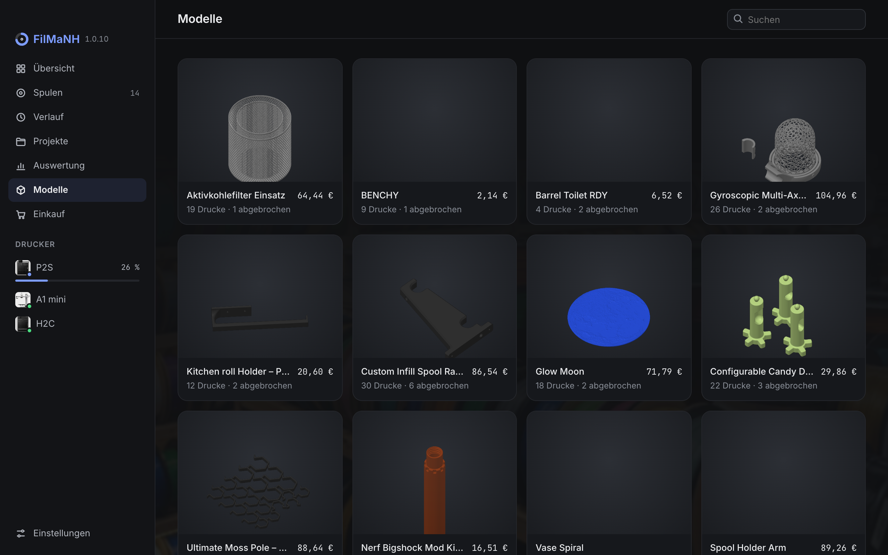

Alle Drucke nach Modell zusammengefasst, mit Anzahl, Kosten und Abbrüchen.

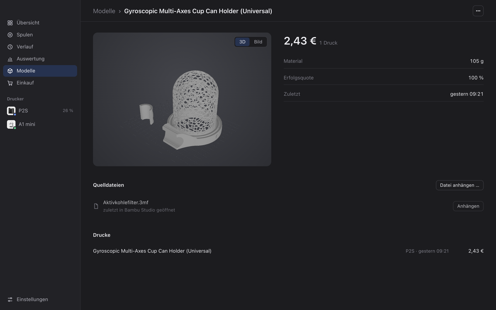

Kosten je Druck, Material, Erfolgsquote und alle Drucke des Modells. Unter **Quelldateien** lässt sich die
Projektdatei (`.3mf`) anhängen; FilMaNH schlägt dafür die zuletzt in Bambu Studio geöffneten Dateien vor.

## 11. Auswertung

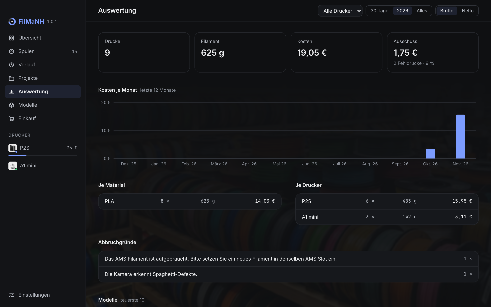

Drucke, Filament, Kosten und Ausschuss (nach der ersten Schicht abgebrochene und als Ausschuss markierte Drucke), Kosten je Monat, je
Material und je Drucker, Abbruchgründe und die teuersten Modelle. Filter nach Drucker und Zeitraum, Brutto oder Netto.

## 12. Einkauf

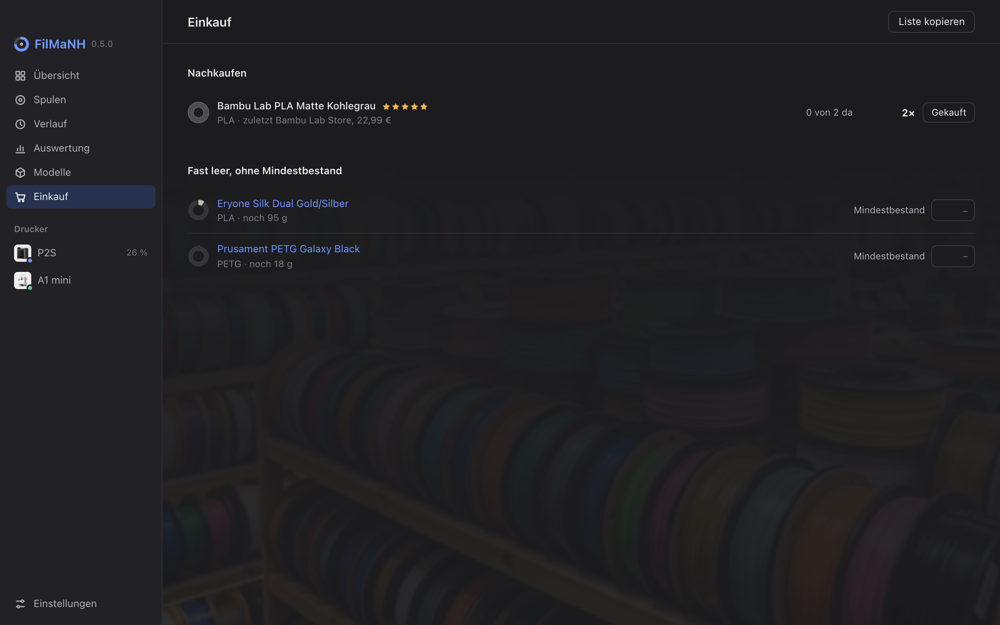

Für ein Filament einen **Mindestbestand** festlegen (hier oder unter Spule › Bearbeiten). Fällt der Bestand
darunter, steht es unter **Nachkaufen**, mit Händler und letztem Preis. **Gekauft** legt die neue Spule mit den
Daten des letzten Kaufs an. **Liste kopieren** kopiert die Einkaufsliste. Sterne zeigen deine Bewertung des
Filaments.

**Bald leer** zeigt Filamente, die nach dem Verbrauch der letzten 90 Tage in weniger als 4 Wochen aufgebraucht sind,
auch ohne Mindestbestand. Bei jedem Filament steht, wie lange der Bestand noch ungefähr reicht.

## 13. Einstellungen

**Allgemein:** Darstellung (hell, dunkel, wie das System), **Hintergrundbild**, **Sprache** (wie das System, Deutsch,
English, Español, Français, Italiano, Nederlands, Polski; spricht das System keine davon, Englisch), Weiterlaufen beim Schließen,
Start mit dem Rechner (empfohlen), Mitteilungen (Druck fertig, Spule reicht nicht, neue Spule erkannt).

**Drucker:** verbundene Drucker; weitere Drucker suchen oder per IP-Adresse hinzufügen, auf Wunsch gleich mit
**Kaufpreis**.

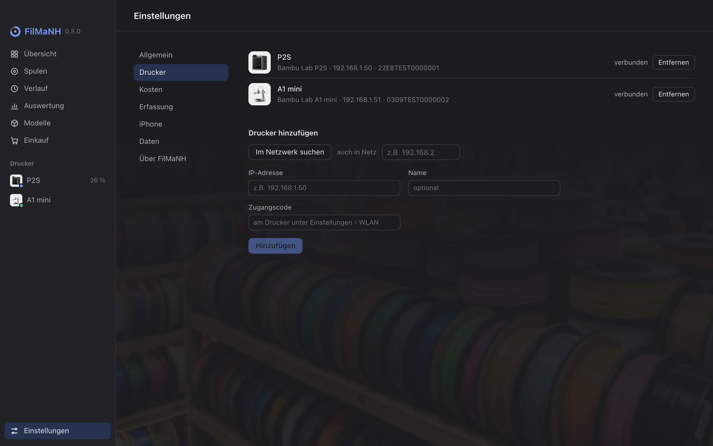

**Kosten:** Währung, Mehrwertsteuer und ob Preise **Brutto** oder **Netto** angezeigt werden. Alle Beträge auf dieser
Seite werden so angezeigt und eingegeben; intern rechnet FilMaNH netto. Die Mehrwertsteuer gilt für Strom,
Anschaffung, Verkaufspreis und neue Spulen; jede Spule behält ihren Satz. Bei einer neuen Installation sind Währung
und Mehrwertsteuer nach dem Land des Systems vorbelegt.

- **Strom:** **Strompreis** je kWh und die Leistung jedes Druckers. Ohne eigene Leistung nimmt FilMaNH Bambus
  gemessenen Durchschnitt für das Modell und das Material des Drucks (z.B. A1 mini mit PLA 80 W, P2S 200 W) – nicht
  die Höchstleistung, die der Drucker nur kurz beim Aufheizen braucht.
- **Anschaffung der Drucker:** je Drucker **Kaufpreis** und **Nutzungsdauer** (Vorgabe 5.000 Druckstunden); daneben
  steht, was das **je Druckstunde** ausmacht (z.B. 799 € über 5.000 h = 0,16 €). Dieser Betrag mal der Druckzeit kommt zu jedem gebuchten Druck, auch zu älteren, immer mit dem aktuellen Kaufpreis. Ist **In die Kosten einrechnen** aus, zählt die
  Anschaffung nirgends mit.
- **Verkaufspreis:** **Stundensatz für deine Arbeit**, Vorgabe für den **Aufschlag** (je Projekt änderbar) und
  **Zuschlag für Fehldrucke** – für den Preisrechner in Projekten, Drucken und Druckdatei prüfen. Der Stundensatz
  zählt nur für die **Arbeitszeit**, die du dort einträgst, nie für die Druckzeit.

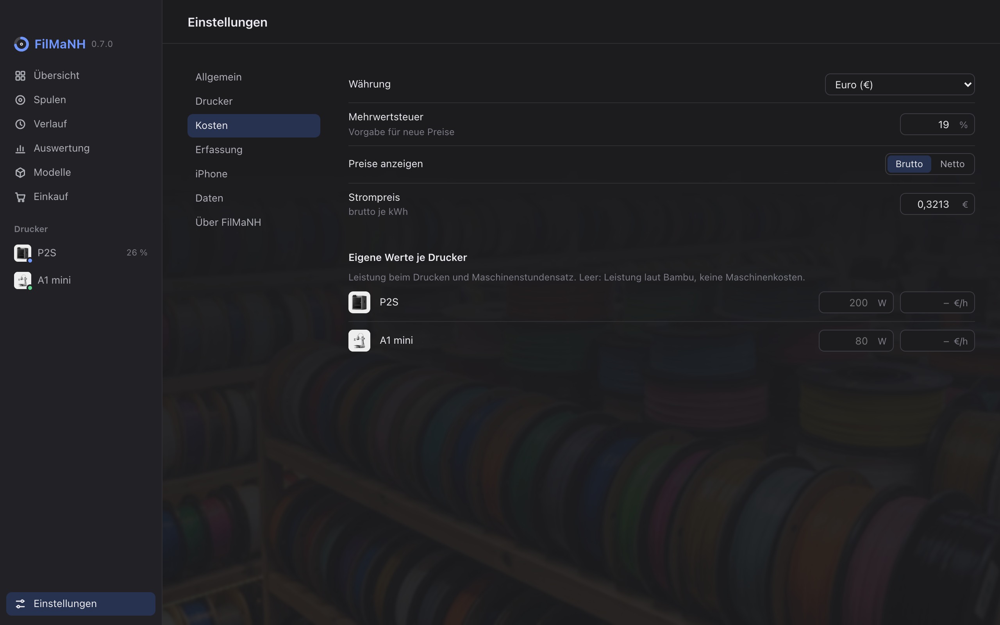

**Erfassung:** Grenze für „fast leer“, Korrektur aus Wiegungen lernen, Bambu-Spulen mit RFID automatisch anlegen,
Druckdateien aufbewahren (Datei und Bild, oder nur Bild), Zeitraffer herunterladen und wie viel Platz Druckdateien
und Zeitraffer höchstens belegen.

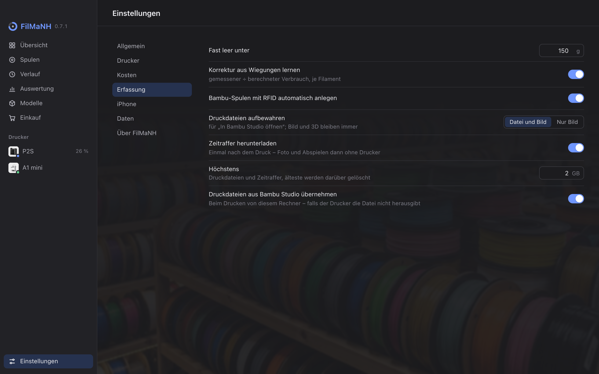

- **Zeitraffer herunterladen:** einmal nach dem Druck, sobald der Drucker ihn fertig geschrieben hat. Foto,
  Abspielen und Speichern brauchen dann den Drucker nicht mehr.
- **Druckdateien aus Bambu Studio übernehmen:** Druckst du aus Bambu Studio auf diesem Rechner, legt Bambu Studio
  die Druckdatei kurz ab, und FilMaNH übernimmt sie. So wird auch gebucht, wenn der Drucker die Datei nicht
  herausgibt. Einzurichten ist nichts.

**Handy:** Koppeln mit der FilMaNH-App für iPhone oder Android (die iPhone-App erscheint demnächst im App Store).
**QR-Code zeigen** öffnet das Koppeln: In der App **Mit Rechner koppeln** antippen und den Code scannen. Es lassen sich
beliebig viele Handys koppeln; jedes steht unter **Gekoppelte Geräte** und lässt sich dort wieder **Entfernen**. Die
Verbindung bleibt im Heimnetz und ist verschlüsselt. Beim ersten Koppeln fragen macOS bzw. Windows, ob FilMaNH
Verbindungen annehmen darf: **Erlauben** (unter Windows für private Netzwerke).

Solange kein Handy gekoppelt ist, steht unten in der Seitenleiste **Handy-App**: Ein Klick zeigt, was die Apps können,
mit QR-Code zum Laden der Android-App. **Ausblenden** entfernt den Hinweis.

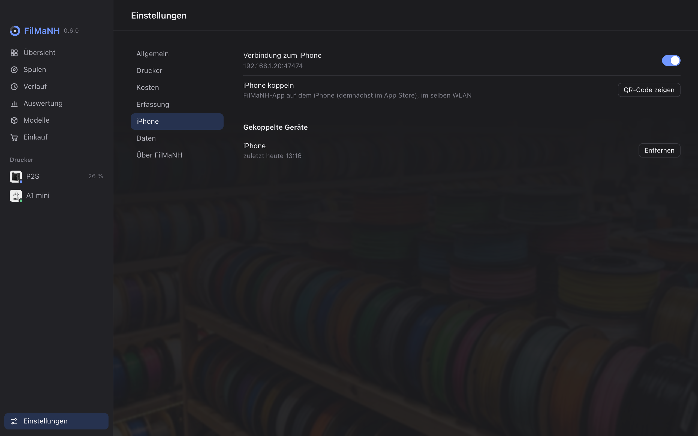

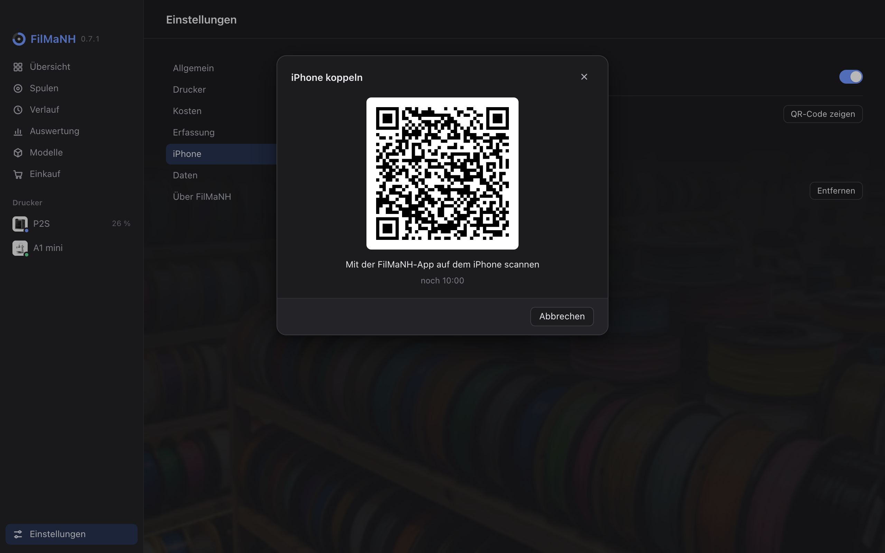

Was die Apps können, steht in den Handbüchern für [iPhone](iphone.md) und [Android](android.md).

**Daten:** tägliche Sicherung (die letzten 14 Stände), Export und Import aller Daten, Druckverlauf als CSV, Datenordner. Sicherung und Export enthalten die Datenbank: Spulen, Buchungen,
Drucke und Einstellungen – nicht Fotos, Druckdateien, 3D-Ansichten, Zeitraffer und Quelldateien. Die liegen im
Datenordner (`drucke`, `modelle`); wer umzieht, kopiert ihn mit. **Aus Spoolman übernehmen** liest Spulen aus einem
Spoolman-Server oder einer Spoolman-Exportdatei.

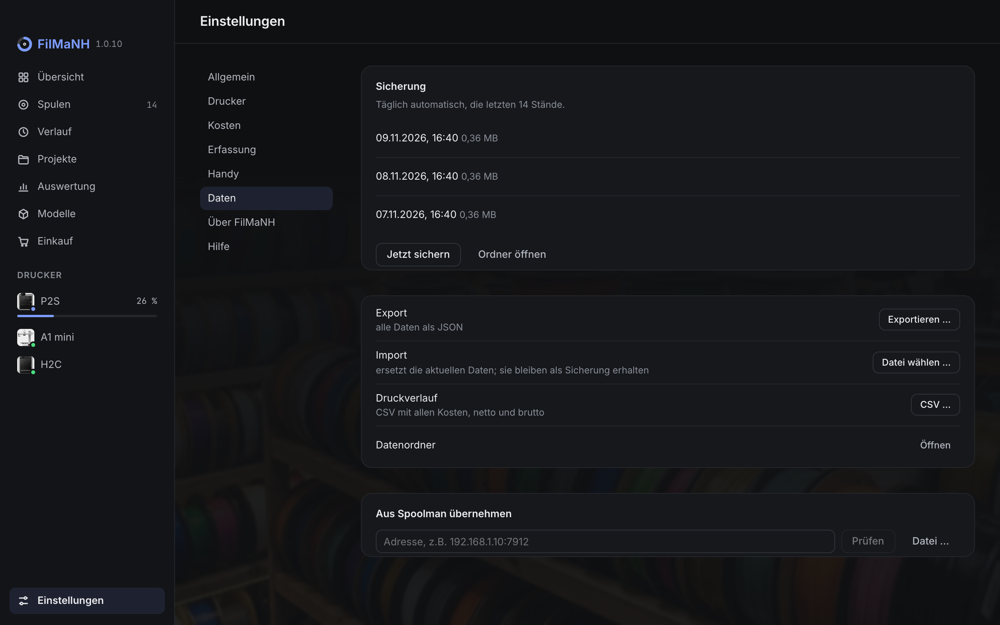

**Über FilMaNH:** Version, Filament-Katalog aktualisieren, Updates, **Diagnose › Kopieren** (für die Hilfe, ohne
Seriennummern, Adressen und Codes), Lizenzen. Die installierte Version steht auch oben in der Seitenleiste; ist
ein Update da, wird sie rot.

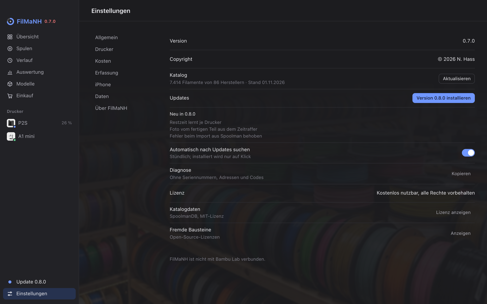

**Updates:** FilMaNH sucht stündlich nach einer neuen Version. Gibt es eine, steht **Update …** in der Seitenleiste;
ein Klick auf **Version … installieren** lädt, prüft, installiert und startet neu. Ohne Klick wird nichts
installiert.

**Hilfe:** dieses Handbuch in der Sprache der App, mit Suche über alle Kapitel. **F1** öffnet es von überall.

## 14. Im Hintergrund

Das Fenster zu schließen beendet FilMaNH nicht – Drucke werden weiter verfolgt.

- **macOS:** Symbol oben rechts in der Menüleiste. Während eines Drucks zeigt es eine Spule in der Farbe des
  Filaments, das gerade gedruckt wird, daneben den Fortschritt; drucken mehrere Drucker, steht je Drucker eine Spule
  da, die Prozente in derselben Reihenfolge. Ganz beenden mit ⌘Q oder **Beenden** im Menü des Symbols.
- **Windows:** Symbol unten rechts im Infobereich, während eines Drucks in der Farbe des Filaments (je Drucker eine
  Spule); der Tooltip nennt alle Drucker mit Fortschritt. Windows 11 legt neue Symbole zunächst unter den Pfeil **^**; von
  dort lässt es sich auf die Taskleiste ziehen. Ganz beenden mit **Beenden** im Menü des Symbols (Rechtsklick).

Mit **Mit dem Rechner starten** (Einstellungen › Allgemein) läuft FilMaNH nach dem Hochfahren gleich im Hintergrund.

## 15. Tastatur und Scanner

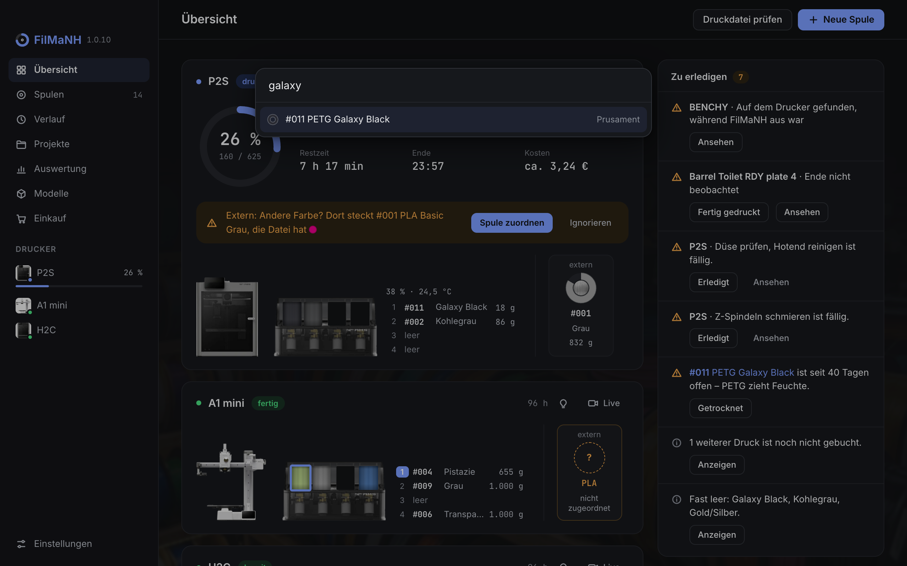

- **⌘K** (Mac) bzw. **Strg+K** (Windows): Suche nach Spulen, Drucken, Modellen und Befehlen.
- **F1**: [Hilfe](#13-einstellungen).
- Eine `.gcode.3mf` auf das Fenster ziehen: Druckdatei prüfen.
- Ein Barcodescanner, der den QR-Code eines FilMaNH-Etiketts liest, öffnet direkt die Spule.
- Scannt er die EAN einer Spule oder ihres Kartons, öffnet sich **Neue Spule** – bei einer bekannten EAN mit dem
  Filament schon gewählt.

## 16. Daten und Datenschutz

- Alle Daten liegen auf deinem Rechner, auch Druckdateien, Fotos und Zeitraffer, im Datenordner der App
  (Einstellungen › Daten › **Datenordner** › **Öffnen**).
- Mit **Druckdateien aus Bambu Studio übernehmen** liest FilMaNH die Druckdateien, die Bambu Studio beim Drucken
  auf diesem Rechner ablegt – nichts sonst.
- Kein Konto, keine Cloud. FilMaNH liest die Drucker nur aus und steuert sie nicht. Zugangscodes liegen im
  Schlüsselbund des Systems.
- Solange ein Handy gekoppelt ist oder der QR-Code zum Koppeln offen ist, nimmt FilMaNH im lokalen Netzwerk
  verschlüsselte Verbindungen an (Port 47474, ist er belegt, einer der nächsten neun); Daten bekommen nur gekoppelte
  Handys. Ist kein Handy mehr gekoppelt, geht der Dienst nach wenigen Minuten aus. Ins Internet geht dabei nichts.
- Ins Internet geht FilMaNH nur für die Update-Suche, die Katalog-Aktualisierung (auf Klick), einen
  Spoolman-Import, wenn du einen startest, und für einen Shop-Link, wenn du einen einfügst oder mit dem Handy
  scannst (dann ruft FilMaNH genau diese Seite ab – nie eine Adresse im eigenen Netzwerk).

Die vollständige Datenschutzerklärung für Programm und Apps: [DATENSCHUTZ.md](../DATENSCHUTZ.md).

## 17. Häufige Fragen

**Der Drucker wird nicht gefunden.** Drucker eingeschaltet und im selben Netzwerk? Liegt er in einem anderen Netz,
unter Einstellungen › Drucker das Netz („auch in Netz“) oder die IP-Adresse eingeben. Ist schon ein Drucker aus
diesem Netz eingerichtet, sucht FilMaNH dort von selbst mit.

**Bei einem Drucker steht „verbinde …“, obwohl er an ist.** Drucker nehmen nur wenige direkte Verbindungen aus dem
Netzwerk gleichzeitig an. Dazu zählen auch Bambu Studio oder Orca Slicer (wenn sie direkt mit dem Drucker verbunden
sind), Home Assistant und ähnliche Programme – die Bambu-Handy-App nicht, sie läuft über Bambus Cloud. FilMaNH
versucht es selbst weiter und holt den Druck nach, sobald es wieder verbunden ist; der Druck wird dadurch nicht
gestört. Bleibt es dabei, ein anderes verbundenes Programm schließen oder die Firmware des Druckers aktualisieren.

**„macOS verweigert FilMaNH den Zugriff aufs lokale Netzwerk“.** Systemeinstellungen › Datenschutz & Sicherheit ›
**Lokales Netzwerk**: FilMaNH einschalten (der Knopf **Systemeinstellungen öffnen** in der Übersicht führt hin), dann
FilMaNH neu starten. Ist es schon an, einmal aus- und wieder einschalten.

**Der Drucker hat eine neue IP-Adresse bekommen.** Ist ein Drucker einige Minuten nicht erreichbar, sucht FilMaNH ihn
selbst im Netz und verbindet sich unter der neuen Adresse. Klappt das nicht, den Drucker unter Einstellungen › Drucker
noch einmal hinzufügen – Name, Zuordnungen und Verlauf bleiben erhalten.

**Muss ich am Drucker den LAN-Modus oder Entwicklermodus einschalten?** Nein.

**Der Bestand stimmt nicht.** Spule wiegen. Mit der Zeit lernt FilMaNH aus den Wiegungen und rechnet genauer.

**Der Rechner war während eines Drucks aus oder hat geschlafen.** FilMaNH holt den Druck beim Aufwachen bzw. nächsten
Start nach und bucht ihn – auch wenn der Drucker inzwischen aus ist.

**Wie bekomme ich ein Foto vom fertigen Teil?** Beim Senden des Drucks in Bambu Studio den Zeitraffer einschalten –
das gilt für jeden Druck einzeln (**Druckplatte drucken › Zeitraffer**).
Zeichnet der Drucker mit der Kamera auf, kommt das Foto auch ohne Zeitraffer. Sonst ein eigenes Foto im Druck
hinzufügen.

**Etwas funktioniert nicht.** Auf GitHub unter [Issues](https://github.com/NikolausH76/FilMaNH/issues/new/choose) das
Formular **Fehler melden / Report a bug** ausfüllen. Hilfreich ist die Diagnose: in der App unter Einstellungen ›
Über FilMaNH › **Diagnose** › **Kopieren**, dann in das Formular einfügen – ohne Seriennummern, Adressen und Codes.
Die Diagnose enthält auch das Ende des Fehlerprotokolls (Verbindungsfehler, nicht gebuchte Drucke, Abstürze), ebenfalls
ohne Seriennummern, Adressen und Namen von Drucken. Das Protokoll selbst liegt als `fehlerprotokoll.log` im Datenordner.

---

© 2026 N. Hass. FilMaNH ist ein unabhängiges Projekt und nicht mit Bambu Lab verbunden.
