# FilMaNH für Android – Handbuch

*Deutsch · [English](../handbook/android.md) · [Handbuch für den Rechner](README.md)*

Die Android-App arbeitet mit FilMaNH auf deinem Rechner zusammen: Spulen scannen, in Slots legen, wiegen,
fotografieren und bearbeiten. Die Daten bleiben auf dem Rechner. Das Handy verbindet sich nur im Heimnetz mit ihm,
verschlüsselt.

1. [Installieren](#1-installieren)
2. [Koppeln](#2-koppeln)
3. [Drucker](#3-drucker)
4. [Spulen](#4-spulen)
5. [Neue Spule](#5-neue-spule)
6. [Scannen](#6-scannen)
7. [Einstellungen](#7-einstellungen)
8. [Widget](#8-widget)
9. [Häufige Fragen](#9-häufige-fragen)

---

## 1. Installieren

- Android 9 oder neuer.
- Auf dem Handy **[FilMaNH-Android.apk](https://github.com/NikolausH76/FilMaNH/releases/latest/download/FilMaNH-Android.apk)** laden – oder den QR-Code auf der
  [Startseite](../README.md#download) mit dem Handy scannen.
- Die Datei öffnen. Beim ersten Mal fragt Android, ob der Browser bzw. die Dateien-App Apps installieren darf:
  erlauben, dann **Installieren**.
- Updates: die neue APK genauso installieren. Kopplung und Einstellungen bleiben erhalten. Die App zeigt unter der
  Kopfzeile **Neue App-Version … – zum Herunterladen tippen**, sobald FilMaNH am Rechner zu einer neueren App gehört
  (auch in den Einstellungen: **App-Version … herunterladen**). Antippen lädt die APK im Browser. Die App selbst geht
  dafür nicht ins Internet – sie erfährt es vom Rechner.

Voraussetzungen am Rechner: FilMaNH läuft (das Fenster darf geschlossen sein). Handy und Rechner sind im selben
WLAN.

## 2. Koppeln

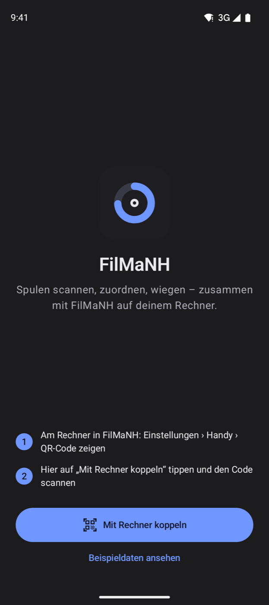

1. Am Rechner in FilMaNH: **Einstellungen › Handy › QR-Code zeigen**.
2. Auf dem Handy **Mit Rechner koppeln** antippen, den Code scannen und **Koppeln** bestätigen. Beim ersten Mal fragt
   Android nach der Kamera: erlauben.

Den Code kann auch die Kamera-App des Handys lesen; der Link öffnet FilMaNH direkt zum Bestätigen.

**Beispieldaten ansehen** zeigt die App ohne Rechner mit erfundenen Spulen; Änderungen werden nicht gespeichert.

## 3. Drucker

  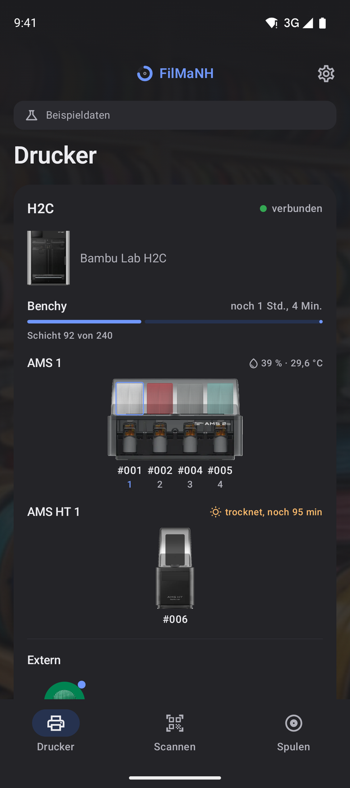
  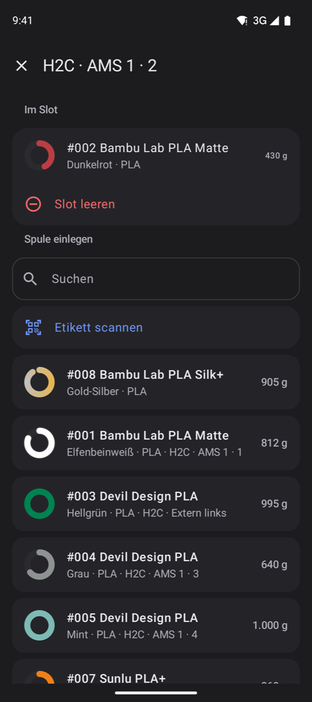

Alle Drucker mit Bild, Verbindung und laufendem Druck mit Schicht und Restzeit. Darunter jedes AMS als Bild: jede
Spule in ihrer Farbe im Fenster, der geladene Slot markiert, ein Slot mit Filament, aber ohne zugeordnete Spule
gestrichelt; unter jedem Fenster die Nummer der Spule bzw. das gemeldete Material. Dazu Feuchte und Temperatur (beim
Trocknen die Restzeit), dann die externe Spule (bei zwei Düsen wie an H2D und H2C mit links/rechts).

Ein Slot öffnet die Auswahl: **Im Slot** zeigt die Spule, **Slot leeren** nimmt sie heraus. Unter **Spule
einlegen** stehen passende Spulen oben (gleiches Material wie im Slot gemeldet, dann noch nirgends eingelegte), mit
Suche – oder **Etikett scannen** und die Spule über ihren QR-Code wählen (auch eine EAN, wenn sie zu genau einer Spule
gehört).

Passt ein Slot nicht zur Meldung des Druckers, steht ein Hinweis auf der Karte des Druckers, solange er verbunden ist
– wie am Rechner (siehe [Abgleich mit dem Drucker](README.md#abgleich-mit-dem-drucker)): **Ja**, **Andere …**,
**Zuordnen**, **#… zuordnen**, **Andere Spule …**, **Stimmt so**, **Ja, entnommen** oder **Steckt noch**.

## 4. Spulen

  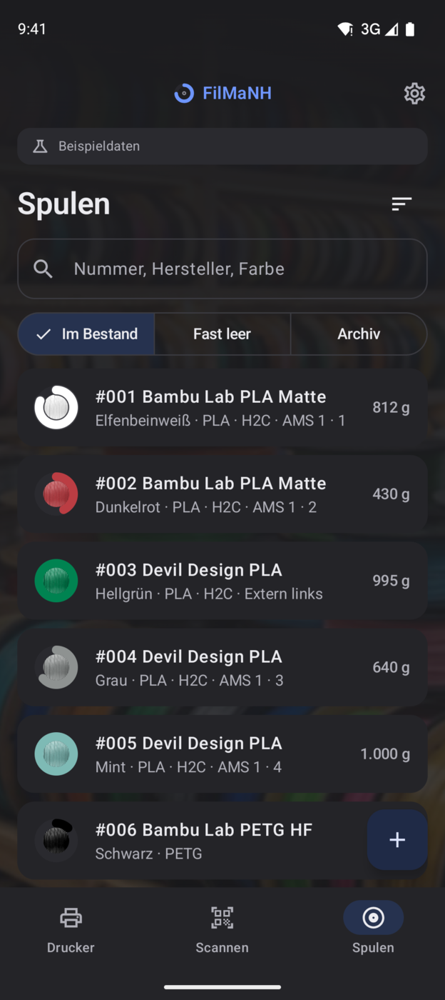
  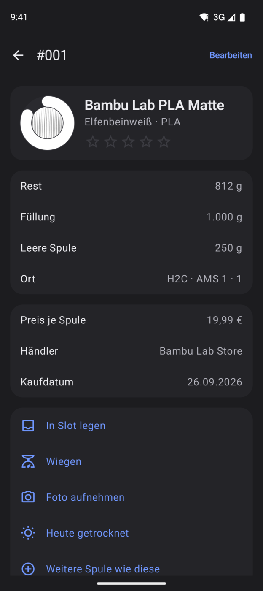
  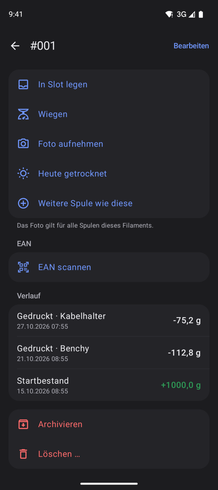

Suche nach Nummer, Hersteller, Farbe, Material und Bezeichnung; Filter **Im Bestand**, **Fast leer** und
**Archiv**. Das Symbol rechts neben **Spulen** sortiert nach Nummer, Rest oder Hersteller.

Eine Spule zeigt Rest, Füllung, leere Spule, Ort, wann sie zuletzt gewogen und getrocknet wurde, Preis, Händler,
Kaufdatum, Öffnungsdatum, Charge und Notiz, dazu den **Verlauf** aller Buchungen. Die Sterne bewerten das Filament;
derselbe Stern noch einmal löscht die Bewertung. Darunter:

- **In Slot legen** – Drucker und Slot wählen.
- **Wiegen** – siehe unten.
- **Foto aufnehmen** – das Foto gilt für alle Spulen dieses Filaments; **Foto entfernen** nimmt es wieder weg.
- **Heute getrocknet** – setzt die Feuchte-Zeit zurück.
- **Weitere Spule wie diese** – neue Spule desselben Filaments.
- **EAN scannen** – Strichcode der Spule merken; eine EAN antippen entfernt sie.
- **Archivieren** – Spule ablegen; eine archivierte holt **Zurückholen** zurück.
- **Löschen …** – versehentlich angelegte Spule entfernen; geht nur ohne gebuchte Drucke.

### Wiegen

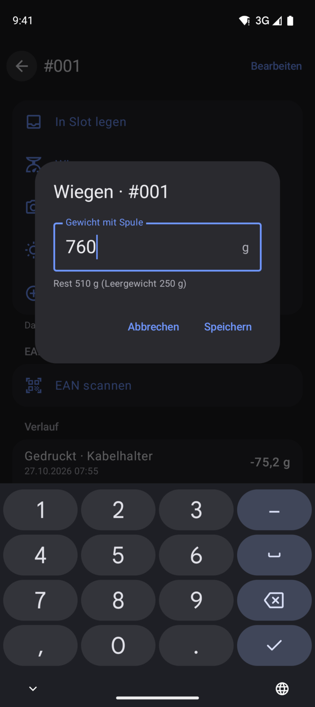

Spule samt Rolle wiegen und das Gewicht eintippen. FilMaNH zieht das Leergewicht ab und zeigt den Rest gleich an.
Ohne Leergewicht geht das nicht – dann unter **Bearbeiten** bei **Leere Spule** eintragen.

### Bearbeiten

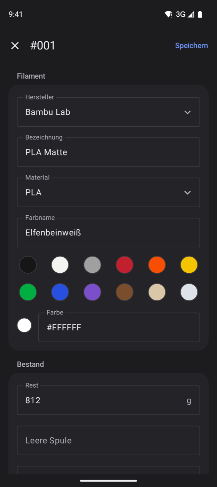

**Bearbeiten** oben rechts. Hersteller, Bezeichnung, Material, Farbname und Farbe gelten für das Filament, also für
alle Spulen dieser Sorte. Die Farbe kommt aus der Farbbibliothek (Standard, Matt, Seide, Galaxy, Transparent,
Mehrfarbig) oder als Farbwert (#RRGGBB) eingetippt; **+** fügt Farben für Verlaufs- und mehrfarbiges Filament hinzu.
Dazu Rest, leere Spule, Lagerort, Mindestbestand, Preis (brutto oder netto), MwSt., Händler, Kaufdatum, **Geöffnet
am**, Charge und Notiz. Ändert sich der Preis einer Spule, mit der schon gedruckt wurde, rechnet **Kosten bisheriger
Drucke mit dem neuen Preis rechnen** auch diese neu.

## 5. Neue Spule

  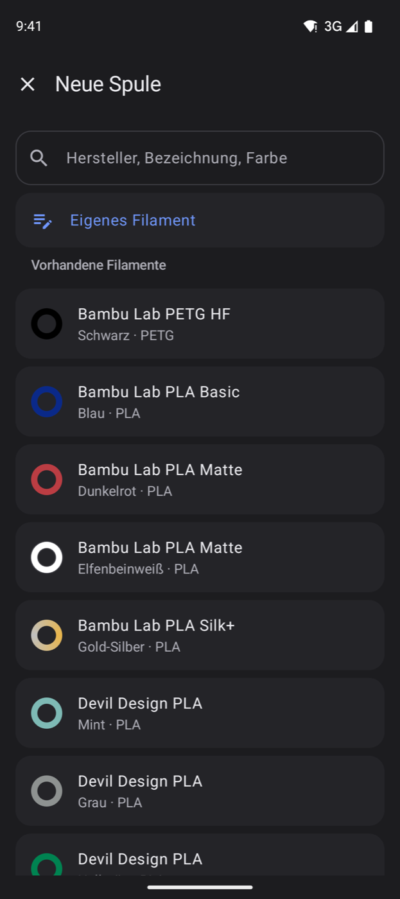
  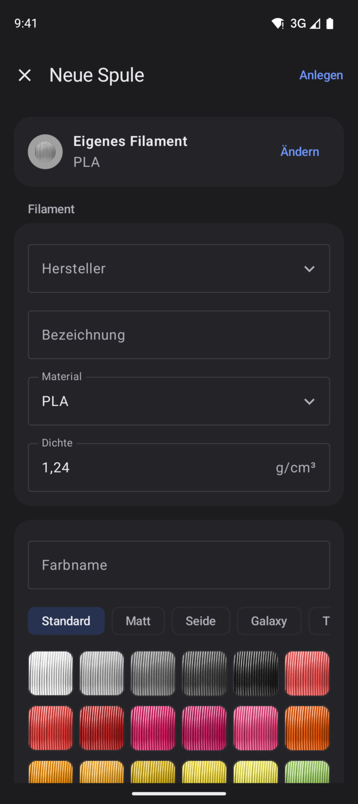

**+** unten rechts in der Spulenliste. Die Suche geht über deine vorhandenen Filamente und den Katalog des Rechners
(Hersteller, Bezeichnung, Farbe). **Eigenes Filament** zum selbst Eintragen (Farbe wie beim Bearbeiten), darunter die
**Vorhandenen Filamente** und der **Katalog**. Danach Füllung, leere Spule, Preis, Kauf, Lagerort, EAN und Anzahl,
dann **Anlegen**.

Das Etikett druckt der Rechner: Dort steht in der Spulenliste **Fehlende Etiketten** mit allen neuen Spulen.

## 6. Scannen

Der Bereich **Scannen** erkennt:

- **FilMaNH-Etikett** (QR-Code) – öffnet die Spule.
- **EAN** (Strichcode auf Spule oder Karton) – zeigt die Spulen mit dieser EAN. Dazu **Weitere Spule anlegen** und
  **Einer anderen Spule zuordnen**, bei einer neuen EAN **Neue Spule anlegen** und **Vorhandener Spule zuordnen** –
  oder **Am Rechner weitermachen**: Dort öffnet sich **Neue Spule** mit der EAN.
- **Link** (z.B. Produktseite) – **An den Rechner schicken** öffnet dort **Neue Spule**, und FilMaNH liest Name,
  Preis und Shop von der Seite.
- **Kopplungs-Code** – koppelt mit dem Rechner.

## 7. Einstellungen

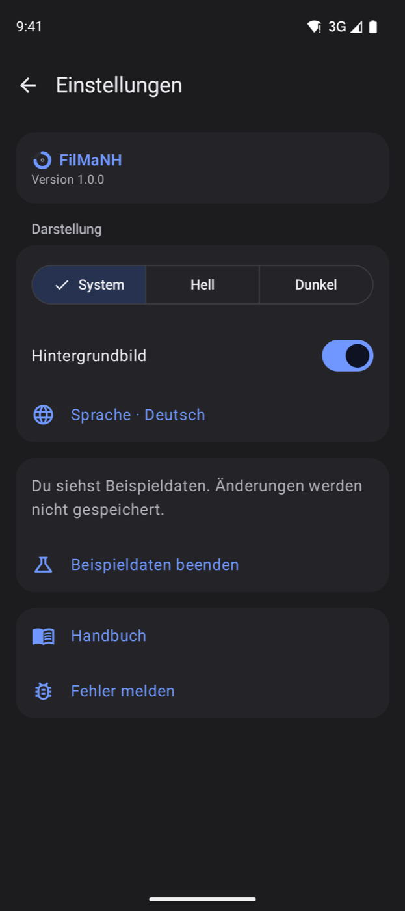

Zahnrad oben rechts. Oben steht die Version der App.

- **Darstellung:** System, Hell oder Dunkel. **Hintergrundbild** ein oder aus (bis du es hier änderst, wie am
  Rechner).
- **Sprache:** Deutsch, English, Español, Français, Italiano, Nederlands, Polski – wie das Handy, sonst Englisch; ein Tipp öffnet die Spracheinstellung von Android
  für FilMaNH.
- **Rechner:** Name, Status, Version von FilMaNH und Adresse. **Neu koppeln** ersetzt die Kopplung, **Trennen** hebt
  sie auf. Am Rechner unter **Einstellungen › Handy** lässt sich das Handy ebenfalls **Entfernen**.
- Mit Beispieldaten: **Beispieldaten beenden**.
- **Handbuch** und **Fehler melden**.

## 8. Widget

Das Widget **Drucke** zeigt auf dem Startbildschirm bis zu drei laufende Drucke: Name,
Drucker, Fortschritt, das voraussichtliche Ende („fertig um 17:54“) und einen Punkt in der Farbe der Spule, aus der
gerade gedruckt wird. Hinzufügen: lange auf eine freie Stelle des Startbildschirms tippen › **Widgets** › **FilMaNH**
› **Drucke**. Ein Tipp aufs Widget öffnet die App.

Das Widget holt den Stand selbst vom Rechner, nur im Heimnetz. Android aktualisiert es etwa alle 30 Minuten, die App
sofort, wenn sie neue Daten hat. Ohne Verbindung steht der letzte Stand mit Uhrzeit da, höchstens 12 Stunden lang.

## 9. Häufige Fragen

**„Rechner nicht erreichbar“?** FilMaNH muss am Rechner laufen, und das Handy muss im selben WLAN sein. Bis dahin
zeigt die App den letzten Stand mit Uhrzeit; Änderungen klappen erst wieder, wenn der Rechner erreichbar ist.

**„App und FilMaNH auf dem Rechner passen nicht zusammen“?** Die App und FilMaNH am Rechner auf die neueste Version
bringen.

Läuft FilMaNH auf einem **Windows-PC**, blockiert oft die Windows-Firewall: am Rechner unter **Einstellungen › Handy**
bei **Windows-Firewall** auf **Freigeben** klicken und die Rückfrage von Windows bestätigen.

**Geht das auch unterwegs?** Nein. Die App spricht nur im Heimnetz mit dem Rechner; ins Internet geht dabei nichts.

**Warum nicht aus Google Play?** Die App kommt zuerst als Datei zum Installieren. Google Play ist geplant.

**Mehrere Handys?** Ja, jedes wird einzeln gekoppelt.
