# FilMaNH für iPhone – Handbuch

*Deutsch · [English](../handbook/iphone.md) · [Handbuch für den Rechner](README.md)*

Die iPhone-App arbeitet mit FilMaNH auf deinem Rechner zusammen: Spulen scannen, in Slots legen, wiegen,
fotografieren und bearbeiten. Die Daten bleiben auf dem Rechner. Das iPhone verbindet sich nur im Heimnetz mit ihm,
verschlüsselt. Die App erscheint demnächst im App Store.

1. [Voraussetzungen](#1-voraussetzungen)
2. [Koppeln](#2-koppeln)
3. [Drucker](#3-drucker)
4. [Spulen](#4-spulen)
5. [Neue Spule](#5-neue-spule)
6. [Scannen](#6-scannen)
7. [Einstellungen](#7-einstellungen)
8. [Widget](#8-widget)
9. [Häufige Fragen](#9-häufige-fragen)

---

## 1. Voraussetzungen

- FilMaNH läuft auf dem Rechner (Mac oder Windows). Das Fenster darf geschlossen sein.
- iPhone mit iOS 17 oder neuer im selben WLAN wie der Rechner.

## 2. Koppeln

  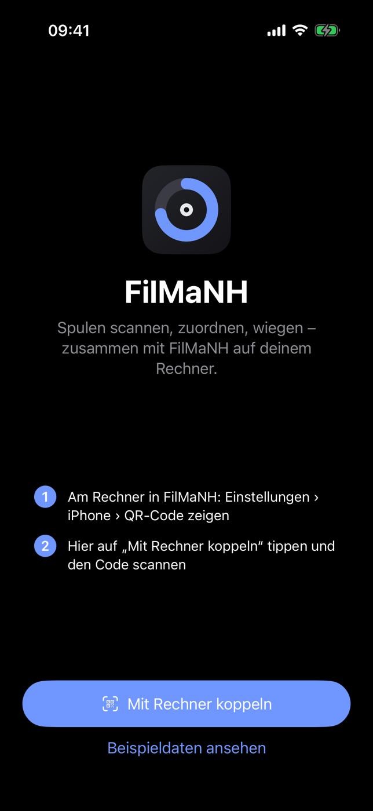
  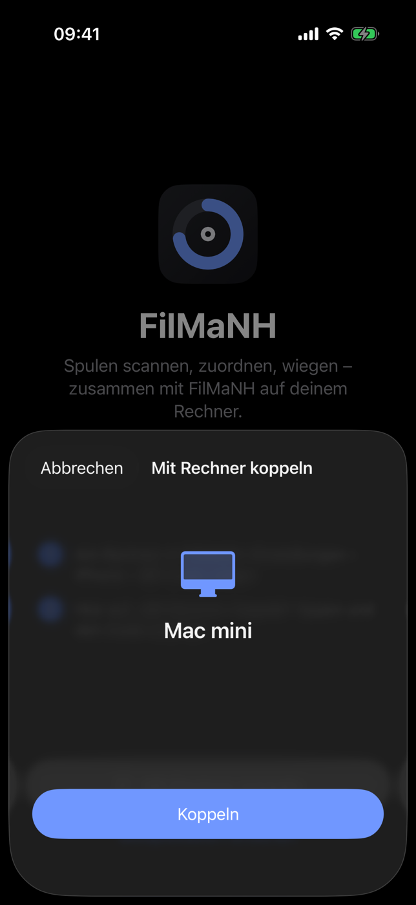

1. Am Rechner in FilMaNH: **Einstellungen › Handy › QR-Code zeigen**.
2. Auf dem iPhone **Mit Rechner koppeln** antippen, den Code scannen und **Koppeln** bestätigen.
3. Beim ersten Mal fragt iOS nach der Kamera und dem **lokalen Netzwerk**: beides erlauben. Ohne das lokale Netzwerk
   findet das iPhone den Rechner nicht.

Den Code kann auch die Kamera-App des iPhones lesen; der Link öffnet FilMaNH direkt zum Bestätigen.

**Beispieldaten ansehen** zeigt die App ohne Rechner mit erfundenen Spulen; Änderungen werden nicht gespeichert.

## 3. Drucker

  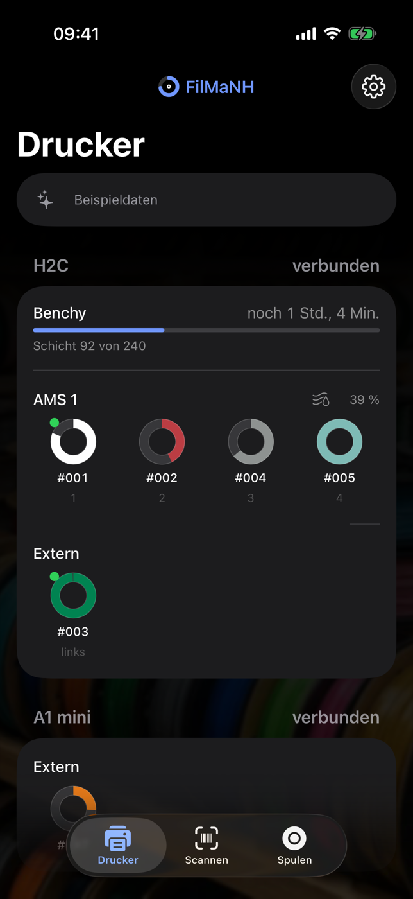
  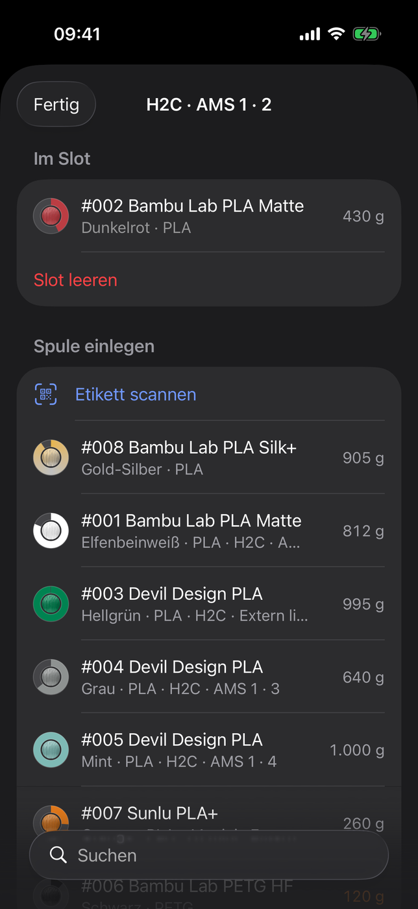
  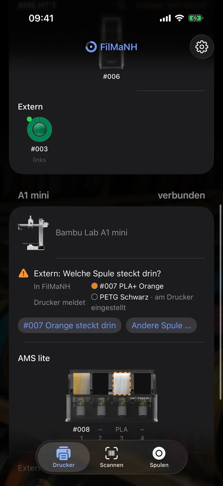

Alle Drucker mit Bild, Verbindung und laufendem Druck mit Schicht und Restzeit. Darunter jedes AMS als Bild: jede
Spule in ihrer Farbe im Fenster, der geladene Slot markiert, ein Slot mit Filament, aber ohne zugeordnete Spule
gestrichelt; unter jedem Fenster die Nummer der Spule bzw. das gemeldete Material. Dazu Feuchte und Temperatur (beim
Trocknen die Restzeit), dann die externe Spule (bei zwei Düsen wie an H2D und H2C mit links/rechts).

Ein Slot öffnet die Auswahl: **Im Slot** zeigt die Spule, **Slot leeren** nimmt sie heraus. Unter **Spule
einlegen** stehen passende Spulen oben (gleiches Material wie im Slot gemeldet, dann noch nirgends eingelegte), mit
Suche – oder **Etikett scannen** und die Spule über ihren QR-Code wählen (auch eine EAN, wenn sie zu genau einer Spule
gehört).

Passt ein Slot nicht zur Meldung des Druckers, steht ein Hinweis auf der Karte des Druckers, solange er verbunden ist
– wie am Rechner (siehe [Abgleich mit dem Drucker](README.md#abgleich-mit-dem-drucker)): **Ja**, **Andere …**,
**Zuordnen**, **#… zuordnen**, **Andere Spule …**, **Stimmt so**, **Ja, entnommen** oder **Steckt noch**.

## 4. Spulen

  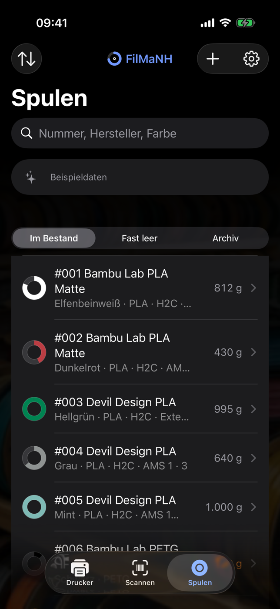
  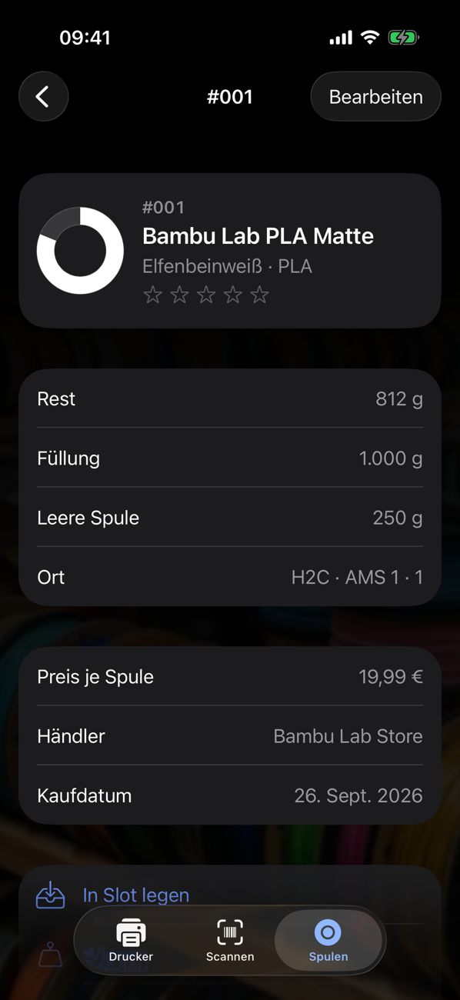
  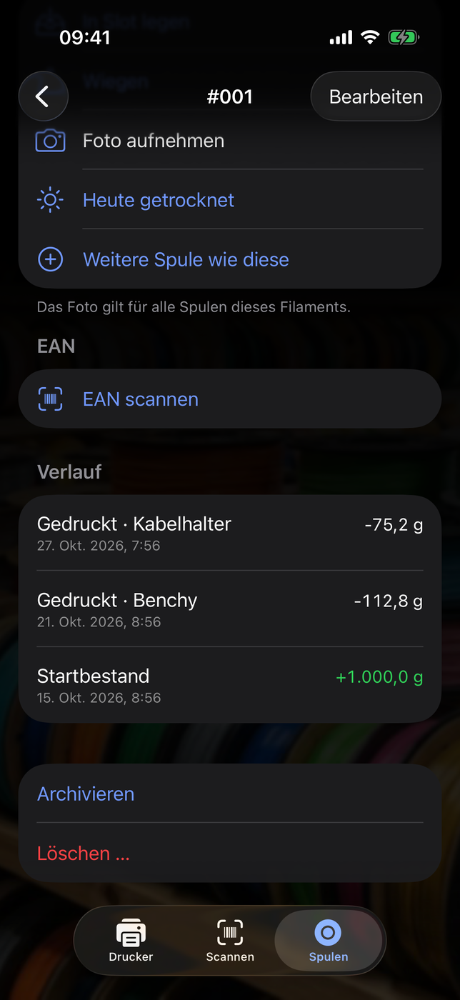

Suche nach Nummer, Hersteller, Farbe, Material und Bezeichnung; Filter **Im Bestand**, **Fast leer** und
**Archiv**. Die Pfeile oben links sortieren nach Nummer, Rest oder Hersteller.

Eine Spule zeigt Rest, Füllung, leere Spule, Ort, wann sie zuletzt gewogen und getrocknet wurde, Preis, Händler,
Kaufdatum, Öffnungsdatum, Charge und Notiz, dazu den **Verlauf** der Buchungen (die neuesten, **Ganzer Verlauf** zeigt
alle). Die Sterne bewerten das Filament; derselbe Stern noch einmal löscht die Bewertung. Darunter:

- **In Slot legen** – Drucker und Slot wählen.
- **Wiegen** – siehe unten.
- **Foto aufnehmen** – das Foto gilt für alle Spulen dieses Filaments; **Foto entfernen** nimmt es wieder weg.
- **Heute getrocknet** – setzt die Feuchte-Zeit zurück.
- **Weitere Spule wie diese** – neue Spule desselben Filaments.
- **EAN scannen** – Strichcode der Spule merken; eine EAN antippen entfernt sie.
- **Archivieren** – Spule ablegen; eine archivierte holt **Zurückholen** zurück.
- **Löschen …** – versehentlich angelegte Spule entfernen; geht nur ohne gebuchte Drucke.

### Wiegen

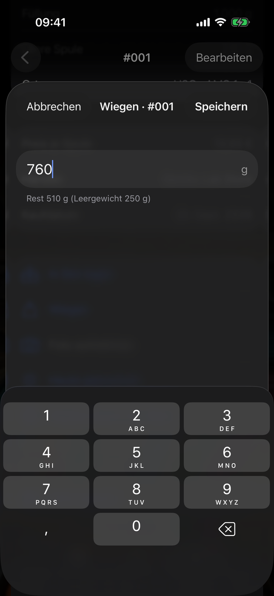

Spule samt Rolle wiegen und das Gewicht eintippen. FilMaNH zieht das Leergewicht ab und zeigt den Rest gleich an.
Ohne Leergewicht geht das nicht – dann unter **Bearbeiten** bei **Leere Spule** eintragen.

### Bearbeiten

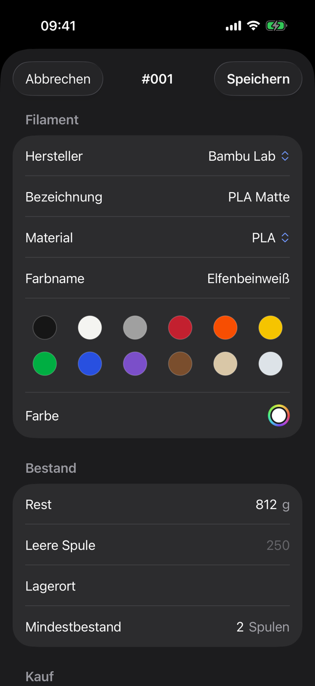

**Bearbeiten** oben rechts. Hersteller, Bezeichnung, Material, Farbname und Farbe gelten für das Filament, also für
alle Spulen dieser Sorte. Die Farbe kommt aus der Farbbibliothek (Standard, Matt, Seide, Galaxy, Transparent,
Mehrfarbig) oder wird selbst eingestellt; **+** fügt Farben für Verlaufs- und mehrfarbiges Filament hinzu. Dazu Rest, leere Spule, Lagerort, Mindestbestand, Preis (brutto oder netto), MwSt.,
Händler, Kaufdatum, **Geöffnet am**, Charge und Notiz. Ändert sich der Preis einer Spule, mit der schon gedruckt
wurde, rechnet **Kosten bisheriger Drucke mit dem neuen Preis rechnen** auch diese neu.

## 5. Neue Spule

  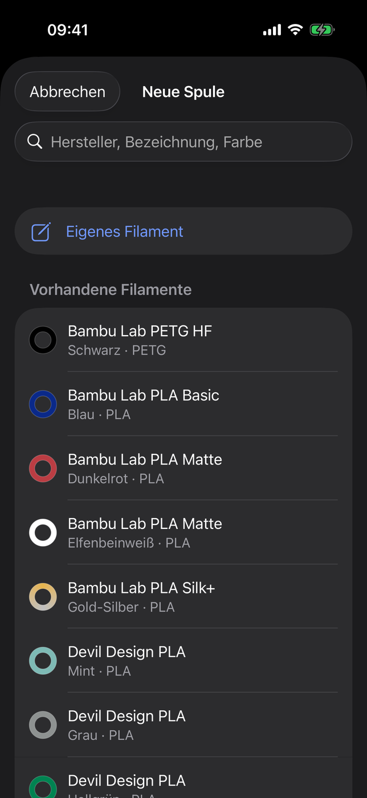
  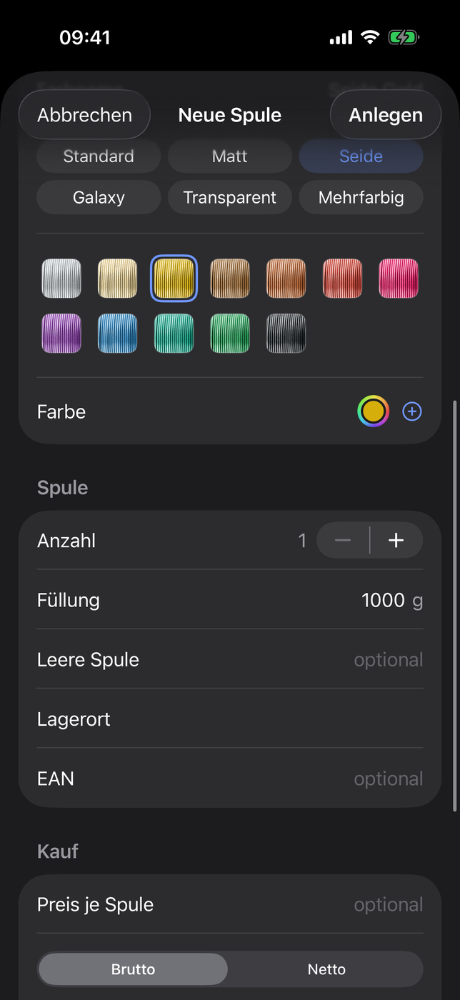

**+** oben rechts. Die Suche geht über deine vorhandenen Filamente und den Katalog des Rechners (Hersteller,
Bezeichnung, Farbe). **Eigenes Filament** zum selbst Eintragen (Farbe wie beim Bearbeiten), darunter die **Vorhandenen
Filamente** und der **Katalog**. Danach Füllung, leere Spule, Preis, Kauf, Lagerort, EAN und Anzahl, dann **Anlegen**.

Das Etikett druckt der Rechner: Dort steht in der Spulenliste **Fehlende Etiketten** mit allen neuen Spulen.

## 6. Scannen

Der Tab **Scannen** erkennt:

- **FilMaNH-Etikett** (QR-Code) – öffnet die Spule.
- **EAN** (Strichcode auf Spule oder Karton) – zeigt die Spulen mit dieser EAN. Dazu **Weitere Spule anlegen** und
  **Einer anderen Spule zuordnen**, bei einer neuen EAN **Neue Spule anlegen** und **Vorhandener Spule zuordnen** –
  oder **Am Rechner weitermachen**: Dort öffnet sich **Neue Spule** mit der EAN.
- **Link** (z.B. Produktseite) – **An den Rechner schicken** öffnet dort **Neue Spule**, und FilMaNH liest Name,
  Preis und Shop von der Seite.
- **Kopplungs-Code** – koppelt mit dem Rechner.

## 7. Einstellungen

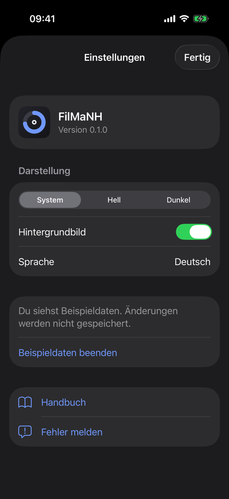

Zahnrad oben rechts. Oben steht die Version der App.

- **Darstellung:** System, Hell oder Dunkel. **Hintergrundbild** ein oder aus.
- **Sprache:** Deutsch, English, Español, Français, Italiano, Nederlands, Polski – wie das iPhone, sonst Englisch; ein Tipp öffnet die Einstellungen von iOS für
  FilMaNH.
- **Rechner:** Name, Status, Version von FilMaNH und Adresse. **Neu koppeln** ersetzt die Kopplung, **Trennen** hebt
  sie auf. Am Rechner unter **Einstellungen › Handy** lässt sich ein iPhone ebenfalls **Entfernen**. Ist der Rechner
  nicht erreichbar, führt **„Lokales Netzwerk“ erlauben** zur Einstellung von iOS.
- Mit Beispieldaten: **Beispieldaten beenden**.
- **Handbuch** und **Fehler melden**.

## 8. Widget

Das Widget **Drucke** (ab App-Version 1.2) gibt es klein und mittel für den Home-Bildschirm und für den
Sperrbildschirm. Es zeigt die laufenden Drucke mit Drucker, Fortschritt, dem voraussichtlichen Ende („fertig um
17:54“) und einem Punkt in der Farbe der Spule, aus der gerade gedruckt wird – klein einen Druck oder bis zu drei
knapp, mittel bis zu drei. Auf dem Sperrbildschirm zeigt es den ersten Druck als Zeile oder als Ring mit den
Prozent. Hinzufügen: lange auf den Home-Bildschirm tippen › **Bearbeiten** › **Widget hinzufügen**
› **FilMaNH**. Ein Tipp aufs Widget öffnet die App.

Das Widget holt den Stand selbst vom Rechner, nur im Heimnetz. Wie oft, entscheidet iOS; die App aktualisiert es
sofort, wenn sie neue Daten hat. Ohne Verbindung steht der letzte Stand mit Uhrzeit da, höchstens 12 Stunden lang.

## 9. Häufige Fragen

**„Rechner nicht erreichbar“?** FilMaNH muss am Rechner laufen, und das iPhone muss im selben WLAN sein. In den iOS-Einstellungen unter FilMaNH muss **Lokales Netzwerk** erlaubt sein.
Bis dahin zeigt die App den letzten Stand mit Uhrzeit; Änderungen klappen erst wieder, wenn der Rechner erreichbar ist.

**„App und FilMaNH auf dem Rechner passen nicht zusammen“?** Die App und FilMaNH am Rechner auf die neueste Version
bringen.

Läuft FilMaNH auf einem **Windows-PC**, blockiert oft die Windows-Firewall: am Rechner unter **Einstellungen › Handy**
bei **Windows-Firewall** auf **Freigeben** klicken und die Rückfrage von Windows bestätigen.

**Geht das auch unterwegs?** Nein. Die App spricht nur im Heimnetz mit dem Rechner; ins Internet geht dabei nichts.

**Mehrere iPhones?** Ja, jedes wird einzeln gekoppelt.
